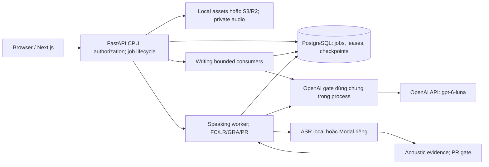

# AI tư vấn Academic Writing của BandPilot

> **Kiểm toán tài liệu: CURRENT.** Tài liệu chuẩn cho chủ đề này; đã đối chiếu ranh giới/API trong mã nguồn, chưa xác thực trực tiếp trên hệ thống chạy.
> Mục đích: mô tả AI tư vấn Academic Writing của BandPilot. Đối chiếu mã nguồn `aca8e0418a56e44d7e06f370ba5f3ebe5bf41778`: [phần triển khai](../backend/app/services/mts_writing.py).
> Đọc cùng [mô-đun/hướng dẫn hiện hành](modules/writing.md); [kiểm toán và giới hạn](DOCS_AUDIT.md). Kết quả kiểm thử/benchmark bên dưới thuộc lần thực hiện gốc, không phải kết quả chạy lại trong đợt kiểm toán này.

[Ngân hàng benchmark Writing](writing-benchmark-bank.md) ADMIN độc lập chỉ lưu dữ liệu chuẩn do người chấm, xuất JSONL/hình/CSV để đánh giá Task 1/Task 2 ngoại tuyến. Task 2 tái sử dụng MTS sản xuất và chỉ số điểm dùng chung. Báo cáo ở đầu ra CLI/Colab; nhãn không vào suy luận, ngân hàng không thay lời nhắc chấm, hiệu chuẩn hoặc mặc định nhà cung cấp.

Task 1 và Task 2 dùng chung bộ tiếp hợp nhà cung cấp: profile vLLM giữ `mistralai/Ministral-3-8B-Instruct-2512`; profile OpenAI dùng `gpt-6-luna` qua API bên ngoài. Task 2 giữ chuỗi chỉ văn bản với hợp đồng bộ nhớ đệm `mts-task2-v12`. Task 1 dùng `mts-task1-scoring-v12`, phiên bản tổng hợp `mts-task1-visual-v12` và hợp đồng nhận thức `mts-task1-visual-v3` không đổi. Xem [nghiên cứu tình huống kỹ thuật độ trễ](enhance_latency.md) về thực thi đồng thời có giới hạn, cấu hình phục vụ, số đo và cách tái hiện.

## Kiểm tra độ liên quan với đề theo hướng thận trọng (v8)

Bộ phân loại phụ trợ chỉ văn bản dùng chung trả `ON_TOPIC`, `PARTIALLY_RELEVANT` hoặc `WHOLLY_UNRELATED`, độ tin cậy `HIGH`/`MEDIUM`/`LOW`, tối đa bốn ID nguồn bài viết ổn định và lý do tiếng Việt ngắn. Backend phân giải trích dẫn đúng nguyên văn. Chỉ **WHOLLY_UNRELATED + HIGH** bỏ qua bằng chứng, chấm và nhận xét TA/TR, tạo kết quả TA/TR **1.0** hợp lệ giải thích mô tả Band 1. CC, LR, GRA vẫn chạy độc lập; phép tổng hợp trọng số đều không đổi.

Kết luận đúng đề, liên quan một phần hoặc chưa chắc đều đi qua chấm TA/TR thông thường. Ngôn ngữ yếu, thiếu tổng quan, số/xu hướng sai, thiếu ý hoặc chỉ bàn một quan điểm không đủ kết luận hoàn toàn lạc đề khi vẫn có liên hệ có nghĩa với đề. Khi mơ hồ ưu tiên liên quan một phần. Cơ chế này không phát hiện đạo văn, học thuộc, gian lận hoặc tác giả.

Task 2 khởi động kiểm tra độ liên quan song song tiêu chí ngôn ngữ; chỉ TR chờ quyết định. Task 1 hoàn thành bước tiếp nhận thị giác chính trước, rồi tái sử dụng ngữ cảnh cấu trúc gọn (nhãn/quan hệ/nhóm, không có giá trị điểm/ô biểu đồ) cho kiểm tra chỉ văn bản. Không gọi hình thêm cho độ liên quan. Khi kết luận sớm, giữ siêu dữ liệu thị giác chính và **không khởi động phát biểu, kiểm chứng, dữ kiện, DePlot tùy chọn, bằng chứng TA, chấm TA hoặc nhận xét TA**. Nếu không, sau cổng kiểm tra, nhánh chuyên đọc/dữ kiện và phát biểu có thể chạy chồng lấp trước TA. Tiêu chí ngôn ngữ độc lập với cả hai phụ thuộc. Tiếp nhận thị giác UNUSABLE giữ lỗi TA và tiến độ ngôn ngữ hiện có, không gây quyết định Band 1 chỉ từ văn bản. Các họ biểu đồ, bảng, bản đồ, quy trình, hệ thống và thị giác khác vẫn được hỗ trợ.

Kiểm độ liên quan dùng nhà cung cấp giới hạn trong từng lượt, trần **768 token**, thời gian chờ mỗi lần 30 giây. JSON/lược đồ/ID nguồn không hợp lệ hoặc lý do kết thúc khác stop cho một lần sửa, không có lần thứ ba. Lỗi thời gian chờ/nhà cung cấp/phụ trợ cho phép tiếp tục, không làm thất bại lượt có thể chấm. Chẩn đoán giữ lý do cố định, kiểu trường an toàn, mức dùng và thời gian, không giữ nội dung thô/thân ngoại lệ. Bằng chứng, chỉ điểm và nhận xét dùng ngân sách bước hữu hạn bên dưới; kiểm kết thúc vẫn nghiêm. Đánh giá bình thường thêm một lần gọi văn bản; sửa độ liên quan thêm tối đa một. Kết luận sớm bình thường dùng mười lần gọi LLM cho Task 2, mười một cho Task 1, gồm tiếp nhận thị giác chính và chín lần gọi ngôn ngữ. Kiểm thử kịch bản không chứng minh độ chính xác/tốc độ mô hình thật.

Siêu dữ liệu `relevance` tùy chọn lưu trong JSON kết quả lượt hiện có, lộ qua DTO đầy đủ/một phần. Sự kiện bền vững `relevance.started`, `.completed`, `.failed` phát lại qua SSE; lỗi phụ trợ tiếp tục đánh giá thường. Lượt lịch sử thiếu relevance vẫn đọc được. Task 2 v12 có hiệu lực bao gồm nhãn phiên bản từng triển khai đến v11, nên kết quả đệm cũ vẫn đọc nhưng không tái sử dụng. Dấu vân tay Task 1 v12 vô hiệu hóa bộ nhớ đệm chấm cũ, giữ nhận thức v3 và hướng dẫn TA/CC v7. Benchmark ngoại tuyến dùng hợp đồng hiện hành; v3/v5 đóng băng giữ hợp đồng đầu ra gộp trước cổng kiểm tra. Dọn thẻ tác vụ vẫn chỉ dừng theo dõi; Dừng rõ ràng mới hủy chấm.

## Nhận xét Writing cá nhân theo phạm vi

`writing_ai_practice_feedback` lưu một ảnh chụp tư vấn mới nhất được người dùng lưu rõ ràng cho mỗi `(user_id, attempt_id, writing_task_id)`: lượt AI nguồn, bốn cặp điểm/nhận xét tiêu chí và dấu thời gian tạo/cập nhật. Migration `20261011_0023` kế tiếp `20261010_0022`. PostgreSQL UPSERT hội tụ lưu đồng thời về cùng dòng; không có lịch sử ảnh chụp, điểm cuối DELETE hoặc điểm tổng trùng.

Đường dẫn tài nguyên cần xác thực:

- `GET /api/v1/attempts/{attempt_id}/writing/{writing_task_id}/ai-practice-feedback` trả ảnh chụp hoặc `null` nếu chưa lưu.
- `PUT` cùng đường dẫn **chỉ** nhận `{ "source_run_id": "UUID" }`, từ chối trường dư. FastAPI kiểm lượt hoàn tất đã lưu qua lược đồ kết quả sản xuất và sao chép bốn điểm/nhận xét; không dùng điểm trình duyệt gửi lên.

Lượt làm bài phải thuộc người gọi, là WRITING/FOCUSED_UNIT riêng và chọn đúng tác vụ đó. Lượt AI nguồn phải khớp lượt làm bài/tác vụ/người yêu cầu, có kết quả đầy đủ đã xác thực. Từ chối toàn mô-đun/Full Mock, lượt/tác vụ/lượt AI của người khác, lượt chờ/đang chạy/thất bại và kết quả sai/thiếu. Khóa ngoại ảnh chụp xóa dây chuyền khi xóa lượt/người dùng. Chấm cuối do người theo nguồn gốc lượt: chủ sở hữu cá nhân và ADMIN được lưu tiêu chí cuối; học viên lớp không được.

Trang xem lại USER chỉ mở Lưu/Cập nhật cho Writing theo phạm vi. Thẻ tải riêng hiển thị bốn điểm tiêu chí, nhận xét, thời gian lưu/cập nhật và nhãn tư vấn EN/VI. Chấm lại không ghi đè thẻ; lưu rõ ràng lần nữa mới thay. Lượt nguồn lạc đề hiển thị giải thích cạnh điểm ngôn ngữ độc lập. Chủ sở hữu cá nhân và ADMIN có thể chép tiêu chí AI vào biểu mẫu cuối, sửa rồi Lưu rõ ràng. Giáo viên lớp dùng biểu mẫu theo bài giao. Lưu ảnh chụp không sửa `AttemptWritingScore`, band lượt làm bài, History, Analytics hoặc trạng thái Full Mock chính thức.

Chú thích nội tuyến thuộc kết quả tiêu chí của lượt AI nguồn. Ảnh chụp luyện tập đã lưu giữ bản tóm tắt điểm/văn bản tương thích; thao tác lưu không tạo cột hoặc lịch sử chú thích riêng.

## Task 2: đánh giá chỉ từ văn bản

Đây là **chuỗi IELTS đa tiêu chí** của dự án, phiên bản thích nghi trực tuyến chứ không tái hiện trung thành thí nghiệm RMTS học thuật. Bốn tiêu chí độc lập dùng ngữ nghĩa mô tả IELTS chính thức: Task Response (`ta` để tương thích), Coherence and Cohesion, Lexical Resource, Grammatical Range and Accuracy. Mỗi tiêu chí nay chạy **chỉ chấm điểm → chọn bằng chứng nguồn → nhận xét có cấu trúc → hiển thị công khai**. Task 1 giữ luồng bằng chứng → chỉ điểm → nhận xét. Không chia sẻ điểm tiêu chí khác. Không có band mặc định, cộng độ lệch, trần, phạt theo số lỗi, co giãn min-max tập dữ liệu hoặc cắt ngoại lệ. Mức khớp mô tả toàn bài vẫn quyết định điểm; đánh giá sinh ra không dẫn suy luận điểm Task 2. Nửa band nội suy hồ sơ nguyên band chính thức lân cận trong 0–9, gồm band thấp và kết quả Band 8/9 có căn cứ.

Trình soạn Writing là textarea thuần. Ký tự Enter rõ ràng đi nguyên vẹn qua JSON, `AttemptWritingResponse.content` PostgreSQL và yêu cầu chấm; xuống dòng mềm khi hiển thị không thêm ký tự. Bộ tách chung trước chỉ coi dòng trống là ranh giới đoạn, nên bài dùng một Enter mỗi đoạn bị thành một P1. Đầu vào Task 2 sản xuất nay mang nguồn gốc textarea nội bộ: mỗi LF/CRLF/CR rõ ràng tách đoạn, bỏ dòng trống lặp. Mặc định chung/Task 1 vẫn coi xuống dòng đơn có thể do ngắt dòng hiển thị, dòng trống mới tách đoạn. Không ghi lại từ, dấu câu, khoảng trắng hoặc câu trả lời cơ sở dữ liệu. ID P1S1, P2S1... phân giải đúng lát cắt/độ lệch gốc; câu lặp vẫn định địa chỉ riêng. Mọi bước suy luận Task 2 và độ liên quan dùng cùng ánh xạ nguồn.

Sau khi nhận điểm nghiêm ngặt, yêu cầu bằng chứng phụ trợ chọn tối đa bốn ID nguồn ổn định. Backend tra mỗi ID ra lát cắt tiếng Anh đúng nguyên văn; mô hình không tái tạo trích dẫn. Nhận định sinh bởi bộ chọn được thay bằng vị trí trung lập do backend phân giải, không vào lời nhắc điểm hoặc nhận xét. Task 2 nay phân tích vỏ `RawTask2EvidenceSelection`, kiểm độc lập mỗi lựa chọn. Chuỗi giải thích assessment/focus được giới hạn cục bộ ở 320/160 ký tự hiện có bằng bộ chuẩn hóa an toàn Unicode. Bỏ ID lạ, mục sai, assessment trống và trùng; giữ tối đa bốn lựa chọn hợp lệ. ID lạ không thành bằng chứng. Nếu hết lựa chọn dùng được, nhận xét nhận danh sách rỗng và toàn bài. Dư thừa trình bày hoặc lựa chọn đơn lẻ sai không gây thử lại LLM. Trích dẫn không biểu diễn được bị bỏ thay vì cắt thành câu chữ bịa.

JSON/lược đồ bằng chứng cấp gốc sai hoặc đầu ra thiếu vẫn được một lần sửa hữu hạn. Nếu lỗi giải thích có thể phục hồi còn lại, Task 2 dùng bằng chứng rỗng và tiếp tục với điểm đã xác thực. Chất lượng bằng chứng vì vậy không chặn điểm Task 2 hợp lệ. Lỗi xác thực, truyền tải, thời gian chờ, nhà cung cấp hủy/lỗi, hủy thao tác và lỗi ứng dụng/lưu trữ bất ngờ vẫn là lỗi cứng. Task 1 giữ hợp đồng bằng chứng nghiêm ban đầu.

Lược đồ suy luận `CriterionBandScore` **chỉ có `score`**, ví dụ `{"score":6.5}`. Bộ kiểm nửa band 0–9 có thẩm quyền hiện có giữ nguyên. Lời nhắc điểm chỉ chứa đề, toàn bài chia đoạn và cùng ngữ cảnh mô tả chính thức riêng tiêu chí. Không có nhận định bằng chứng, điểm mạnh, cải thiện hoặc nhận xét sinh ra. Một điểm sai được một lần sửa chỉ điểm; điểm sai/cắt cụt lần hai làm tiêu chí thất bại. Không bịa, suy đoán, mặc định hoặc thay điểm. vLLM giữ temperature 0, seed 0. ID yêu cầu, dấu thời gian và điểm tiêu chí khác không vào lời nhắc ngữ nghĩa; thứ tự nguồn/bằng chứng tất định.

Sau kiểm điểm, yêu cầu nội bộ `RawTask2FeedbackDraft` riêng nhận band cố định như siêu dữ liệu bất biến, toàn bài, ID nguồn chọn và ngữ cảnh mô tả. Điểm không là mục tiêu nhận xét phải biện minh: không buộc giải thích mỗi nửa band hoặc tìm khuyết điểm dưới 9. Quan sát, hạn chế, cải thiện rỗng hợp lệ; nhận định chưa chắc phải bỏ. Lược đồ không có điểm ghi được hoặc tóm tắt tự do.

Hợp đồng nhà cung cấp hướng dẫn cấu trúc/enum hỗ trợ nhưng chấp nhận độ dài chuỗi giải thích thô. Bộ làm sạch backend kiểm từng mục trước khi dựng `Task2FeedbackDraft` hữu hạn. Tối đa bốn quan sát đại diện có `source_id`, `kind` (`STRENGTH`, `LIMITATION`, `ERROR`, `OPTIONAL_REFINEMENT`), `observation` tiếng Việt ngắn, độ tin cậy và `original_span`/`suggested_revision` đúng nguyên văn tùy chọn. Văn bản quan sát/sửa giới hạn ở câu trọn tối đa 240 ký tự, không thử lại toàn phản hồi vì độ dài. Bản viết lại quá lớn bị bỏ thay vì cắt thành sửa dở. Bỏ riêng ID lạ, mục sai, mô tả vị trí do mô hình tạo, khẳng định Band mâu thuẫn, độ tin cậy thấp, nhận định tiêu cực không HIGH và bản sửa tùy chọn không dùng được. Quan sát hợp lệ còn lại được giữ. Kiểm văn bản đầy đủ trước giới hạn để nhận định cấm không ẩn sau ngưỡng hiển thị. Backend suy vị trí từ siêu dữ liệu nguồn đã kiểm.

Nhận định GRA/LR ERROR vẫn cần đoạn nguồn đúng nguyên văn, không trống. Bỏ ERROR có đoạn được bịa và bản viết lại OPTIONAL_REFINEMENT phụ thuộc đoạn không khớp. Với STRENGTH/LIMITATION, bỏ đoạn tùy chọn không dùng được và bản sửa phụ thuộc; quan sát gắn nguồn hợp lệ còn lại vẫn giữ. Không cắt/chuẩn hóa đoạn gốc thành vẻ như khớp chính xác. Các kiểm tra chứng minh căn cứ nguồn, không chứng minh phán đoán ngôn ngữ là đúng.

Hướng dẫn riêng tiêu chí yêu cầu lỗi tiếng Anh chuẩn thật trước khi GRA báo sửa, gồm kiểm chủ ngữ, hòa hợp, mạo từ, dấu câu, cấu trúc hệ từ và chủ ngữ danh động từ. LR không được đổi đồng nghĩa chỉ để đa dạng, bác từ thông dụng/đúng chủ đề hoặc biến thể Anh/Mỹ hợp lệ, hay đổi nghĩa, ngữ vực, kết hợp từ. CC chấp nhận tiến triển logic rõ mà không cần thêm từ nối. Task Response không đòi nghiên cứu, thống kê, trích dẫn hoặc ví dụ quốc gia có tên: lập luận liên quan và ví dụ giả định hợp lý có thể hỗ trợ.

Backend giữ trường công khai `CriterionResult` tương thích (`feedback`, `strengths`, `improvements`, `evidence`) từ quan sát chấp nhận. Không dùng nhận định bộ chọn chưa kiểm hoặc tóm tắt mô hình tự sinh. Bản sửa tùy chọn dùng mẫu backend “Gợi ý tùy chọn: có thể diễn đạt…” thay văn bản mô hình khẳng định lỗi thực tế. Giới hạn hiển thị hiện có vẫn một tóm tắt 800 ký tự ghép tối đa hai quan sát trọn câu, điểm mạnh/cải thiện có cấu trúc mỗi mục 240 ký tự. Cả bốn quan sát chấp nhận vẫn ở danh sách cấu trúc dù không vừa tóm tắt. Nhận định Band mâu thuẫn bị bỏ cùng quan sát; chèn trường điểm cấp gốc là lỗi cấu trúc và được sửa hữu hạn. Nhận xét không đổi band số đã chấp nhận.

Mỗi bước tối đa một lần sửa. Trần hoàn thành thực tế:

| Bước | Token bình thường | Token sửa do độ dài |
| --- | ---: | ---: |
| Bằng chứng | 1800 | 2056 |
| Chỉ điểm | 128 | 256 |
| Nhận xét | 1200 | 1400 |

Lỗi lược đồ khác giữ trần thường. Hai bộ tiếp hợp nhận cùng tùy chọn bước có kiểu. Gửi lại `CompletionContextExceeded` đã xác minh của vLLM có thể hạ một lần trần rõ ràng mà không cắt đầu vào. Ràng buộc chuỗi guided-schema không hỗ trợ (`minLength`, `maxLength`, `pattern`, `format`) vẫn bị bỏ. JSON được hướng dẫn không đảm bảo độ dài chuỗi hiển thị. Phân tích thô, làm sạch từng mục và dựng miền hữu hạn ở backend có thẩm quyền; không tăng giới hạn hoặc nới hợp đồng điểm. Lời nhắc vẫn yêu cầu mô tả ngắn, nhưng chuẩn hóa hiển thị không thêm lời nhắc sửa. Sửa cấu trúc nhận xét thêm một hướng dẫn sửa gọn, không lặp toàn chỉ dẫn.

Nếu nhận xét vẫn sai JSON/lược đồ cấp gốc, trống, quá lớn hoặc `finish_reason=length` sau một sửa, hoặc làm sạch hết quan sát dùng được, tiêu chí hoàn tất với điểm cố định hợp lệ và bằng chứng đã kiểm. Dự phòng tiếng Việt nói nhận xét chi tiết không khả dụng nhưng điểm tư vấn đã hoàn tất; điểm mạnh/cải thiện rỗng. Chẩn đoán nội bộ an toàn phân biệt `score` và `feedback`, gồm `EVIDENCE_PRESENTATION_NORMALIZED`, `EVIDENCE_ITEM_DROPPED`, `EVIDENCE_FALLBACK_USED`, `FEEDBACK_OBSERVATION_DROPPED`, `FEEDBACK_FALLBACK_USED`, `FEEDBACK_PRESENTATION_NORMALIZED`. Chỉ giữ lý do cố định, đường dẫn trường/chỉ số an toàn và kiểu, không giữ văn bản nhà cung cấp quá dài. Bản nháp hợp lệ cố ý rỗng không tạo lỗi/thử lại. Lỗi xác thực, truyền tải, thời gian chờ, hủy, Dừng rõ ràng và trạng thái/lưu trữ bất ngờ vẫn là lỗi cứng. Không ghi nhật ký, lưu chẩn đoán hoặc truyền lỗi thô, bài viết, thông tin xác thực, lời nhắc, suy luận ẩn. Bước SSE công khai và DTO `CriterionResult` giữ tương thích. Sự kiện công khai bước điểm được đệm tới khi bằng chứng phụ trợ sẵn sàng (có thể rỗng) để giữ thứ tự bằng chứng/chấm công khai; suy luận nội bộ chạy điểm trước. Đường phục hồi đầu ra không cho lỗi nhận xét xóa band hợp lệ.

Task 2 nay dùng **`mts-task2-v12`**. Nhãn cấu hình v1–v11 phân giải thành v12, nhãn tùy chọn được thêm tiền tố v12 cho danh tính bộ nhớ đệm. Kết quả v11 hiện có vẫn đọc và không dùng lại cho hợp đồng mới. Lược đồ đầu ra gộp/hàm hiệu chuẩn cũ vẫn dành cho công cụ lịch sử, tách khỏi suy luận chỉ điểm sản xuất.

Hồi quy nhà cung cấp giả kiểm độ tin cậy, cô lập, xác thực lược đồ và tính tất định yêu cầu. Không có tập chấm cục bộ gán nhãn người, nên không chứng minh đồng thuận điểm với giám khảo hoặc độ chính xác nhận xét mô hình thật tốt hơn. Không tuyên bố đổi hiệu chuẩn/ngữ nghĩa mô tả chính thức; kiểm giả không hỗ trợ tuyên bố độ chính xác mô hình trực tiếp. Điểm AI vẫn tư vấn. Hướng dẫn mô tả tiếp tục dùng [mô tả IELTS chính thức](https://ielts.org/cdn/ielts-guides/ielts-writing-band-descriptors.pdf) (tháng 5 năm 2023), theo kiểm mức khớp mô tả hiện có.

Mỗi tiêu chí phải ở 0–9 theo bước 0.5. FastAPI tính trung bình Decimal trọng số đều, làm tròn bằng `round_to_half`: `(6.5 + 6 + 7 + 6) / 4 = 6.375 → 6.5`. Chỉ lưu cả hai giá trị nếu đủ bốn tiêu chí thành công. Nếu không, lượt kết thúc FAILED sau khi thử mọi tiêu chí, giữ kết quả thành công/lỗi riêng và không có tổng. **Điểm tổng AI Task 2** là tư vấn; không cập nhật `AttemptWritingScore`, `Attempt.band_score`, Writing chính thức, History hoặc Analytics. Chủ sở hữu cá nhân/quản trị được phép chép điểm/nhận xét vào biểu mẫu cuối; cần Lưu rõ ràng của người chấm. Giáo viên lớp nhập tiêu chí cuối qua biểu mẫu bài giao khi tham khảo tư vấn. Quy tắc Task 1 × 1 / Task 2 × 2 chính thức không đổi. Học viên lớp không được dùng AI để có quyền chấm cuối. AI Speaking là tính năng riêng.

## Nhận xét ngắn và chú thích nội tuyến dùng chung

Hai tác vụ yêu cầu từ 0 đến bốn quan sát hữu ích mỗi tiêu chí, thường một câu khoảng 180 ký tự. Lỗi độ tin cậy cao ưu tiên trước hạn chế lặp và vài gợi ý tinh chỉnh tùy chọn. Không buộc cân bằng tích cực/tiêu cực, giảng thang chấm chung chung hoặc soát mọi lỗi. Văn dài chỉ giữ ở ranh giới câu trọn hoặc bỏ; tóm tắt không cắt từ/ý, đoạn đúng nguyên văn/bản sửa không bị cắt.

Mỗi tiêu chí công khai thêm `annotations`, mặc định `[]` cho lịch sử, và `feedback_status` (`PENDING`, `COMPLETED`, `UNAVAILABLE`), mặc định `COMPLETED` cho DTO lịch sử. Nhờ đó tách checkpoint điểm đã chấp nhận khỏi nhận xét hoàn tất khi nhiều tiêu chí sinh đồng thời. `WritingAnnotation` gồm ID tất định, tiêu chí, loại, ID nguồn, đoạn gốc, bản sửa tùy chọn, thông điệp ngắn, độ tin cậy và nhóm kiểm soát tùy chọn. ERROR cần HIGH; LOW không qua chuẩn hóa. GRA sở hữu ngữ pháp/dấu câu; LR sở hữu chính tả, cấu tạo từ, chọn từ/kết hợp từ. Cấu trúc hệ từ/danh động từ đúng, đồng nghĩa thông dụng và biến thể Anh/Mỹ hợp lệ được bảo vệ thận trọng. Kiểm vị trí không chứng minh mọi phán đoán ngôn ngữ.

Backend phân giải đoạn trong `SourceSegment` đã kiểm, yêu cầu đúng một lần xuất hiện trong nguồn và xác minh lát cắt tuyệt đối của bài đã lưu. Cụm lặp ở nguồn khác phân biệt bằng ID nguồn. Trùng mơ hồ trong một nguồn vẫn là nhận xét bảng, không thành chú thích nội tuyến. `start_offset`/`end_offset` công khai là **đơn vị mã UTF-16 trong đúng chuỗi bài viết đã lưu**, điểm cuối loại trừ. Độ lệch nguồn nội bộ vẫn là chỉ số ký tự Python. Giữ CRLF, khoảng trắng, ký tự ngoài BMP để JavaScript `content.slice(start_offset, end_offset)` khớp đoạn gốc mà không tìm mờ hoặc chuẩn hóa xuống dòng.

`AnnotatedEssay` chỉ đọc dùng chung chỉ trang trí GRA/LR: gạch chân lỗi tiết chế, gạch nhẹ hơn cho tùy chọn/hạn chế. Di chuột, tiêu điểm bàn phím và chạm lộ tiêu chí, thông điệp, gốc → gợi ý sửa; Escape hoặc Đóng tắt bảng nổi. Chỗ chồng tách thành phân đoạn không chồng, có thể lộ nhiều gợi ý nhưng chỉ dựng văn bản bài một lần. Kiểu dáng ngữ nghĩa hỗ trợ sáng/tối và giảm chuyển động. Mật độ thường tối đa bốn GRA cộng bốn LR; 0 là hợp lệ. TA/CC ở bảng tiêu chí.

Sau checkpoint điểm, sự kiện bền vững `criterion.feedback.started` với `stage=feedback` lộ hoạt động `generating_feedback` trước gọi nhà cung cấp. Chỉ chú thích phân tích/kiểm đầy đủ mới tạo `criterion.feedback.annotation` riêng. `criterion.feedback.completed` mang khối tiêu chí cuối và hoạt động `feedback_completed`, tiếp theo `criterion.completed` hiện có. Đây là sự kiện ngữ nghĩa, **không truyền token thô** hoặc JSON phân tích dở. Chúng dùng kho số thứ tự/phát lại hiện có; máy khách khử trùng ID chú thích, hiển thị nhận xét/gạch chân trực tiếp và đối chiếu ảnh chụp cuối có thẩm quyền. Lượt mới/được chọn có trạng thái riêng; lượt lỗi xóa gạch chân, giữ điểm đã nhận và bài đã lưu.

Chú thích là bằng chứng dạy học tư vấn. Số lượng/mức nghiêm trọng không quyết định band, phạt ẩn hoặc đổi điểm đã chấp nhận. Điểm chính thức/thủ công, nền tảng Task 1, độ liên quan Task 2 và cấu hình nhà cung cấp không đổi. Chú thích/sự kiện cuối dùng JSONB hiện có; thiết kế này không cần migration hoặc sửa kết quả lịch sử.

## Task 1: tiếp nhận thị giác có căn cứ trước đánh giá

Task 1 cũng suy luận chỉ điểm rồi nhận xét theo band cố định, cùng ngân sách bước và dự phòng nhận xét phục hồi như Task 2. Phiên bản tổng hợp hiện là **`mts-task1-visual-v12`**, phiên bản chấm **`mts-task1-scoring-v12`**; hợp đồng thị giác vẫn **`mts-task1-visual-v3`**. Chấm TA giữ tham chiếu thị giác, dữ kiện tất định và phát biểu đã kiểm; nhận xét chọn phát biểu hợp lệ, dùng văn bản dữ kiện do backend sở hữu. Hiệu chuẩn TA/CC Task 1 và ranh giới tiêu chí ngôn ngữ giữ nguyên. Dịch vụ benchmark ngoại tuyến v3/v5 đóng băng giữ hợp đồng gộp/ngân sách gốc. Cấu hình benchmark hiện hành định danh đúng v12. V7/v8 lịch sử giữ lời nhắc/ngân sách gộp; lược đồ báo cáo/kết quả vẫn đọc được. CLI mặc định `--scoring-version v12`; `both` so v5 đóng băng với v12 hiện tại. V11 điểm trước đóng băng vẫn chọn rõ ràng, bên cạnh v3/v5/v7/v8. Bản ghi lịch sử vẫn phân tích được, không lấy nhãn cũ cho ứng viên sản xuất mới.

### Task 1: kiểm chứng nhận xét ngôn ngữ theo hướng hoài nghi và hiệu chuẩn band lân cận (v12)

Task 1 theo **nhận xét đề xuất → làm sạch nguồn/lược đồ → kiểm chứng ngôn ngữ LR/GRA theo hướng hoài nghi → nhận xét/chú thích công khai**. Điểm đã cố định trước kiểm chứng; quyết định không đổi điểm hoặc kích hoạt chấm lại. Khớp nguồn chứng minh vị trí trích dẫn, không chứng minh lời phê bình ngôn ngữ đúng.

Chỉ đề xuất LR/GRA ERROR hoặc LIMITATION đã làm sạch kích hoạt kiểm chứng: một lần gọi gộp mỗi tiêu chí chịu ảnh hưởng, tối đa bốn quyết định có chỉ số, 384 token đầu ra, thời gian chờ 30 giây, không thử lại phụ trợ. TA/CC, đề xuất rỗng, điểm mạnh hoặc bản nháp chỉ có tùy chọn không thêm lần gọi. Tiêu chí ngôn ngữ độc lập giữ giới hạn đồng thời nhà cung cấp trong lượt.

Bộ kiểm mặc định tiếng Anh chuẩn được chấp nhận, bác lời phê chưa chắc, sở thích phong cách và phương án hợp lệ. ERROR cần sửa ngôn ngữ thật sự cần thiết; LIMITATION cần bằng chứng đáng kể hoặc lặp trong bài. Hợp đồng quyết định nghiêm không có điểm, giải thích hoặc văn cho người học. Quyết định thiếu/trùng/ngoại lai, lý do không nhất quán, đầu ra sai, kết thúc khác stop, quá giờ/lỗi nhà cung cấp bỏ mọi nhận định tiêu cực chưa kiểm, giữ điểm mạnh an toàn và band. Chẩn đoán nội bộ chỉ ghi `LANGUAGE_FEEDBACK_VERIFICATION_UNAVAILABLE`; nội bộ nhà cung cấp không tới UI.

Chỉ LR/GRA ERROR độ tin cậy HIGH đã kiểm, có đoạn đúng nguyên văn, được thành chú thích nội tuyến. LIMITATION đáng kể đã kiểm vẫn ở bảng tiêu chí. Bỏ viết lại tùy chọn theo phong cách khỏi nhận xét công khai, tóm tắt, bằng chứng và mục Cần sửa tiếp theo của Task 1; không có lỗi nội tuyến vẫn là thành công. Task 2 giữ hiển thị/ngữ nghĩa điểm hiện có, lượt lịch sử không bị viết lại.

Chấm Task 1 riêng củng cố phân biệt LR/GRA band lân cận: Band 8 cho phép sơ suất thỉnh thoảng, ghi nhận từ tự nhiên chính xác và độ đa dạng cấu trúc phù hợp nhiệm vụ phần lớn đúng, không đòi từ điển đồng nghĩa hay hoàn hảo. CC chấp nhận dấu nối tự nhiên và tổ chức mở bài/tổng quan/chi tiết theo năm hiệu quả; 6.5/7 không là mặc định dung hòa. Bằng chứng ngôn ngữ thể hiện chất lượng toàn bài, không săn lỗi. Hướng dẫn TA, tham chiếu thị giác, dữ kiện/kiểm chứng giữ nguyên. Không có độ lệch cộng, sàn/trần, phạt số lỗi hoặc sửa điểm theo nhận xét. Kiểm giả chứng minh ranh giới, không tuyên bố đã đo cải thiện hiệu chuẩn mô hình trực tiếp.

### Task 1: độ tin cậy đoạn văn và nhận xét (v10)

Hai tác vụ dùng cùng `<textarea>` thuần, JSON tự lưu `content` có revision, `AttemptWritingResponse.content`. Enter lưu thành xuống dòng; ngắt mềm không thêm ký tự. Task 1 trước bỏ nguồn gốc nội bộ `paragraph_mode="textarea"` của Task 2, một số nơi gọi trực tiếp bộ tách dòng trống mặc định. Kết quả bốn đoạn cách một Enter thành P1. Task 1 sản xuất nay mang nguồn gốc textarea; độ liên quan, chọn bằng chứng, ngữ cảnh điểm, nhận xét cấu trúc, trích phát biểu, kiểm chứng và tra trích dẫn đều dùng `request_sources(request)`. Nhận LF, CRLF, CR; dòng trống không tạo đoạn rỗng. Nội dung từ và độ lệch gốc không đổi; câu lặp có ID riêng. Yêu cầu chung thiếu nguồn gốc trình soạn vẫn coi xuống dòng đơn có thể do ngắt hiển thị. Vị trí hiển thị đến từ siêu dữ liệu backend, không từ nhãn đoạn/câu mô hình tự viết.

Chuỗi ngữ nghĩa Task 1 vẫn là tiếp nhận/đối chiếu thị giác và dữ kiện/phát biểu đã kiểm → bằng chứng tiêu chí → **chỉ điểm** → điểm cố định → nhận xét cấu trúc → hiển thị thận trọng ở backend. Tiêu chí ngôn ngữ độc lập tiếp tục chồng lấp tiếp nhận thị giác. Trường điểm, kiểm nửa band, tổng hợp, thử lại, ngân sách token không đổi; đầu ra nhận xét/cải thiện không quay lại chấm. Hồ sơ band chính thức, hướng dẫn lân cận, trọng số và ngưỡng hiệu chuẩn không đổi. Cấu trúc nguồn/khớp dữ kiện đúng có thể ảnh hưởng điểm sau qua đầu vào đã sửa; đây không là hiệu chuẩn nâng điểm hoặc hứa band cao hơn.

`RawTask1FeedbackDraft` là nội bộ. Quan sát gồm ID nguồn, khía cạnh tiêu chí, loại, độ tin cậy, đoạn/bản sửa/ID phát biểu đã kiểm tùy chọn. Không có điểm ghi được hoặc tóm tắt tự do. `fixed_score` là siêu dữ liệu bất biến, không là mục tiêu biện minh; dưới 9 không buộc bịa điểm yếu. Danh sách quan sát/cải thiện rỗng hợp lệ. Bỏ riêng nguồn lạ, mục sai, tiêu cực không HIGH, lỗi GRA/LR đoạn không khớp, bản sửa không thay đổi và lấn tiêu chí phát hiện được, giữ mục hợp lệ khác. Lỗi toàn JSON tối đa một sửa; lỗi nhận xét phục hồi giữ điểm. `CriterionResult` công khai thêm mặc định chú thích dùng chung; DTO phân tích Task 1 tương thích. Nhận định bộ chọn không là nhận xét dữ kiện công khai: bằng chứng hiển thị dùng trích dẫn chính xác và vị trí trung lập của backend.

Với TA, `observation` phải null: mô hình chọn phát biểu đã kiểm thay vì tự viết số/xu hướng. Điểm mạnh cần SUPPORTED và nguồn khớp. ERROR dữ kiện cần CONTRADICTED, đoạn nguồn chính xác và bằng chứng dữ kiện tất định sẵn có. Backend dựng nhãn, trạng thái, giá trị hoặc hướng; văn dữ kiện tùy ý của nhà cung cấp bị bỏ, không viết lại thành điểm yếu chung thiếu căn cứ. INSUFFICIENT_EVIDENCE không thành sửa lỗi. Chọn bằng chứng/trích phát biểu không đầy đủ mọi nội dung nên không xác lập được thiếu ý; bỏ khuyên thiếu không kiểm được, kể cả so sánh vốn đã có căn cứ. Điều này chủ đích giới hạn giải thích TA ở phát biểu kiểm được, không chứng minh mọi đánh giá tổng quan/chọn ý hoặc mọi sự vắng mặt ngữ nghĩa.

Nhận xét CC đánh giá tiến triển, nhóm ý, đoạn thật và quan hệ; không đếm từ nối hoặc yêu cầu ở mọi nơi, không suy nhân quả khi chưa quan sát. LR bác đổi đồng nghĩa chỉ để đa dạng và thay nhãn biểu đồ/tên thực thể cần thiết. GRA tập trung cấu trúc ngữ pháp/dấu câu, ERROR cần đoạn chính xác; tư vấn dòng ý/từ nối thuộc ngoài GRA. Kiểm khía cạnh cấu trúc và chốt thận trọng cho văn phát hiện được thực thi ranh giới. Gợi ý phong cách tùy chọn dùng lời backend “Gợi ý tùy chọn” hiện có. Suy luận ngôn ngữ không chờ thị giác; nếu chưa có nhãn, bỏ thận trọng bản viết lại LR đề xuất thay vì đoán có thay nhãn cố định không. Chốt không thể chứng minh toán học mọi phán đoán; bất định nên giảm nhận định, không bịa lỗi.

Biểu đồ tròn một chuỗi thường giữ nhãn lát dưới nhóm điểm và năm trong `component.state`; lời nhắc nhận thức hiện ưu tiên một thành phần ma trận với chuỗi lát có tên và nhóm mốc/năm. Hồi quy bao phủ cả hai. Ma trận có thứ tự rõ nay giữ khoảng trạng thái trên dữ kiện ổn định để phát biểu không đổi kèm hai năm có địa chỉ. Với bảng riêng một chuỗi, cách xem dữ kiện chung cũ tìm tên lát như tên chuỗi, không so được bảng năm riêng. Cách tất định mới dùng nhãn lát làm chủ thể, trạng thái rõ làm nhóm, giữ dữ kiện điểm/hạng ở ID thành phần gốc. Cặp biểu đồ tròn tương thích (năm bốn chữ số rõ, cùng tiêu đề tập sau bỏ năm nêu, đơn vị, nhãn chuỗi, tập nhãn lát và trục) sinh dữ kiện qua năm dưới danh tính cặp ổn định. Kiểm được giá trị, hạng, đổi có dấu, hướng, không đổi và so trực tiếp cùng lát qua năm. Trích phát biểu nhận danh tính nhãn/trạng thái gọn có căn cứ, không diễn giải hình mới hoặc giá trị để chép. Trạng thái chưa biết, bảng không tương thích, điểm null/không tin cậy, khớp mơ hồ giữ INSUFFICIENT_EVIDENCE; ngưỡng tin cậy không đổi. Lỗi cấu trúc tái hiện bằng dữ liệu hư cấu, nhưng không có lần chạy trực tiếp 1/14 gốc để xác lập mọi kết luận thiếu bằng chứng đều do lỗi này.

Sửa độ tin cậy đoạn/dữ kiện ra ở v10; v11 vô hiệu hóa bộ nhớ đệm nhận xét cũ nhưng giữ hành vi và nhận thức thị giác thô v3. Task 2 dùng hợp đồng v12 riêng. DTO cũ vẫn đọc. Hồi quy giả chỉ chứng minh hợp đồng/căn cứ tất định, không độ chính xác nhận xét thật hoặc đồng thuận giám khảo tốt hơn. Không dùng suy luận trực tiếp.

Chỉ backend nạp hình Task 1 đã lưu. Nó kiểm quyền sở hữu, điều kiện Writing/xem lại đã hoàn tất, đúng tác vụ/phiên bản đóng băng, câu trả lời không trống, phiên bản/loại tài sản, MIME PNG/JPEG/WebP và chữ ký byte khớp, đường dẫn trong gốc lưu trữ, tệp tồn tại/kích thước (tối đa giới hạn tải cấu hình, trần 10 MiB). Không nhận URL hình từ xa. Frontend dùng hình đề hiện có, không tải thêm hình để chấm.

Lượt thường gọi một lần hình kèm đề để tiếp nhận thị giác, rồi trích phát biểu chỉ văn bản và các bước bằng chứng → chỉ điểm → nhận xét dùng chung. Hình không tới chấm TA, kiểm chứng phát biểu, CC, LR, GRA. Thị giác/trích phát biểu sai cấu trúc cho một sửa hữu hạn; dư độ dài tóm tắt/ghi chú vô hại cắt cục bộ. Chỉ sửa thị giác mới lặp gọi hình. Không thêm cờ phục vụ, mô hình, triển khai hoặc GPU.

Hợp đồng nhà cung cấp chung biểu diễn thông điệp chuỗi hoặc phần văn bản có kiểu và byte hình tin cậy. vLLM và bộ tiếp hợp OpenAI chưa hoạt động đều tuần tự hóa byte thành một data URL tương thích OpenAI trong lớp nhà cung cấp. Tuần tự hóa chỉ văn bản không đổi. Định dạng đã đối chiếu [máy khách đa phương thức vLLM 0.13.0 đã ghim](https://github.com/vllm-project/vllm/blob/v0.13.0/examples/online_serving/openai_chat_completion_client_for_multimodal.py), [tài liệu đa phương thức vLLM](https://docs.vllm.ai/en/v0.13.0/features/multimodal_inputs/) và [thẻ đúng mô hình Ministral](https://huggingface.co/mistralai/Ministral-3-8B-Instruct-2512). Chữ trong hình, đề, bài viết, phát biểu trích và quan sát cấu trúc là dữ liệu nguồn không tin cậy; lời nhắc hệ thống cấm làm theo chỉ dẫn trong đó. Không lưu byte/base64 hình, lời nhắc hệ thống hoặc suy luận ẩn.

`VisualReference` có kiểu là hợp Pydantic phân biệt loại, phản chiếu bằng Zod:

| Loại tác vụ hiện có | Họ | Nội dung cấu trúc |
| --- | --- | --- |
| LINE_GRAPH, BAR_CHART, PIE_CHART, TABLE, MIXED_CHARTS | chart_table | Thành phần/đơn vị riêng, nhóm, chuỗi, điểm số chưa chắc; bảng có tiêu đề/ô, biểu đồ tròn hỗ trợ nhãn trạng thái không bịa trục |
| PROCESS | process | Bước có nhãn, cạnh có hướng, ranh giới, hình tuyến tính/chu kỳ/phân nhánh |
| MAP_PLAN | map | Trạng thái/đặc điểm, vị trí la bàn định tính, thêm/xóa/thay/di chuyển/mở rộng/không đổi |
| OBJECT_SYSTEM_DIAGRAM | system | Thành phần, kết nối/luồng, đầu vào/đầu ra |
| OTHER_VISUAL | other | Thực thể, quan hệ và quan sát chính theo hướng thận trọng |

Nhãn, định danh, đầu mối quan hệ, số, độ tin cậy và kích thước tập được kiểm; số null/chưa biết giữ chưa biết. Phép Decimal chỉ ở backend suy giá trị, cực trị, đầu/cuối, thay đổi tuyệt đối/phần trăm có dấu (không chia 0), hạng dày/đồng hạng, đổi hạng, tăng/giảm lớn nhất, chuỗi ổn định, hướng và giao cắt giữa nhóm liền kề quan sát. Dữ kiện có thứ tự cần trục được xác định thứ tự rõ. Điểm thiếu/không tin cậy không thành dữ kiện bịa; cực trị/hạng cần quan sát đầy đủ đủ mức. Giới hạn 1,600 dữ kiện mỗi lượt; ngữ cảnh chấm ưu tiên dữ kiện tổng hợp trong 120 mục, giữ tham chiếu cấu trúc và kết luận phát biểu.

Trích phát biểu tái sử dụng chia đoạn/ID nguồn ổn định. Backend phân giải trích đúng lát cắt gốc. Khẳng định số, so sánh, thứ hạng, thứ tự quy trình, đổi bản đồ và quan hệ hệ thống có hướng dùng kiểm tất định thận trọng. Quan sát mơ hồ/thiếu là `INSUFFICIENT_EVIDENCE`. Phát biểu không có kiểm cấu trúc có thể dùng một gọi kiểm ngữ nghĩa chỉ văn bản hữu hạn; lỗi để chưa kết luận. Kết luận gồm `SUPPORTED`, `CONTRADICTED`, `INSUFFICIENT_EVIDENCE`, `NOT_APPLICABLE`, có giải thích tiếng Việt ngắn. Trích tiếng Anh nguồn giữ nguyên.

Task Achievement dùng tham chiếu, dữ kiện tất định, kết luận này để đánh giá toàn thể theo diễn giải nguyên gốc của [mô tả Academic Task 1 chính thức](https://ielts.org/cdn/ielts-guides/ielts-writing-band-descriptors.pdf) (tháng 5 năm 2023, trang PDF 2–4). Không phạt theo số lỗi, trần điểm hoặc tiêu chí thứ năm. CC/LR/GRA chỉ nhận đề/bài và bằng chứng riêng, không có dữ liệu thị giác hoặc điểm tiêu chí khác. Tái sử dụng chuẩn hóa điểm, trung bình Decimal trọng số đều và làm tròn nửa band.

Chấm Task 1 v6 xử lý hiện tượng TA bị nén band do quá thận trọng bằng phân biệt mô tả lân cận rõ hơn, không cộng điểm hoặc tự nới. Tổng quan có cố gắng/chọn đặc điểm đủ ở Band 6 khác tổng quan rõ, mẫu chính và đặc điểm nhấn rõ ở Band 7. Band 7 cho vài thiếu sót cục bộ; Band 8 cho thỉnh thoảng khi đáp ứng đủ, chọn/minh họa đặc điểm khéo. Sơ suất được phép không tự buộc band thấp, nhưng thiếu phẩm chất thiết yếu thật hoặc yếu nội dung đáng kể vẫn quan trọng. Nửa band nội suy mô tả lân cận; sơ suất số phụ và sai xu hướng trung tâm khác ý nghĩa định tính, không phạt số học.

Chọn bằng chứng TA thể hiện tổng quan, đặc điểm, so sánh chính, hỗ trợ và hạn chế đáng kể thay vì săn lỗi. Trần bốn nguồn/hợp đồng ID giữ nguyên.

Chấm Task 1 v7 thêm phân biệt mô tả CC lân cận. Đánh giá tiến triển toàn bài, nhóm/chia đoạn, quan hệ thông tin trước phương tiện cục bộ hoặc tham chiếu/thay thế. Từ nối thông thường có thể tự nhiên; lặp chính xác tên thực thể tránh so sánh mơ hồ. Đa dạng từ nối hoặc mật độ đại từ không quyết định band. Band 6 cần hạn chế liên kết thấy rõ; Band 7 cho lỗi nhỏ cục bộ, Band 8 trình tự dễ theo và quản lý liên kết tốt, Band 9 xuất sắc có tiến triển nhẹ nhàng và chia đoạn khéo. Nửa band nội suy hồ sơ lân cận, không biểu thị chưa chắc. Nhận định tiêu cực cần mẫu quan sát và tác động lên dòng ý; nhận xét không phải bịa cải thiện hoặc đủ hạn ngạch. Bằng chứng CC thể hiện tiến triển đoạn, nhóm, chuyển ý, trình tự nội bộ và hành vi liên kết thật, không band mục tiêu/săn từ nối. Đây là làm rõ mức khớp mô tả, không cộng lệch, sàn, trần hoặc thưởng.

Ở v7, ngữ nghĩa TA, LR/GRA, Task 2, tiếp nhận/đối chiếu thị giác v3, lược đồ đầu ra, cấu hình nhà cung cấp/mô hình không đổi. Dấu vân tay tổng hợp v7 ngăn dùng lượt chấm v6/cũ hơn, vẫn đọc lịch sử. Nền lời nhắc v5 lịch sử giữ đóng băng. [Benchmark Task 1](../benchmarks/writing_task1/README.md) so nền với lời nhắc sản xuất hiện tại dưới cùng nhà cung cấp/mô hình/cấu hình chuyên đọc. Cần độ lệch tiêu chí có dấu, MAE, đồng thuận trên tập gán nhãn người chấm để xác lập hiệu chuẩn tốt hơn; kiểm tổng hợp không chứng minh.

TA Task 1 nay chung trần chỉ điểm 128 token (256 khi sửa độ dài), nhận xét 1200 (1400 khi sửa độ dài). Đầu vào có căn cứ lớn không cần đầu ra điểm lớn. Nhà cung cấp có thể hạ một lần trần rõ theo ngữ cảnh khả dụng đã kiểm mà không bỏ hình/bài. Nền ngoại tuyến đóng băng giữ ngân sách gộp 3072/4096.

Tiếp nhận `HIGH`/`MEDIUM` hỗ trợ so dữ kiện thường. `LOW` hiển thị cảnh báo tiếng Việt, chỉ cho đánh giá TA thận trọng; không đưa mâu thuẫn số tất định. `UNUSABLE` hoặc thị giác rỗng/thất bại làm TA thất bại an toàn, CC/LR/GRA tiếp tục. Lỗi bước phát biểu không nghĩa bài sai; TA có thể tiếp từ tham chiếu dùng được kèm thông báo kiểm chưa đủ. Bất kỳ tiêu chí lỗi đều ẩn tổng, giữ thẻ thành công và cho chấm lại rõ ràng.

Lượt/sự kiện JSONB hiện có lưu phân tích Task 1 có kiểu cùng tiêu chí một phần; không cần migration. SSE lưu bắt đầu/hoàn tất/thất bại thị giác, hoàn tất dữ kiện, bắt đầu/hoàn tất/thất bại trích/kiểm và sự kiện tiêu chí/lượt hiện có. Ảnh chụp/phát lại con trỏ khôi phục độ tin cậy, kết luận phát biểu, thẻ một phần, hoạt động hiện tại. Heartbeat gia hạn lease (quyền xử lý tạm thời) và con trỏ, không tạo tiến độ nhìn thấy.

Dấu vân tay Task 1 thêm loại tác vụ, MIME hình và SHA-256 byte hình thật vào đề/bài/nhà cung cấp/mô hình và phiên bản lời nhắc Task 1 riêng. Đổi byte hình không dùng lại lượt cũ; worker kiểm đầu vào lại trước suy luận. Lịch sử đã lưu vẫn đọc nếu sau này hình không khả dụng. Đầu vào dấu vân tay Task 2 và phân tích lịch sử tương thích.

Bảng xem lại chung nay theo lựa chọn Task 1/2, nhãn TA/TR, bước thị giác trực tiếp, thông báo độ tin cậy, chi tiết phát biểu thị giác TA thu gọn, tổng/nhãn mỗi tác vụ, lịch sử và buộc chấm lại. Mọi giải thích dùng hàm trình bày tham chiếu nguồn hiện có; ID nguồn nội bộ, trích đúng vẫn chọn được. Chép gợi ý chỉ đổi trạng thái biểu mẫu thủ công cục bộ được phép. Vẫn cần Lưu rõ ràng của người chấm: lượt AI không ghi điểm tiêu chí chính thức, band, History, Analytics. Không hiển thị band Writing AI gộp. T1-B thêm đối chiếu DePlot tùy chọn bên dưới. TinyChart, VLM giám khảo thêm, bỏ phiếu mô hình và đánh giá T1-C ngoài phạm vi.

## Thiết lập backend

Từ `backend/`:

```powershell
uv run alembic upgrade head
```

Cấu hình các biến chỉ dành cho backend trong `backend/.env` (xem `.env.example`):

```dotenv
AI_WRITING_ENABLED=true
AI_WRITING_PROVIDER=vllm
AI_WRITING_VLLM_BASE_URL=https://YOUR-PROTECTED-ENDPOINT.modal.run/v1
AI_WRITING_VLLM_MODEL=mistralai/Ministral-3-8B-Instruct-2512
AI_WRITING_MODAL_KEY=<proxy token id>
AI_WRITING_MODAL_SECRET=<proxy token secret>
AI_WRITING_VLLM_API_KEY=
AI_WRITING_REQUEST_TIMEOUT_SECONDS=300
AI_WRITING_STARTUP_TIMEOUT_SECONDS=600
AI_WRITING_PROMPT_VERSION=mts-task2-v6
AI_WRITING_STALE_AFTER_SECONDS=90
```

Không đặt URL suy luận hoặc thông tin xác thực vào `NEXT_PUBLIC_*`. Chỉ FastAPI gọi nhà cung cấp. Khóa bearer vLLM tùy chọn tách khỏi xác thực proxy Modal; triển khai Modal dựa vào xác thực proxy bắt buộc ở lớp ngoài. Cấu hình tắt/thiếu trả `AI_NOT_CONFIGURED`, vẫn cho dùng xem lại Writing. Khởi động lại FastAPI sau khi đổi cấu hình. Tăng phiên bản lời nhắc khi đổi thang chấm/hành vi để phân biệt bộ nhớ đệm cũ. URL gốc nhận điểm cuối hoặc nền `/v1`; tầng truyền tải chuẩn hóa một lần. Đổi mô hình cũng đổi dấu vân tay chấm.

Truyền tải HTTP OpenAI triển khai cùng hợp đồng hoàn thành nội bộ, chưa hoạt động trừ khi chọn và có khóa. vLLM không cần khóa OpenAI:

```dotenv
AI_WRITING_PROVIDER=openai
AI_WRITING_OPENAI_API_KEY=<backend-only key>
AI_WRITING_OPENAI_MODEL=gpt-6-luna
AI_WRITING_OPENAI_BASE_URL=https://api.openai.com/v1
```

Tên mô hình được giữ đúng cấu hình; không tự thay model hoặc fallback sang vLLM. Tầng truyền tải dùng Chat Completions JSON mode cùng ranh giới validation/repair Pydantic, không phải bảo đảm schema strict từ server OpenAI. Với đúng `gpt-6-luna`, adapter gửi `reasoning_effort=none` để ngân sách điểm nhỏ dành cho JSON hiển thị; bỏ temperature/seed và dùng `max_completion_tokens`. Model khác vẫn giữ hành vi không gửi reasoning parameter. Xem [API chính thức](https://developers.openai.com/api/reference/resources/chat/subresources/completions/methods/create) và [cấu hình/kiểm chứng OpenAI](#openai-gpt6-luna).

<a id="openai-gpt6-luna"></a>

## OpenAI GPT-6 Luna: local, Modal CPU và AWS

Tích hợp ngày 2026-11-03 bắt đầu tại HEAD `33f40c78756ea203ba1819111409557db02f9915`. Audit xác nhận đã có OpenAI adapter và Speaking dùng lại transport Writing. Các điểm cần sửa là model mặc định cũ, Modal gắn vLLM khi bật AI bất kể provider, thiếu giới hạn request dùng chung và Speaking chưa lưu token usage. Không đổi rubric, bốn tiêu chí, visual grounding/DePlot tùy chọn, human-final boundaries, API DTO hoặc schema database. Lease/checkpoint/recovery hiện có tiếp tục sở hữu lifecycle; inference ở ngoài transaction.



Sơ đồ mô tả code đã triển khai; không chứng minh deployment Modal/AWS đang chạy. OpenAI-only không tải LLM weights hoặc gắn hàm LLM GPU. ASR và chart specialist có lựa chọn/chi phí riêng. Modal demo vẫn một owner cho embedded PostgreSQL; provider OpenAI không thay điều kiện mở rộng database/storage.

### Tự điền key ở máy local

Tạo key riêng cho project tại [trang API keys](https://platform.openai.com/api-keys), cấp quyền tối thiểu phù hợp và thiết lập ngân sách/cảnh báo billing trong project. Key chỉ đặt ở `backend/.env`, không gửi vào chat, `NEXT_PUBLIC_*`, ảnh chụp, notebook hay Git. `.gitignore` loại `.env`; `git ls-files -- backend/.env` phải rỗng. Không chạy lệnh in nội dung file hoặc giá trị environment để chẩn đoán key.

Từ gốc repository, chỉ sao chép mẫu khi chưa có file:

```powershell
uv sync --project backend --locked --group dev
if (!(Test-Path backend/.env)) { Copy-Item backend/.env.example backend/.env }
git check-ignore -v -- backend/.env
```

Tự sửa file bằng editor; giá trị key bên dưới cố ý để trống:

```dotenv
AI_WRITING_ENABLED=true
AI_WRITING_PROVIDER=openai
AI_WRITING_OPENAI_API_KEY=
AI_WRITING_OPENAI_MODEL=gpt-6-luna
AI_WRITING_OPENAI_BASE_URL=https://api.openai.com/v1
SPEAKING_AI_ENABLED=true
SPEAKING_AI_PROVIDER=openai
SPEAKING_AI_MODEL=gpt-6-luna
AI_WRITING_OPENAI_MAX_CONCURRENT_REQUESTS=4
AI_WRITING_OPENAI_MAX_QUEUED_REQUESTS=16
AI_WRITING_OPENAI_MAX_OUTPUT_TOKENS=4096
AI_WRITING_OPENAI_READINESS_RETRIES=2
AI_WRITING_REQUEST_TIMEOUT_SECONDS=300
AI_WRITING_STARTUP_TIMEOUT_SECONDS=600
```

Giữ DATABASE_URL/JWT/storage hợp lệ của môi trường local hiện có. Khởi động backend bằng `cd backend` rồi `uv run fastapi dev app/main.py`; restart sau khi sửa cấu hình. Speaking kế thừa key/base URL Writing; `SPEAKING_AI_REQUEST_TIMEOUT_SECONDS` và `SPEAKING_AI_STARTUP_TIMEOUT_SECONDS` có thể ghi đè timeout. Giữ output budgets theo stage hiện có; cap OpenAI là trần trên, không nâng các cap score/feedback của rubric. Speaking ASR vẫn phải được cấu hình độc lập theo [hướng dẫn chép lời](speaking-transcription.md).

### Giới hạn tải, retry và lỗi

[Admission gate](../backend/app/providers/writing_llm/admission.py) giới hạn mặc định 4 request đang thực thi và 16 request chờ **chung Writing/Speaking trong một process/event loop**. Hàng chờ đầy trả lỗi an toàn `AI_PROVIDER_BUSY`; thời gian chờ slot nằm trong request timeout. Hủy coroutine trả slot. Các settings trong cùng process phải thống nhất, nếu khác sẽ trả `AI_PROVIDER_CONFIGURATION_ERROR`. Với N process/replica, phải tính tổng N × giới hạn; đây không phải rate limiter RPM/TPM toàn project hoặc queue bền vững toàn fleet.

Writing vẫn có admission/consumers/leases PostgreSQL từ capacity audit. Speaking giữ local tasks và recovery hiện có; số task đợi ASR chưa có admission toàn cục. Gate chặn HTTP inference quá tải nhưng không chứng minh toàn bộ worker fleet đã được kiểm stress. Cần giới hạn service replicas, điều chỉnh gate theo rate limits thực của project và theo dõi pending jobs trước production traffic lớn.

Chỉ readiness `GET /models` được thử lại tối đa 2 lần mặc định, backoff 0,5/1 giây cộng jitter 0–0,25 giây, trong startup timeout. Authentication/quota exhaustion không được retry. Completion `POST /chat/completions` không tự replay khi 429, 5xx, network error hoặc timeout: provider có thể đã tính phí trước khi kết nối mất. Repair đầu ra thành công nhưng JSON/điểm không hợp lệ vẫn là cơ chế chấm có giới hạn sẵn có, có thể phát sinh thêm phí. Không cam kết exactly-once provider execution khi crash giữa response và checkpoint.

| Lỗi | Ý nghĩa / xử lý |
| --- | --- |
| `AI_NOT_CONFIGURED` / `SPEAKING_AI_NOT_CONFIGURED` | Kiểm tra enablement, provider/model/base URL và key local/Secret, không in giá trị key |
| `AI_PROVIDER_AUTH_FAILED` | Kiểm tra key, project/quyền truy cập; không tự retry |
| `AI_PROVIDER_QUOTA_EXHAUSTED` | `insufficient_quota` hoặc billing hard limit; kiểm billing/credit, không tạo vòng retry |
| `AI_PROVIDER_RATE_LIMITED` | 429 tạm thời; giảm concurrency/RPM/TPM và thử lại có chủ đích |
| `AI_MODEL_UNAVAILABLE` | Model không có quyền hoặc provider 502/503; giữ đúng model, không fallback |
| `AI_PROVIDER_TIMEOUT` / `AI_PROVIDER_HTTP_ERROR` | Kết quả tính phí có thể chưa rõ; xem trạng thái run/checkpoints trước khi retry thủ công |
| `AI_PROVIDER_BAD_RESPONSE` | Envelope/finish/content không hợp lệ; không nhận JSON bị cắt là thành công |

Speaking giữ các public error codes tương thích; nguyên nhân provider allowlisted nằm trong usage metadata backend. Không trả provider error body, URL có credentials, prompts, audio hoặc nội dung reasoning vào logs/DTO.

### Token usage và chi phí

Writing giữ token usage/stage diagnostics hiện có. Speaking ghi `usage_json.calls` tối đa 32 bản ghi gần nhất, tổng `prompt_tokens`, `completion_tokens`, `total_tokens`, `observed_call_count` và `accounting=observed_partial`. Metadata được allowlist và ghi qua lease-fenced transaction; không chứa transcript/key. Score checkpoint vẫn commit trước feedback. Đây là số liệu đã quan sát, có thể thiếu response khi process chết trước checkpoint, không phải hóa đơn bảo đảm đầy đủ.

Ước tính chuẩn: `cost = (prompt_tokens × input_price_per_million + completion_tokens × output_price_per_million) / 1_000_000`. Lấy giá tại [trang đúng model](https://developers.openai.com/api/docs/models/gpt-6-luna) vào ngày đo, tách cache/processing tier/region nếu billing cung cấp. Allowlist hiện chỉ giữ ba token counters nên không phân tách cached-input discounts; dùng giá uncached chỉ là ước tính. Đối chiếu dashboard Usage/Billing để kết luận phí thực. Không suy ra giá hoặc độ chính xác chấm IELTS từ một smoke request.

### Smoke thật có opt-in

[CLI smoke](../scripts/smoke_openai.py) mặc định từ chối chạy trước khi đọc credentials. Sau khi người sở hữu xác nhận đã cấu hình và đồng ý tiêu credits, từ gốc repo:

```powershell
uv run --project backend python scripts/smoke_openai.py --allow-paid-request
```

CLI chỉ chấp nhận OpenAI official base URL và đúng `gpt-6-luna`, gửi một completion JSON nhỏ với trần 64 output tokens, không readiness GET, không repair/retry. `--env-file` chọn file backend local; `--output` lưu JSON đã lọc nếu cần. Không chạy định kỳ hoặc trong CI. Kết quả PASS xác nhận transport/model và JSON response nhỏ, không chứng minh rubric quality, full grading, ASR, throughput hoặc Modal deployment.

Ngày 2026-11-03, sau xác nhận người dùng, một request thật đạt PASS: 17 prompt + 11 completion = 28 tokens; client wall time 2,669 s. [Bằng chứng đã lọc](openai-gpt6-luna-verification.json) ghi trạng thái và phạm vi. Task 1/2 và Speaking bốn tiêu chí được kiểm bằng [HTTP mock qua adapter thật](../backend/tests/test_openai_grading_contracts.py); không gọi toàn bộ rubric với API trả phí trong nhiệm vụ này. Modal/AWS deployment thật **NOT VERIFIED**.

### Modal, AWS và quay lại vLLM

Theo [lệnh Modal CPU/Secret](modal-web.md#cpu-web-openai) để đóng băng provider tại deploy và chuyển key từ backend sang Modal Secret, không vào image. Tắt ASR chỉ phù hợp khi không cần chấm Speaking mới; PR vẫn cần acoustic evidence. AWS dùng cùng backend environment qua `BACKEND_ENV_FILE`/secret injection theo [hướng dẫn AWS](aws-deployment.md), không cần SDK/OpenAI key trên frontend hoặc LLM GPU. Không tự tạo cloud resources hoặc đổi database topology.

Quay lại vLLM: đặt `AI_WRITING_PROVIDER=vllm`, `SPEAKING_AI_PROVIDER=vllm` (hoặc bỏ override để kế thừa), cung cấp endpoint/model và cặp proxy credentials hiện có. Với Modal đặt provider trong shell trước `serve/deploy`, cập nhật Secret theo hướng dẫn và restart workers. Historical outputs giữ provider/model cũ; cache mới có model, prompt, endpoint hash và output policy. OpenAI outputs cũ trước policy v2 không tái sử dụng, vẫn đọc được; không migration dữ liệu và không sửa score lịch sử.

## API và truyền sự kiện

Mọi điểm cuối dùng xác thực cookie/bearer hiện có và kiểm nghiêm quyền sở hữu lượt làm bài, kể cả quản trị:

| Phương thức | Đường dẫn | Mục đích |
| --- | --- | --- |
| POST | `/api/v1/attempts/{attempt_id}/writing/{task_id}/ai-grading-runs` | `{ "force": false }`; trả `run_id`, `cache_hit`, `existing_active` |
| GET | cùng đường dẫn | Trạng thái cấu hình và 20 lượt gần nhất của tác vụ Writing |
| GET | `/api/v1/ai-writing-grading-runs/{run_id}` | Ảnh chụp JSON an toàn, kết quả tiêu chí một phần |
| GET | `/api/v1/ai-writing-grading-runs/{run_id}/events` | Phát lại/sự kiện trực tiếp SSE |

Chỉ lượt Writing đã hoàn tất, có câu trả lời Task 1/2 đã lưu không trống từ đúng phiên bản đóng băng mới được khởi tạo. Hạn chế xem lại Full Mock cũng áp dụng. Bài vượt 12,000 ký tự hoặc đề vượt 4,000 bị từ chối thay vì cắt âm thầm; mô hình có thể từ chối đầu vào ngắn hơn nhưng mật độ token bất thường.

Dấu vân tay SHA-256 bao phủ đúng đề, câu trả lời đã lưu, phiên bản lời nhắc, nhà cung cấp và mô hình. Yêu cầu thường tái sử dụng lượt tương đương đã hoàn tất hoặc đang hoạt động. PostgreSQL khóa dòng lượt làm bài lúc tạo để tuần tự hóa yêu cầu trùng giữa tiến trình API. `force: true` rõ ràng luôn tạo lượt mới, giữ đánh giá hoàn tất cũ. UI tắt nhấp lặp khi yêu cầu/lượt đang hoạt động, cung cấp lịch sử lượt hoàn tất gọn.

Consumer có giới hạn (mặc định trong tiến trình, tùy chọn chạy riêng) sở hữu phiên mới cho giao dịch ngắn, không mượn phiên yêu cầu. Tiến độ/sự kiện chốt cùng nhau, `(run_id, sequence)` duy nhất tăng dần. SSE gửi sự kiện có tên và số thứ tự `id`, tuân `Last-Event-ID`, `?after=`, tắt bộ nhớ đệm/đệm proxy. Frontend kết nối lại từ số thứ tự đã kiểm mới nhất, dò JSON qua máy khách làm mới xác thực hiện có. Bỏ sự kiện phát lại trùng. Đóng trình duyệt chỉ ngắt luồng, không ngắt worker.

Thẻ Task 1/2 chỉ đổi chế độ xem. Tháo thành phần đóng EventSource hiện tại, xóa hẹn giờ kết nối lại, bỏ sự kiện/ảnh chụp tới muộn; không gửi `/cancel` hoặc hủy yêu cầu HTTP chấm. Quay lại, liệt kê lượt lưu khôi phục cùng lượt hoạt động/tiến độ đã lưu hoặc kết quả hoàn tất. Theo dõi/phát lại không khởi động suy luận. Hủy yêu cầu SSE chỉ giải phóng phiên thăm dò; consumer cố định sở hữu tác vụ con hoạt động có giới hạn, PostgreSQL sở hữu hàng đợi và lease có rào chắn.

Chỉ **Dừng chấm** đã xác nhận gửi điểm cuối hủy. Backend chốt `AI_GRADING_CANCELLED` trước khi hủy worker cục bộ; tiêu chí hoàn tất vẫn lưu, checkpoint/hoàn tất sau không thể viết lại lượt đã kết thúc. Tắt ứng dụng và kiểm trạng thái kết thúc bền vững hiện có là đường dừng hợp lệ riêng. Hủy lan qua công việc tiêu chí/thị giác tới luồng `httpx` nhà cung cấp, đóng ngay thay vì nhận hết suy luận không cần. Truyền chưa đủ vẫn là lỗi, kể cả byte nhận được tình cờ tạo JSON hợp lệ.

Proxy HTTP của Modal SDK 1.5.3 cục bộ đã xem xét hủy kết nối thượng nguồn khi `http.disconnect`. Cùng lớp bọc proxy cả SSE ứng dụng và HTTP vLLM; riêng vết lỗi `_runtime/asgi.py` `ClientPayloadError`/`TransferEncodingError` không định danh điểm cuối ngắt hoặc chứng minh chấm bị hủy. Nó có thể đi cùng ngắt proxy, kể cả Dừng có chủ đích; chưa tái hiện sự cố triển khai báo cáo bằng mô hình trực tiếp. Đối chiếu dấu thời gian với nhật ký worker không chứa nội dung (`source=explicit_user`, `shutdown`, `terminal_state`) và nhật ký hủy nhà cung cấp (`operation=/models` hoặc `/chat/completions`). Mã lỗi quá giờ/truyền tải ghi riêng. Không giấu ngoại lệ, không chấp nhận hoàn thành thiếu, không thêm nhật ký mỗi heartbeat.

Yêu cầu nhà cung cấp giữ `stream=false` để JSON cấu trúc đáng tin. Sự kiện công khai phân biệt chuẩn bị, lấy/kiểm bằng chứng, chấm/kiểm điểm, tạo nhận xét, nhận xét sẵn sàng, thử lại và kết thúc. Gồm `evidence.request.started`, `evidence.validation.started`, `criterion.scoring.validation.started`, `criterion.feedback.started`, `criterion.feedback.annotation`, `criterion.feedback.completed`, `criterion.retrying`. Hoạt động an toàn có mốc bước lưu trong siêu dữ liệu JSON lượt và ảnh chụp; không cần migration. Dòng thời gian dọc dựng lại từ hoạt động, tiến độ, trạng thái kết thúc sau tải lại. Thẻ tiêu chí hiện ngay khi sự kiện hoàn tất riêng tới; band chấp nhận hiện lúc bắt đầu nhận xét, mục chú thích/gạch chân đã kiểm hiện trước khi lượt hoàn tất. Thời gian đã qua chỉ để hiển thị, không ước lượng phần trăm; hoạt ảnh nhẹ tôn trọng giảm chuyển động. Heartbeat tăng con trỏ phát lại mà không gọi hàm cập nhật React UI.

Tiêu chí hoàn tất chốt trước khi tiêu chí tiếp theo bắt đầu. Nếu LR hoặc thao tác sau lỗi, kết quả trước vẫn hiện/đã lưu nhưng không tính tổng. Chấm lại rõ ràng chạy mới đủ bốn tiêu chí, giữ lịch sử.

Bổ sung 2026-11-02: dòng PENDING đã chốt tạo hàng đợi bền vững; `launch` chỉ là tín hiệu đánh thức. Consumer cố định nhận việc theo ngân sách chờ/đang chạy toàn cục và lease gồm mã/quy định hạn chót theo đồng hồ cơ sở dữ liệu. Heartbeat chạy mỗi `min(5s, lease_seconds/3)` và rào chắn mọi checkpoint/hoàn tất. Bộ quét độc lập đánh dấu RUNNING hết hạn thất bại `RUN_INTERRUPTED`, giữ tiến độ một phần để người dùng chấm lại rõ ràng; chưa triển khai tiếp tục bước MTS. Đọc không còn làm thất bại dòng chờ vì bị coi là cũ. Tắt có kiểm soát xử lý dứt worker khi còn truy cập được cơ sở dữ liệu; điểm vào riêng có xử lý SIGTERM/SIGINT. Gọi nhà cung cấp ngoài vẫn có thể lặp khi thử lại rõ ràng; không đảm bảo tính phí đúng một lần. Mặc định, triển khai/hoàn tác 0044 và phạm vi đã đo: [báo cáo năng lực](performance/5000-user-capacity.md).

## Triển khai Modal

Chạy các lệnh từ gốc kho mã trong môi trường Python 3.12+:

```powershell
uv tool install modal
modal setup
modal profile list
# Create backend-only proxy credentials; keep the output private:
modal workspace proxy-tokens create --json
# Copy the pair into backend/.env, then update the existing private Web Secret:
cd backend
uv run python ../scripts/modal_web_setup.py --snapshot <existing-snapshot>/database.dump
cd ..
# One temporary app: CPU Web + a separate protected GPU function:
modal serve deploy/modal/app.py
# Persistent app; stop its previous database writer first:
modal deploy deploy/modal/app.py
```

Điểm vào toàn hệ thống tự phân giải URL GPU cho FastAPI. Cấu hình cặp `Modal-Key` / `Modal-Secret` trả về vào cấu hình backend ở trên. Với workspace có phạm vi, cho phép token trong môi trường triển khai (`modal workspace proxy-tokens allow --help`). Thông tin Modal/token Hugging Face không thuộc Git. Tải mô hình công khai không cần bí mật kho mã; nếu workspace cần quyền hạn chế, thêm Modal Secret phạm vi hẹp vào triển khai thay vì viết cứng token.

Với máy khách FastAPI cục bộ chủ đích chạy ngoài ứng dụng toàn hệ thống, điểm vào độc lập vẫn có:

```powershell
modal serve deploy/modal/writing_llm.py
# Or a stable, independent deployment:
modal deploy deploy/modal/writing_llm.py
```

Chỉ quy trình độc lập này cần cấu hình URL in ra thủ công. Dùng một triển khai mô hình cho ứng dụng; lệnh toàn hệ thống gồm cùng hàm, không yêu cầu triển khai GPU độc lập thứ hai. Xem [modal-web.md](modal-web.md) về thiết lập cơ sở dữ liệu và lệnh chỉ Web.

Ứng dụng dùng `vllm/vllm-openai:v0.13.0` đã ghim, Volume mô hình/bộ nhớ đệm bền vững, một L4, trọng số FP8 được mô hình công bố (`--dtype auto`), thực thi eager, độ dài mô hình 8,192 token, một chuỗi đồng thời và một hình mỗi lời nhắc. Giữ `min_containers=0` / cửa sổ nhàn rỗi 60 giây. Điểm cuối web có `requires_proxy_auth=True`. URL/token mô hình nằm sau FastAPI. Khởi động nguội cần thời gian tải/đệm trọng số, khởi tạo GPU.

L4 có 24 GB và hỗ trợ Ada FP8. T4 thiếu hỗ trợ FP8 gốc cho checkpoint công bố này. Đây là lựa chọn bộ nhớ/khả năng thận trọng cho văn bản và một hình, không phải benchmark thông lượng; kiểm lại giá vì có thể đổi. Nguồn: [GPU Modal hỗ trợ](https://modal.com/docs/guide/gpu), [giá Modal](https://modal.com/pricing), [bộ nhớ GPU NVIDIA](https://docs.nvidia.com/brev/reference/gpu-types), [hướng dẫn phục vụ mô hình](https://huggingface.co/mistralai/Ministral-3-8B-Instruct-2512), [tương thích FP8 vLLM](https://docs.vllm.ai/en/v0.13.0/features/quantization/fp8/), [ví dụ Ministral 3 của Modal](https://modal.com/docs/examples/ministral3_inference), [xác thực proxy Modal](https://modal.com/docs/guide/webhook-proxy-auth).

Một yêu cầu kiểm sẵn sàng phía backend và một hoàn thành văn bản rất nhỏ (cặp proxy trong `.env` backend được bỏ qua hoặc shell hiện tại):

```powershell
cd backend
uv run python ../deploy/modal/smoke.py --base-url https://YOUR-PROTECTED-ENDPOINT.modal.run/v1
```

Lệnh gửi `GET /v1/models`, kiểm đúng mô hình đang phục vụ, rồi gửi một yêu cầu lược đồ JSON 16 token qua cùng truyền tải/xác thực backend như chấm. Chỉ in trạng thái/thời gian an toàn. Thông điệp Task 2 chỉ có văn bản; hỗ trợ hình dùng ở bước thị giác riêng Task 1. Lệnh thử văn bản này không xác minh thị giác; truyền tải Task 1 được kiểm bằng hoàn thành giả lập. Trong T1-A chưa chạy thử đa phương thức trực tiếp hoặc chấm Task 1 thật. Kiểm thử thường không liên hệ Modal/OpenAI. Dừng `modal serve` dừng cả hai hàm trong ứng dụng tạm. Với triển khai toàn hệ thống bền vững, dừng `ielts-practice-web`; quy trình GPU độc lập dừng `ielts-writing-llm`. Volume vẫn còn sau khi dừng:

```powershell
modal app stop ielts-practice-web --yes
# Standalone GPU deployment only:
modal app stop ielts-writing-llm --yes
# Optional, destructive: deletes cached model weights after stopping the app.
modal volume delete ielts-writing-model-cache
# Revoke the deployment's proxy token when no longer needed:
modal workspace proxy-tokens delete <proxy-token-id>
```

Ministral 3 2512 phát hành theo [Apache 2.0](https://huggingface.co/mistralai/Ministral-3-8B-Instruct-2512). Kiểm lại giấy phép mô hình và phụ thuộc hiện hành trước triển khai thương mại.

## Ảnh chụp PostgreSQL trên Modal Volume

PostgreSQL cục bộ vẫn có thẩm quyền. Để sao lưu nội dung hiện tại lên Modal Volume riêng, từ `backend/`:

```powershell
uv run python ../scripts/modal_database_snapshot.py --volume ielts-postgres-backups
```

Lệnh tạo `pg_dump` định dạng tùy chỉnh nhất quán qua hàm sao lưu hiện có, lưu bản cục bộ dưới `backups/modal/` được bỏ qua, tạo Volume nếu cần, tải dump/bản kê lên, tải dump xuống và kiểm SHA-256. Bản kê gồm phiên bản Alembic. Ảnh chụp có dấu thời gian, không ghi đè bản cũ; gồm bản ghi cơ sở dữ liệu, không gồm tài sản nhị phân ngoài hoặc bí mật `.env` backend. Modal Volume giữ ảnh chụp, không cung cấp máy chủ PostgreSQL trực tiếp. Dùng công cụ sao lưu đầy đủ hiện có nếu cũng cần phục hồi tài sản.

```powershell
modal volume ls ielts-postgres-backups
modal volume get ielts-postgres-backups /<snapshot>/database.dump ./database.dump
# Restore only into an explicitly selected PostgreSQL target, then migrate it.
pg_restore --dbname=<target-database> --no-owner --no-acl ./database.dump
```

## Xử lý sự cố và xác minh tập trung

- **Chưa cấu hình:** bật AI, cung cấp URL/mô hình/thông tin xác thực nhà cung cấp đã chọn; Modal cần cả hai trường proxy token. Khởi động lại FastAPI.
- **Khởi động:** phát `provider.starting` trước yêu cầu models có xác thực; chỉ phát `provider.ready` sau khi thấy mô hình đã cấu hình trong danh sách. Heartbeat tiếp tục lúc chờ. Ngân sách sẵn sàng mặc định 600 giây; suy luận thường giữ 300 giây.
- **Lỗi sau 150 giây:** Modal có thể trả HTTP 303 với URL thăm dò kết quả khi yêu cầu gốc vẫn chạy. Backend theo tối đa bốn chuyển hướng Modal cùng nguồn/cùng đường dẫn dưới dạng GET trong ngân sách tổng ban đầu. Không gửi lại POST hoàn thành hoặc chuyển thông tin xác thực sang máy khác. Xem [hợp đồng thời gian chờ Web Function Modal](https://modal.com/docs/guide/webhook-timeouts).
- **Lỗi nhà cung cấp:** `AI_PROVIDER_UNREACHABLE`, `AI_PROVIDER_AUTH_FAILED`, `AI_PROVIDER_ENDPOINT_ERROR`, `AI_MODEL_UNAVAILABLE`, `AI_PROVIDER_STARTUP_TIMEOUT`, `AI_PROVIDER_TIMEOUT`, `AI_PROVIDER_BAD_RESPONSE` phân biệt kết nối, thông tin xác thực, đường dẫn/mô hình, khởi động, suy luận, đầu ra sai. Kiểm `modal app logs ielts-practice-web-dev` (hoặc tên triển khai). Nhật ký an toàn chỉ có thao tác/mã/trạng thái. Dòng thất bại/tiến độ một phần vẫn giữ; Chấm lại tạo lượt mới thử được.
- **Đánh giá sai định dạng:** chỉ điểm giữ nghiêm, một lần sửa có mục tiêu; điểm sai lần hai phát/lưu `criterion.failed`. Bằng chứng/quan sát Task 2 làm sạch mục/trình bày sai cục bộ, không thử toàn phản hồi. Đầu ra phụ trợ sai cấu trúc/thiếu cho một sửa rồi dùng bằng chứng rỗng/nhận xét dự phòng để giữ điểm hợp lệ. Bằng chứng Task 1 vẫn nghiêm. Lỗi nhà cung cấp/ứng dụng thật vẫn là lỗi. Tiêu chí khác tiếp tục; lượt chỉ FAILED khi có tiêu chí lỗi. `usage_json.diagnostics` nội bộ và nhật ký an toàn chỉ chứa bước, tiêu chí, lần thử, lý do kết thúc, đường dẫn trường/chỉ số cho phép và kiểu lỗi Pydantic tích hợp (không đầu vào, ngữ cảnh, thông điệp). Tên trường dư lạ bị che `<extra>` vì tên có thể chứa nội dung không tin cậy. Lý do cố định gồm `INVALID_JSON`, `SCHEMA_VALIDATION`, `INVALID_HALF_BAND`, `EVIDENCE_UNKNOWN_SOURCE_ID`, `EVIDENCE_SCHEMA_INVALID`, `SCORE_SCHEMA_INVALID`, `EVIDENCE_ITEM_TOO_LONG`, `TOO_MANY_EVIDENCE_ITEMS`, `PROVIDER_FINISH_LENGTH`, `EMPTY_MODEL_CONTENT`, `MALFORMED_COMPLETION_ENVELOPE`, `OUTPUT_TOO_LARGE`. Không lộ chẩn đoán qua API/SSE. Siêu dữ liệu tùy chọn có thể tạo `CALIBRATION_DROPPED`, `CALIBRATION_SOURCE_DROPPED`, `CALIBRATION_METADATA_NORMALIZED` không gây lỗi/thử lại. `SCORE_CALIBRATION_INVALID` chỉ còn đọc cho chẩn đoán v3 lịch sử. Giới hạn trình bày nhận xét hiện tạo `FEEDBACK_PRESENTATION_NORMALIZED` không thêm suy luận; công cụ gộp cũ giữ `SCORE_PRESENTATION_NORMALIZED`. Lỗi ngữ nghĩa/cấu trúc bắt buộc vẫn sửa hữu hạn. Không lưu đầu ra thô, đầu vào Pydantic, lời nhắc. Tiêu chí lỗi dừng hoạt ảnh ngay dù đối chiếu JSON tạm ngoại tuyến; tiêu chí sau vẫn chạy. `failures` trong ảnh chụp giữ lỗi qua tải lại/kết nối lại. Thẻ hoàn tất hiện ở mỗi `criterion.completed` trước toàn lượt; bộ đếm tách hoàn tất/lỗi/đang hoạt động. Heartbeat không đổi tiến độ hiển thị.
- **Siêu dữ liệu kết thúc:** nhật ký/chẩn đoán an toàn phân biệt stop, length, abort, error và lý do khác/thiếu/tool/filter. [Hợp đồng engine vLLM 0.13](https://github.com/vllm-project/vllm/blob/v0.13.0/vllm/v1/engine/__init__.py) định nghĩa length là giới hạn token/ngữ cảnh, abort là sinh bị ngắt, error là lỗi nội bộ; không phải hoàn thành stop thành công. Length bị từ chối kể cả JSON trông đầy đủ, có một sửa hữu hạn. Siêu dữ liệu lạ làm sạch thành `other`, không ghi nguyên văn. Giữ guided JSON-schema, temperature 0/seed 0; ngân sách bước hiện hành ở trên. Assessment bằng chứng tối đa 320 ký tự/hai câu được yêu cầu; nhận xét riêng tối đa 800 ký tự, điểm mạnh/cải thiện giữ tối đa bốn quan sát chấp nhận. Quan sát nội bộ hai tác vụ tối đa bốn, mô tả 240 ký tự; chấm Task 2 không chứa bằng chứng sinh ra. Không cần tăng token toàn cục hoặc lượt thử GPU.
- **Lượt gián đoạn:** chờ lease heartbeat hết hạn hoặc quay lại xem lại; trạng thái quá hạn thành FAILED và có Chấm lại.
- **Luồng theo dõi ngắt:** máy khách dò JSON đã lưu, kết nối lại bằng con trỏ. Kiểm cookie/CORS API và đệm SSE proxy.

```powershell
cd backend
uv run pytest tests/test_task2_best_effort.py tests/test_task2_grounded_feedback.py -q
uv run pytest tests/test_writing_score_first.py tests/test_writing_completion_budgets.py tests/test_vllm_context_budget.py tests/test_mts_descriptor_fit.py tests/test_writing_relevance.py -q
uv run pytest tests/test_mts_writing_v3.py tests/test_mts_writing_v4.py tests/test_mts_writing_v5.py tests/test_writing_ai.py tests/test_writing_concurrency.py tests/test_writing_ai_observer_lifecycle.py -q -m 'not integration'
uv run pytest tests/test_task1_calibration.py tests/test_writing_llm_providers.py tests/test_mts_writing_validation.py tests/test_writing_ai_output_normalization.py -q
# When a dedicated PostgreSQL test database is available, run the persisted-run checks:
uv run pytest tests/test_writing_ai.py tests/test_task1_writing_ai.py -q -m integration
cd ..
# Run Ruff against only changed Python files, including newly added ones.
$writingPythonPaths = @(git diff --name-only -- '*.py')
$writingPythonPaths += @(git ls-files --others --exclude-standard -- '*.py')
uv run --project backend ruff check $writingPythonPaths
git diff --check
```

Các kiểm tra điểm trước này dùng nhà cung cấp giả và dữ liệu tổng hợp. Không yêu cầu trình duyệt, Playwright, mô hình trực tiếp, triển khai, khởi động máy chủ hoặc bộ E2E diện rộng.

### Điều tra vận hành, 2026-10-08

Lượt lỗi sau trên Ministral 3 hoàn tất Task Response (7.5), Coherence and Cohesion (7.0). Bản ghi mức dùng đã lưu có cả hai lần bằng chứng LR (thường/sửa), sự kiện kết thúc sau `criterion.started` cho LR, không có `criterion.evidence.completed` hoặc chấm LR. Điều này xác nhận lỗi ở ranh giới kiểm JSON/lược đồ/trích dẫn bằng chứng LR, không ở chấm hoặc sự cố kết nối trước. Mã cũ gộp lỗi kiểm và không lưu lý do nên không thể phân biệt hồi cứu trích dẫn không khớp với lỗi JSON/lược đồ. Không phục hồi/lưu đầu ra thô nhà cung cấp. Chẩn đoán mới giúp phân biệt lỗi sau. Cập nhật được xác minh bằng nhà cung cấp giả, không thêm suy luận GPU thật.

Lượt dev lỗi đã xem dùng mô hình 2410 cũ, lưu `PROVIDER_HTTP_ERROR` sau 150 giây, không có bằng chứng hoàn tất hoặc mức dùng. Điểm cuối GPU đã triển khai, xác thực, đang xử lý; hoàn thành vLLM thành công sau khi backend đã báo lỗi. HTTP timeout cấu hình 300 giây. Lỗi là phân loại chuyển hướng thăm dò kết quả 303 của Modal, không thiếu cấu hình, sai xác thực hoặc timeout ứng dụng 150 giây. Dòng FAILED cũ không đổi.

Ứng dụng dev toàn hệ thống cập nhật được chạy bằng `modal serve deploy/modal/app.py`. Đã kiểm môi trường FastAPI không in bí mật: vLLM bật, đúng mô hình thống nhất, điểm cuối `/v1` được bảo vệ cùng ứng dụng, đủ hai trường proxy, timeout suy luận 300 giây/sẵn sàng 600 giây. Một yêu cầu models thật hoàn tất sau 256.3 giây, gồm khởi động container và tải trọng số mới. Một hoàn thành JSON-schema văn bản nhỏ sau đó đạt trong 4.4 giây. vLLM báo trọng số FP8 dùng khoảng 9.77 GiB, có lập cấu hình hình ảnh. Không gửi bài viết/hình thật để chấm. Đã dừng ứng dụng dev tạm sau xác minh; ứng dụng sản xuất hiện có không đổi.

Điều hướng HTTP mới qua cùng Web dev trả 307 tới đăng nhập khi thiếu phiên, 200 cho `/auth/me`, `/library`, `/history`, `/admin` khi cookie hợp lệ. Giữ mã xác thực hiện tại. Liên kết được bảo vệ vẫn dùng prefetch mặc định Next; chưa tái hiện hành vi bộ nhớ đệm router máy khách do không có trình duyệt, nên giả thuyết prefetch cũ chưa xác nhận. Hồi quy tập trung bao phủ kiểm cookie mới, đích đăng nhập đã kiểm, chờ xác nhận phiên, vai trò, đăng xuất. Không đổi xác thực/prefetch hàng loạt.

## T1-B: đối chiếu nhận thức biểu đồ tùy chọn

T1-A vẫn là bộ tiếp nhận thị giác tổng quát chính. T1-B thêm một lần trích hình thành bảng độc lập `google/deplot`, chỉ cho LINE_GRAPH, BAR_CHART, PIE_CHART, TABLE, MIXED_CHARTS. PROCESS, MAP_PLAN, OBJECT_SYSTEM_DIAGRAM, OTHER_VISUAL giữ T1-A; Task 2 chỉ văn bản. Không thêm mô hình giám khảo thứ ba hoặc chấm hình lặp. DePlot không nhận bài viết hoặc cấp điểm IELTS.

[Thẻ mô hình chính thức](https://huggingface.co/google/deplot) xác định checkpoint Pix2Struct Apache-2.0. Ghim revision `6e76d62430da16986be3426bae32301fb9115397`, Transformers **5.13.0**, PyTorch **2.10.0**, Pillow **12.1.1**, SentencePiece **0.2.1**, FastAPI **0.135.1**. [API Transformers trực tiếp](https://huggingface.co/docs/transformers/v5.13.0/model_doc/deplot) dùng `AutoProcessor`, `Pix2StructForConditionalGeneration`, hình PIL RGB và chỉ dẫn cố định chuyển biểu đồ thành bảng. Không cài pipeline lỗi thời hoặc kho nghiên cứu Google. Đầu ra phải kết thúc trong 512 token sinh.

`ChartDerenderingProvider` chỉ backend nhận byte `ImagePart` tin cậy. Bản HTTP gửi một lần đến dịch vụ chuyên đọc được bảo vệ, kiểm mô hình/revision báo về và giới hạn byte/thời gian phản hồi. Bảng tuyến tính thô phân tích cục bộ, không lưu/truyền. Giới hạn bộ phân tích: 16,384 ký tự, 30 dòng dữ liệu, 30 cột giá trị, 120 ký tự mỗi nhãn. Ô dùng hợp đồng Decimal hữu hạn có giới hạn hiện có, trạng thái VALUE/MISSING/UNPARSEABLE rõ và đơn vị phần trăm; dấu phân cách hàng nghìn mơ hồ, chuỗi số mũ, mã và văn tùy ý không phải số.

Đối chiếu chuẩn hóa nhãn bằng NFC, cắt/gộp khoảng trắng, casefold. Chỉ nhận khớp dòng/cột chính xác hoặc chuyển vị, không khớp ngữ nghĩa mờ. Vùng nhiều biểu đồ tròn khớp qua trạng thái/tiêu đề thành phần chính và nhãn lát, không suy trục thời gian. Thành phần hỗn hợp/đơn vị giữ riêng. Một ô chuyên đọc không xác nhận hai thành phần chính. Đơn vị lạ/mâu thuẫn ghi là bất định.

So số bằng Decimal chính xác, **không có dung sai**. Vì vậy 48, 48.0, 48% đồng thuận khi đã xác lập nghĩa phần trăm. Giá trị in, tỷ lệ lát, ô bảng khớp độc lập có thể tăng độ tin cậy điểm; giá trị biểu đồ liên tục được ghi rõ là ước lượng vẫn dưới ngưỡng dữ kiện chính xác hiện có. Giá trị một nguồn giữ độ tin cậy gốc; ô chỉ có ở bộ chuyên đọc không bịa dữ liệu chính mới. Không nâng độ tin cậy gốc LOW/UNUSABLE.

Giá trị tranh chấp thành null với độ tin cậy điểm 0 trước `derive_facts()`. Dữ kiện chính xác phụ thuộc và mâu thuẫn tất định không được dùng chúng. Tóm tắt chính xóa nhận định số có thể cũ; bỏ dự phòng ngữ nghĩa cho phát biểu không cấu trúc khi có bất đồng. Dữ kiện có căn cứ khác vẫn dùng. TA nhận thông tin có căn cứ thận trọng, **không phạt band theo số bất đồng**.

Bộ chuyên đọc quá giờ, không khả dụng, đầu ra sai hoặc sai danh tính mô hình quay về tham chiếu chính không đổi. Chẩn đoán có kiểu an toàn chỉ có danh tính mô hình, số đồng thuận/bất đồng/không khớp/chưa biết hữu hạn và cảnh báo cho phép. DePlot không thay tham chiếu chính không dùng được; TA thất bại riêng, CC/LR/GRA tiếp tục. Điểm người chấm hiện có vẫn có thẩm quyền. Lịch sử T1-A cũ vẫn đọc qua `cross_check` tùy chọn; danh tính bộ nhớ đệm biểu đồ bổ sung bật/nhà cung cấp/mô hình, revision ghim, phiên bản hợp đồng phân tích/đối chiếu bên cạnh băm thị giác và phiên bản lời nhắc chấm. Dấu vân tay không phải biểu đồ bỏ cấu hình chuyên đọc.

Bước SSE là `chart_specialist.started`, `.completed`, `.failed`, `chart_reconciliation.completed`, trước bước dữ kiện/phát biểu/tiêu chí hiện có. Ảnh chụp lưu chẩn đoán an toàn để phát lại. UI mô tả xác nhận biểu đồ, bất định hoặc quay về dự phòng bằng tiếng Việt, không bảng thô/nội bộ mô hình.

Bật qua `AI_WRITING_CHART_SPECIALIST_ENABLED=true` chỉ backend và `AI_WRITING_DEPLOT_BASE_URL` tin cậy; mặc định nhà cung cấp/mô hình/revision ở `backend/.env.example`. Cặp proxy Modal hiện có bảo vệ cả hai dịch vụ. Bộ chuyên đọc mặc định tắt, không bắt buộc cho tiêu chí ngôn ngữ. Timeout backend mặc định 90 giây (tối đa 120), kể cả chờ khởi động nguội. Chi tiết triển khai/bộ nhớ đệm/chi phí và kết quả chạy thử đo được ở [triển khai Modal](modal-web.md#optional-t1-b-chart-service). TinyChart là ứng viên so sánh tương lai; chưa triển khai T1-C, bỏ phiếu mô hình hoặc bảng đánh giá.

## Điểm cuối Writing do người chấm

AI vẫn tư vấn. Chủ sở hữu bài luyện cá nhân được tự đánh giá thủ công hoặc chép tiêu chí AI hoàn tất vào biểu mẫu điểm cuối, chỉnh rồi Lưu rõ ràng. Chép chưa lưu dữ liệu; chú thích không tham gia tính điểm. Học viên lớp chỉ xem kết quả cuối hoặc “Đang chờ giáo viên chấm”. Nhân sự có quyền chấm của lớp được lưu/sửa tiêu chí qua route giới hạn theo bài giao. **ADMIN chỉ quan sát lớp học, không được chấm điểm cuối cho bài của lớp**, kể cả qua route cá nhân; quyền chấm bài luyện cá nhân trên nền tảng là quyền riêng. Chính sách hiện hành tại [GradingPolicy](../backend/app/services/grading_policy.py) và [capabilities lớp học](../backend/app/services/classroom_capabilities.py) có ưu tiên hơn mô tả giai đoạn cũ.

Cả ID bài giao riêng và ID bài giao Full Mock cha đều là nguồn gốc lớp học. Giữ khóa xem lại và hành vi band chỉ tác vụ theo phạm vi. DTO xem lại lộ khả năng `grading` từ backend; tuyến thay đổi kiểm lại. Xem [teacher-classrooms.md](teacher-classrooms.md#human-final-subjective-grading) về chính sách/tuyến dùng chung. Ảnh chụp luyện tập AI theo phạm vi hiện có tách khỏi chấm cuối do người.

Khi rollout policy/provider mới, cho jobs đang chạy kết thúc hoặc hủy có chủ đích trước khi restart. Run đang chờ từ cấu hình cũ có thể kết thúc với `AI_CONFIGURATION_CHANGED`/`SPEAKING_AI_CONFIGURATION_CHANGED` trước inference; retry tường minh tạo công việc theo identity mới. Không chỉnh fingerprint/điểm lịch sử để ép tái sử dụng.
