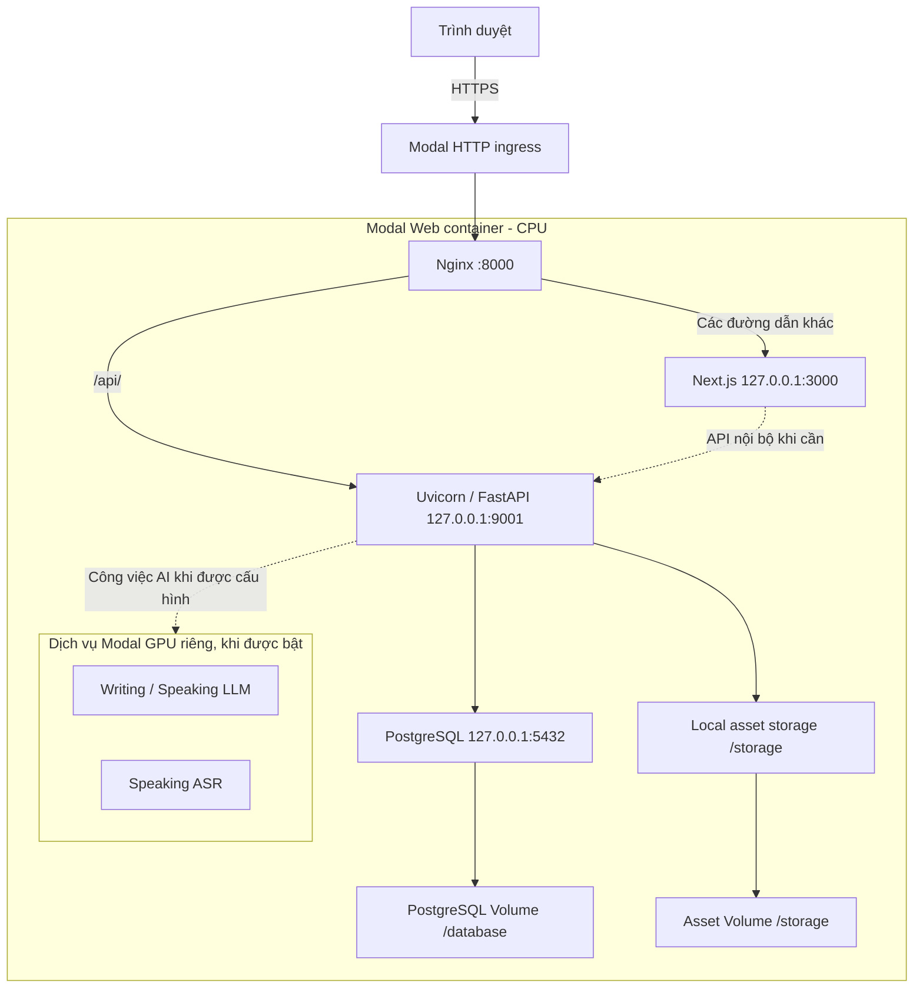
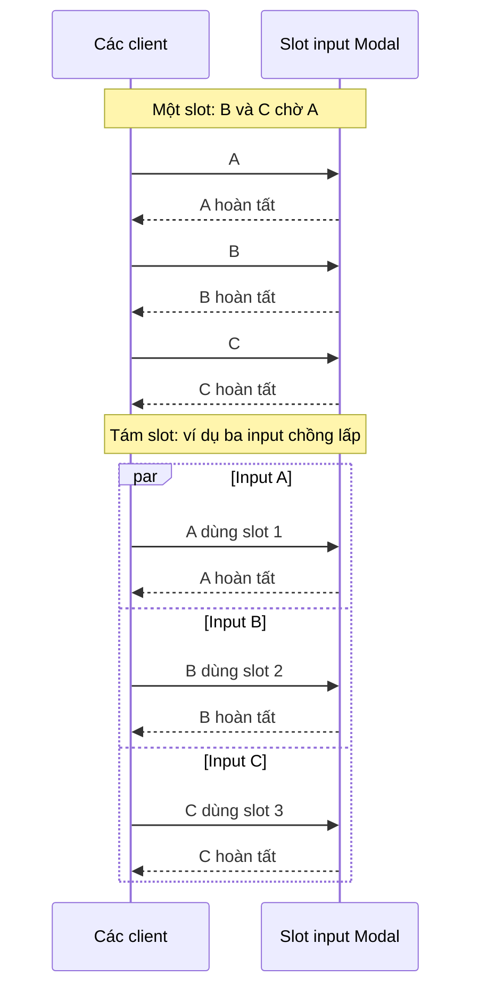
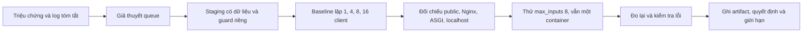

# Case Study: BandPilot — Diagnosing and Optimizing Modal Web Latency

Tài liệu này dùng để học cách điều tra một sự cố hiệu năng có thật trong repository. Số liệu là phép đo **staging**, không phải cam kết tốc độ với người dùng production. Nguồn chi tiết: [báo cáo thực nghiệm](../modal-web-performance.md), [kiến trúc](../architecture.md), [cấu hình Modal](../../deploy/modal/app.py), [runtime](../../deploy/modal/web_runtime.py) và các JSON trong [thư mục benchmark](../performance/modal-p2/).

## 1. Bối cảnh dự án

BandPilot là ứng dụng tự luyện IELTS bốn kỹ năng, có bài luyện, lớp học, công cụ biên soạn và phản hồi AI mang tính tham khảo. **Next.js** tạo giao diện và giao tiếp HTTP với **FastAPI**. FastAPI chịu trách nhiệm xác thực, phân quyền, quy tắc nghiệp vụ và truy cập **PostgreSQL**, nguồn dữ liệu chính thức. Trình duyệt không kết nối thẳng database.

Trong cấu hình Modal dùng PostgreSQL nhúng, một **container** — môi trường chạy cô lập đóng gói ứng dụng — dùng CPU và chạy nhiều process: Nginx, Next.js, Uvicorn/FastAPI và PostgreSQL. Nginx là **reverse proxy**, tức điểm tiếp nhận HTTP rồi chuyển request cho server nội bộ. Các dịch vụ AI, khi được bật và cần gọi, là những Modal function riêng; service Writing/Speaking dùng GPU L4, Speaking ASR dùng GPU T4. Trang web thông thường không cần GPU để phục vụ HTML, API hay tài nguyên tĩnh. Sự kiện này không đo inference.



**Modal Volume** là vùng lưu trữ bền vững được mount vào container; dữ liệu PostgreSQL và asset ở các Volume riêng. Local Volume có các giới hạn về durability và commit được giải thích trong [hướng dẫn Modal](../modal-web.md). PostgreSQL nhúng ghi trực tiếp vào một data directory trên Volume. Hai process PostgreSQL cùng sở hữu directory đó có thể làm hỏng dữ liệu; vì vậy Web giữ `max_containers=1` và dùng Modal Dict làm **single-owner guard**: chỉ một container được lấy khóa cho database trước khi khởi động. Xem [`Web.start` và `Web.stop`](../../deploy/modal/app.py).

Trong local development, Next.js thường chạy trên cổng 3000, FastAPI trên 8000 và PostgreSQL Docker Compose được đưa ra cổng 5433. Trên Modal, HTTPS kết thúc tại ingress; Nginx lắng nghe cổng 8000 bên trong Web container, còn Next.js và FastAPI dùng loopback 3000/9001. Next.js server-side còn có thể gọi FastAPI qua loopback mà không đi qua Nginx. Cấu hình external PostgreSQL cũng tồn tại; sơ đồ trên mô tả topology **embedded** đã được thử, không phải mọi cách triển khai.

## 2. Sự cố và giả thuyết ban đầu

Người dùng quan sát chuyển trang chậm. Bản tóm tắt 201 HTTP request được cung cấp cho cuộc điều tra cho biết median khoảng 1,84 giây, khoảng 91 request mất ít nhất 2 giây. Một chuỗi asset tăng gần đều: 0,65 → 1,27 → 1,89 giây, rồi đến 6,27 giây ở request thứ mười; chỉ số “execution” được ghi khoảng 0,43 giây. Đây là **waterfall**: cách biểu diễn trình tự và thời gian request, không tự nó chỉ ra nơi phải chờ.

Tách bốn mức khẳng định:

1. **Quan sát người dùng:** navigation trên web triển khai bị chậm.
2. **Log được báo cáo:** thời gian của nhiều asset tăng dần như ví dụ trên. Raw log gốc không thấy được lưu trong Git; không thể tái kiểm tra độc lập 201 dòng từ artifact hiện có.
3. **Giả thuyết:** request đồng thời có thể xếp hàng trước Web container. Network, routing, CPU, Next.js, Nginx và database cũng cần xem xét; `execution` của Modal không được mặc định coi là thời gian handler FastAPI.
4. **Bằng chứng sau này:** staging tái hiện waterfall trong một topology và thay đổi input concurrency làm giảm mạnh p95 khi tải đồng thời. Phép đo không tách chính xác thời gian queue Modal khỏi ingress và mạng, và không chứng minh cùng mức cải thiện ở production.

## 3. Những khái niệm cần phân biệt

| Thuật ngữ | Ý nghĩa và ví dụ BandPilot |
| --- | --- |
| **Latency — độ trễ** | Thời gian từ lúc client bắt đầu một request đến khi nhận xong response. HTML chậm 2 giây là một latency của request, không tự động là thời gian CPU. |
| **Throughput — thông lượng** | Số request hoàn thành thành công mỗi giây trong một đợt đo. Nó cho biết hệ thống xử lý được bao nhiêu việc, khác với độ trễ của một việc. |
| **Concurrency — đồng thời** | Nhiều công việc đang tiến triển trong cùng khoảng thời gian, có thể xen kẽ khi chờ I/O. Tám asset có thể cùng chờ mạng trong một container. |
| **Parallelism — song song** | Nhiều phép tính thực sự chạy cùng lúc trên các tài nguyên tính toán. Có tám input đồng thời không chứng minh tám phép tính CPU cùng chạy. |
| **Request queue — hàng đợi** | Request đã đến nhưng phải chờ một slot xử lý. Client thấy thời gian chờ dù Nginx chưa nhận được request. |
| **Head-of-line blocking** | Việc phía trước chiếm tài nguyên hoặc slot khiến việc phía sau phải chờ; một request dài có thể làm nhiều request ngắn bị trễ khi capacity bị giới hạn. |
| **HTTP request lifecycle — vòng đời request** | Client kết nối, gửi request, qua ingress/proxy tới ứng dụng, nhận header rồi body. Lỗi hoặc thời gian chờ có thể xuất hiện ở nhiều chặng. |
| **Reverse proxy** | Server đứng trước các upstream; ở đây Nginx chuyển `/api/` sang FastAPI và phần còn lại sang Next.js. |
| **Event loop** | Cơ chế điều phối tác vụ bất đồng bộ: trong khi một tác vụ chờ I/O, tác vụ khác có thể tiến triển. Nó không tự biến mã CPU nặng thành song song. |
| **Worker / process** | Process là chương trình đang chạy; worker là đơn vị thực thi công việc. Nginx, Node, Uvicorn và PostgreSQL là các process riêng trong cùng container Web; không đồng nhất worker với Modal input. |
| **CPU-bound / I/O-bound** | CPU-bound chủ yếu cần tính toán; I/O-bound thường chờ mạng, disk hoặc database. Nhiều HTTP request chờ I/O có thể hưởng lợi từ concurrency, nhưng vẫn dùng chung CPU và bộ nhớ. |
| **Horizontal scaling** | Tăng số container/replica. Nếu Web dùng PostgreSQL nhúng, thêm container là thay đổi topology và quyền sở hữu database, không chỉ là đổi một số. |
| **Vertical scaling** | Tăng CPU hoặc RAM cho một container. Việc này không tự giải quyết hàng đợi input nếu giới hạn admission vẫn còn. |
| **Cold start / warm container** | Cold start gồm cấp phát và khởi động khi chưa có container sẵn; warm container đã chạy. Benchmark có warmup và `min_containers=1`, nhưng warmup không chứng minh mọi request đều không gặp biến động nền. |
| **Tail latency** | Phần chậm ở đuôi phân phối, ví dụ p95. Nó giúp phát hiện các request tệ hơn mức điển hình. |

`max_inputs=8` cho phép tối đa tám input đồng thời **trong mỗi container**; `max_containers=8` cho phép tối đa tám container. Chúng là hai chiều cấu hình khác nhau. Tám input không tạo tám container, tám CPU core hay tám Python function CPU-bound thực thi song song. Web vẫn chia sẻ 2 CPU và 4096 MiB giữa Nginx, Next.js, FastAPI và PostgreSQL. Lợi ích đến từ khả năng chồng lấp thời gian chờ, với giới hạn phụ thuộc toàn bộ stack.

## 4. Tại sao kiến trúc cũ có thể chậm?

Trước commit tối ưu, lớp [`Web` ở baseline](../../deploy/modal/app.py) có cấu hình tương đương đoạn rút gọn sau, chưa có decorator concurrency:

```python
@app.cls(
    cpu=2,
    memory=4096,
    min_containers=1,
    max_containers=1,
    # Các tham số khác được lược bớt.
)
class Web:
    @modal.web_server(8000, startup_timeout=240)
    def web(self):
        pass
```

Theo [Modal input concurrency](https://modal.com/docs/guide/concurrent-inputs), mặc định là một input mỗi container. Browser có thể cần HTML, CSS, JavaScript và API gần như cùng lúc; khi chỉ có một slot, các request khác có thể chờ admission trước khi đến Nginx. Handler FastAPI làm việc vài mili giây không xóa thời gian chờ ở chặng trước. Tuy nhiên, các chỉ số hiện có không đo trực tiếp từng mili giây queue; còn có thời gian kết nối, vận chuyển giữa vùng và xử lý ingress.

Timeline dưới đây là **minh họa khái niệm**, không phải trace thực tế hay số đo theo từng request:



Điều này không đảm bảo request sẽ chạy nhanh hơn nếu CPU hoặc database đã bão hòa. Cơ chế slot chỉ loại bỏ một giới hạn; nó không tạo thêm tài nguyên.

## 5. Thiết kế benchmark

Script [`benchmark_modal_web.py`](../../scripts/benchmark_modal_web.py) dùng GET không đăng nhập với `/`, `/api/v1/ready`, `/icon.svg` và một asset `/_next/static/...`. Nó đọc HTML trang chủ, tìm `src` của `script` hoặc `href` của `link` cùng origin có prefix đó; nó không tự bịa đường dẫn asset. Trong bốn run chính, asset tìm được là CSS 42.141 byte. Readiness kiểm tra kết nối database; ba endpoint còn lại cung cấp những loại response khác nhau.

Staging được chọn để tránh tạo tải hoặc thay đổi database thật: database khởi tạo rỗng, asset Volume, Secret và owner Dict riêng; migration tạo một tài khoản legacy bất hoạt hư cấu; AI/GPU tắt. Baseline và ứng viên dùng cùng URL, dataset, endpoint, số request và vùng container quan sát `ap-south`; routing là `us-east`. Baseline không pin region, ứng viên pin `ap-south` để giữ vùng sau khi container được thay thế. Cùng nhãn vùng không chứng minh cùng host hay cùng zone. Trước khi thay phiên bản, container baseline đã dừng và owner key được giải phóng.

Mỗi endpoint được warmup tuần tự hai lần, sau đó đo ở **client concurrency** 1, 4, 8 và 16, mỗi mức 16 request, timeout 30 giây. Client concurrency là số thread của script phát request; **Modal input concurrency** là số slot trên mỗi Web container: không được nhầm hai con số này. Lặp mỗi cấu hình hai run giúp thấy biến động, dù chưa đủ để tạo confidence interval. Nếu tìm đủ asset, một run gửi tối đa 265 GET gồm discovery, warmup và các lượt đo.

Script xác thực HTTP 200, body, content type và trạng thái JSON `ready`; không theo redirect, không gửi cookie, đếm lỗi/status, giới hạn body và concurrency. Thống kê latency chỉ dùng request thành công; report vẫn ghi lỗi và throughput thành công. Một run lỗi warmup, validation hoặc không tìm thấy asset sẽ trả exit code khác 0. [Mã benchmark](../../scripts/benchmark_modal_web.py) là nguồn chính xác cho mọi điều kiện.

Để tái lập, trước tiên **xác nhận staging cô lập và được phép chịu tải**: database/asset Volume, Secret, owner guard và dữ liệu riêng; không nhắm production nếu chưa được cho phép. Chạy từ root repository, thay URL bằng origin staging thật:

```powershell
python scripts/benchmark_modal_web.py --base-url https://YOUR-ISOLATED-STAGING.modal.run --confirm-staging --requests 16 --concurrency 1,4,8,16 --warmup 2 --timeout 30 --output modal-before.json
```

Giữ cùng URL, topology, phiên bản workload, vùng, mạng và cách warmup cho lượt sau; lưu file mới, chạy lặp và đối chiếu cả lỗi. Script dùng `urllib`, mở kết nối mới và yêu cầu `Accept-Encoding: identity`; browser thường tái sử dụng kết nối và có thể nén. Nó không thực thi JavaScript, không quan sát render hay tương tác, nên **không đo Core Web Vitals** hoặc trải nghiệm browser đầy đủ.

## 6. Đọc đúng các chỉ số

- **Latency:** `thời điểm đọc hết response − thời điểm bắt đầu request`. Ví dụ 2.000 ms là hai giây; bao gồm các phần ngoài ứng dụng.
- **p50:** percentile thứ 50, thường gọi median. Script dùng nearest-rank: sắp xếp mẫu, chọn vị trí `ceil(0,50 × n)` theo chỉ số bắt đầu từ 1; với số mẫu chẵn đây là phần tử giữa phía dưới, không phải trung bình hai phần tử giữa.
- **p95:** chọn `ceil(0,95 × n)` theo nearest-rank. Với `n=16`, `ceil(15,2)=16`: p95 chính là mẫu lớn nhất. Một outlier làm p95 thay đổi mạnh; đây không phải ước lượng SLO production ổn định.
- **TTFB — time to first byte:** thời gian chờ đến response đầu tiên. Script lấy mốc ngay sau `urlopen` trả response headers, xấp xỉ TTFB; mốc này gồm DNS/kết nối/TLS khi có, và không nhất thiết là byte đầu tiên của body. Nó không phải thời gian xử lý thuần của server.
- **Successful throughput:** `số request thành công / thời gian cả batch`, đơn vị request/giây. Script còn ghi throughput tính tất cả request; không dùng chỉ số đó để che lỗi.
- **Error rate:** `số request lỗi / tổng request đo`. Kiểm tra cả status, validation và warmup; 0 lỗi ở một batch nhỏ không chứng minh độ tin cậy dài hạn.
- **Speedup:** `metric trước / metric sau` khi metric là latency; với throughput là `throughput sau / throughput trước`. **Latency reduction:** `(trước − sau) / trước × 100%`. Giảm 50% latency tương đương speedup 2×, không phải tăng 50 lần.

## 7. Chẩn đoán từng lớp

```mermaid
sequenceDiagram
    participant C as Client Việt Nam
    participant I as Modal routing us-east
    participant M as Container ap-south
    participant N as Nginx :8000
    participant A as Next :3000 / FastAPI :9001
    participant D as PostgreSQL :5432
    C->>I: GET HTTPS
    Note over I,M: Có thể chờ admission; không đo trực tiếp queue
    I->>M: Chuyển input tới container
    M->>N: HTTP nội bộ
    N->>A: Proxy request
    opt Readiness hoặc request cần dữ liệu
        A->>D: Truy vấn qua backend
        D-->>A: Kết quả
    end
    A-->>N: Headers và body
    N-->>I: Response
    I-->>C: Response qua mạng
```

Phía client, JSON ghi total latency, TTFB xấp xỉ, kích thước, status và RPS; không có trace queue trực tiếp. Trên container, tùy chọn `IELTS_MODAL_WEB_TIMINGS=true` bật log Nginx cho request time, upstream response/connect time và request ID. FastAPI middleware ghi thời gian ASGI tổng, status, method an toàn và ID khi hợp lệ. Cấu hình này mặc định tắt; log không ghi URL/query, cookie, authorization hay body. Xem [`nginx_config_with_timings`](../../deploy/modal/web_runtime.py) và [`RequestTimingMiddleware`](../../backend/app/core/request_timing.py). Các số ASGI/upstream có thể gồm streaming và backpressure, không phải CPU time thuần.

Trong hai run chính, Nginx → FastAPI có p95 request/upstream 6 ms baseline và 5 ms sau; Nginx → Next p95 14 ms và 20 ms. FastAPI ASGI tổng p95 5,24 ms và 4,96 ms. Đây là aggregate trên nhiều endpoint/warmup, không ghép từng mẫu với client; xem [server-timings.json](../performance/modal-p2/server-timings.json). Trong baseline, cùng script chạy **localhost trong container** cho readiness ở client concurrency 16: p95 49,69 ms và 224 request/s. Public URL cùng mức tải đạt p95 9,86/10,22 giây và khoảng 1,5 request/s.

Những đối chiếu này khiến xử lý thông thường trong Nginx/FastAPI và truy vấn readiness khó giải thích toàn bộ khoảng chênh lệch. Kết hợp waterfall và tác dụng của `max_inputs=8`, chúng ủng hộ mạnh giả thuyết admission/input queue là bottleneck lớn trong topology staging `us-east → ap-south`. Chúng **không đo trực tiếp thời gian queue**, không chứng minh PostgreSQL chậm, không định lượng riêng RTT hay khẳng định vùng địa lý là nguyên nhân duy nhất. Không có bằng chứng GPU inference gây sự cố web. Region, ingress, network, Next.js và database vẫn cần đo riêng nếu workload khác.



## 8. Thay đổi kỹ thuật

Commit [`45587af`](https://github.com/ChuTungDuongg/IELTS_Self_Practising_Web/commit/45587afde437359034d6ee0d35897d362f6a5fb2) thêm đúng một decorator ở cấp lớp, sau `@app.cls` và trước `class Web`; các tham số tài nguyên vẫn giữ nguyên ([mã hiện tại](../../deploy/modal/app.py)):

```python
@app.cls(
    image=image,
    cpu=2,
    memory=4096,
    volumes=web_volumes,
    secrets=web_secrets,
    min_containers=1,
    max_containers=1,
    timeout=900,
    scaledown_window=300,
)
@modal.concurrent(max_inputs=8)
class Web:
    ...
```

SDK Modal cài tại thời điểm thử là 1.5.3; ứng viên đã được deploy và đo trên staging. `min_containers=1` giữ cấu hình warm container; `max_containers=1` cùng owner guard bảo vệ PostgreSQL nhúng. Nhiều replica là quyết định kiến trúc khác: cần giải quyết database, tài sản, ownership và lifecycle. Concurrency 8 cho phép nhiều input cùng được phục vụ, không đổi số CPU.

Trước đó, commit [`c5ed541`](https://github.com/ChuTungDuongg/IELTS_Self_Practising_Web/commit/c5ed5410e78751930f181a63b615c3e0b2c7e700) thêm benchmark, diagnostic tùy chọn và sửa [`NotificationCenter`](../../frontend/src/features/notifications/notification-center.tsx): khi panel đóng chỉ lấy unread count; khi mở mới lấy danh sách và làm mới count. Unit test ghi số list request trước khi mở từ 1 xuống 0. Đây là giảm request được xác nhận trong component test, **không phải** cải thiện latency deployed đã đo riêng. Commit [`4a6b5b0`](https://github.com/ChuTungDuongg/IELTS_Self_Practising_Web/commit/4a6b5b0850bb39161a308de3207f6d93b1c3a7e7) là baseline trước diagnostics và chỉ sửa selector E2E; không phải commit performance fix.

## 9. Kết quả trước và sau

Các số dưới đây được làm tròn từ [baseline](../performance/modal-p2/baseline.json), [baseline repeat](../performance/modal-p2/baseline-repeat.json), [after-8](../performance/modal-p2/after-8.json) và [after-8 repeat](../performance/modal-p2/after-8-repeat.json). Mỗi dấu `/` tách **run 1 / run 2**, không phải confidence interval. Bảng so sánh tại **16 client đồng thời**; bảng đủ 1/4/8/16 nằm trong [báo cáo gốc](../modal-web-performance.md).

| Chỉ số | Baseline: 1 input | Sau: 8 input |
| --- | ---: | ---: |
| Homepage p50 | 5,82 / 5,54 s | 1,78 / 1,79 s |
| Homepage p95 | 10,78 / 10,67 s | 2,37 / 2,32 s |
| Readiness p95 | 9,86 / 10,22 s | 2,13 / 2,14 s |
| Static CSS p95 | 11,11 / 10,90 s | 2,63 / 2,59 s |
| Readiness throughput | 1,57 / 1,54 request/s | 6,82 / 6,87 request/s |
| HTTP error | 0 / 512 request | 0 / 512 request |

Tính bằng **giá trị ms chưa làm tròn trong JSON**, riêng từng run:

| Metric | Giảm tuyệt đối run 1 / run 2 | Giảm tương đối run 1 / run 2 |
| --- | ---: | ---: |
| Homepage p95 | 8,406.14 / 8,352.95 ms | 78,00% / 78,28% |
| Readiness p95 | 7,727.15 / 8,081.64 ms | 78,39% / 79,09% |
| Static CSS p95 | 8,487.01 / 8,307.75 ms | 76,36% / 76,23% |

Ví dụ homepage run 1: `(10777,38 − 2371,24) / 10777,38 × 100 ≈ 78,00%`. Readiness throughput run 1: `6,82 / 1,57 ≈ 4,34×`; run 2 `6,87 / 1,54 ≈ 4,46×`. Đây là hai phép chia riêng, không lấy trung bình các run.

Ở **một client**, readiness p95 là 1,29/1,48 giây trước và 1,32/1,29 giây sau; cải thiện không nhất quán. Chờ mạng/routing vẫn hiện diện. Mẫu cgroup 5 giây ghi CPU 0,086 → 0,036 core và memory 534,1–535,6 → 541,6–545,9 MiB; đây là hai mẫu ngắn, không phải peak hoặc average toàn bộ run. Một mẫu PostgreSQL sau thay đổi thấy bốn connection, gồm cả phiên kiểm tra, không phải peak.

## 10. Trade-off và tình huống lỗi

Chọn 8 vì hai run staging cho thấy p95 và throughput tải đồng thời cải thiện rõ, không có lỗi trong benchmark giới hạn, đồng thời giữ replica và database guard. Điều đó không chứng minh 8 tối ưu toàn cầu. `max_inputs=16` không tự động được chọn: cần benchmark riêng và chứng minh headroom, độ ổn định, tail latency và chi phí.

Nhiều input có thể tranh CPU/memory, đặc biệt với render nặng hoặc công việc CPU-bound; task dài có thể giữ slot và gây head-of-line blocking mới. Async database pool có giới hạn; nhiều request có thể chờ connection thay vì chờ Modal. SSE giữ kết nối lâu, upload lớn và Speaking audio có bandwidth/range khác request ngắn; protected media còn phải qua authorization. Nginx hiện giữ buffering tắt cho proxy, không được bật bừa hoặc cache response riêng tư. Theo dõi tải, lỗi, pool và p95 theo loại endpoint trước khi nâng tiếp.

Khi cần nhiều replica Web/API, cần thiết kế scale-out thay vì chỉ nâng `max_containers`: database quản lý bên ngoài, storage dùng chung đúng semantics, session/auth, kết nối, migration và recovery phải được kiểm chứng. Managed PostgreSQL là một hướng khi muốn tách database khỏi lifecycle của Web; việc chuyển đổi không tự động và không được bỏ qua ownership/durability.

## 11. Giới hạn và các điều khó nói

- Các phép thử chính là staging giới hạn, không phải production; waterfall thực trong browser và Core Web Vitals chưa được đo lại. p95 ít mẫu không phải SLA/SLO.
- Chưa live-test authenticated private media hoặc SSE stream; các kiểm thử local bao gồm range/stream, còn staging đã kiểm tra 401 và static range 206. Điều này không chứng minh mọi luồng upload, audio hay stream chịu tải an toàn.
- Client tạo kết nối mới, routing `us-east` và container `ap-south` khác nhau; concurrency không xóa geographic RTT. `us-east` trong URL là vùng routing, không đủ để khẳng định vùng container production.
- Hai lượt thăm dò đầu dùng Volumes/Secret riêng nhưng tạm ghi một key staging trong **Dict guard dùng chung**. Key đã được xóa và xác nhận không còn; không có bằng chứng thay đổi key production. Bộ đo chính sau đó dùng Dict riêng. Cần kiểm tra cả control-plane resource, không chỉ database và asset Volume.
- App thử nghiệm cuối tiếp tục chạy khoảng **5 giờ 34 phút** sau lượt đo cuối trước khi được dừng; có thể phát sinh chi phí. Bài học: đặt người chịu trách nhiệm cleanup, giới hạn thời gian, xác nhận zero containers và kiểm tra billing; không khẳng định biết chính xác chi phí nếu chưa có hóa đơn.

## 12. Bài học

Đo trước khi tăng tài nguyên; so sánh public path với nội bộ; phân biệt input concurrency, replica và CPU; giữ owner guard của PostgreSQL. Chạy tải đồng thời vừa phải, lặp phép đo, lưu dữ liệu nguồn và báo cáo lỗi. Thực hiện thay đổi có giới hạn, có thể hoàn nguyên, rồi kiểm tra authorization, range và streaming. Lên kế hoạch dừng test infrastructure ngay từ đầu.

Điều đã đạt được là một thay đổi một dòng được hỗ trợ bởi benchmark staging có thể kiểm tra lại. Điều còn mở là đo browser và production một cách được phép, xác thực media/SSE dưới tải, theo dõi CPU/memory/database theo thời gian và đánh giá routing hoặc topology scale-out khi có bằng chứng.
