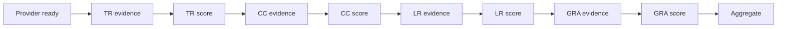
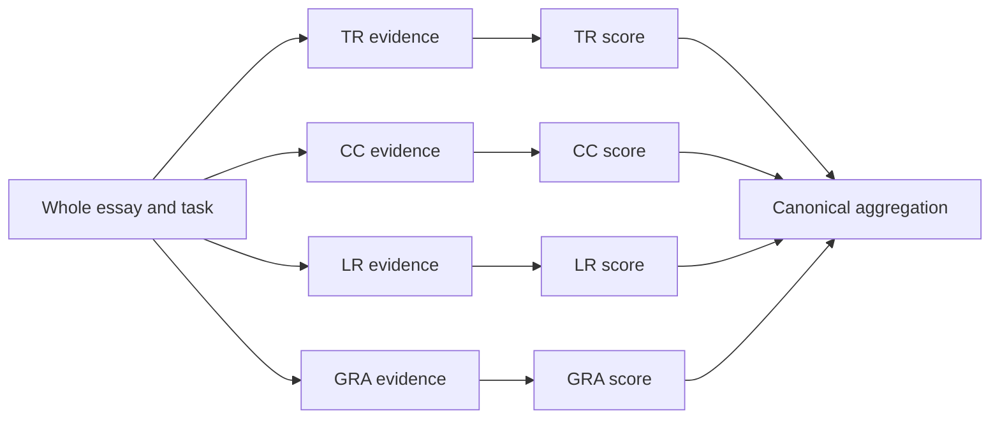
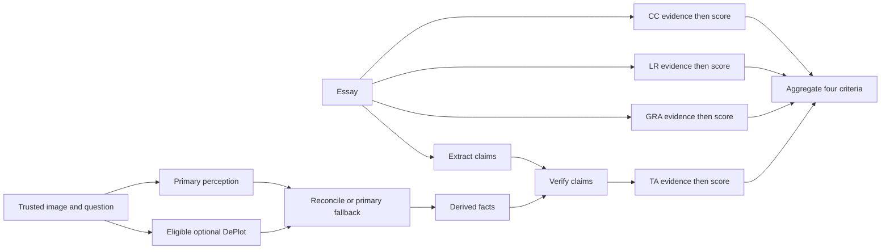

# Độ trễ IELTS Writing: đồ thị phụ thuộc, đồng thời có giới hạn và phục vụ mô hình

> **Kiểm toán tài liệu: HISTORICAL.** Tài liệu tham khảo lịch sử; không phải hợp đồng hiện hành.
> Mục đích: Độ trễ IELTS Writing: đồ thị phụ thuộc, đồng thời có giới hạn và phục vụ mô hình. Đối chiếu mã nguồn `aca8e0418a56e44d7e06f370ba5f3ebe5bf41778`: [mã triển khai](../backend/app/services/writing_execution.py).
> Đọc cùng [mô-đun/hướng dẫn hiện hành](ai-writing.md); [audit và giới hạn](DOCS_AUDIT.md). Kết quả kiểm thử/benchmark ghi bên dưới thuộc lần thực hiện gốc, không phải chạy lại trong lần kiểm toán này.


Phiên triển khai: 2026-10-08. Commit khởi đầu: `814197afcf83b9ed8bcc71fc01d914808c668f7b` trên `main` Local, cũng là tham chiếu remote-main được cung cấp. Worktree đã có thay đổi trung lập chấm điểm chưa commit: 18 tệp sửa và ba tệp mới. Bộ chấm Local đó là mốc của giai đoạn; không khôi phục prompt từ xa. Giai đoạn này không commit, push, triển khai hoặc suy luận GPU thật.

## 1. Tóm tắt điều hành

Ứng dụng chờ từng tiêu chí xong trước bắt đầu tiêu chí tiếp. Task 1 còn trì hoãn đánh giá chỉ văn bản sau nhận diện hình, DePlot tùy chọn, dữ kiện và nhận định. Điều này đặt yêu cầu độc lập trên một đường găng tuần tự. Lệnh vLLM đã triển khai chỉ cho một sequence, nên chỉ tạo thêm tác vụ backend vẫn để lại nút thắt phục vụ.

Task 2 nay chạy đồng thời bốn pipeline độc lập bằng chứng-rồi-chấm. Task 1 chạy CC/LR/GRA và trích xuất nhận định song song nhận diện hình, DePlot tùy chọn ở nhánh riêng. TA vẫn chờ đúng phụ thuộc hình/nhận định. Mỗi run giới hạn completion LLM đang chờ, mặc định hai, giữ trạng thái riêng từng tiêu chí. Định nghĩa triển khai Modal nay mặc định cho hai input/sequence vLLM, cấu hình được 1/2/4.

Giữ cùng mô hình, prompt tiêu chí, xác minh nguồn, tổng hợp điểm, nửa band và phản hồi tiếng Việt. Giữ Task 1 chấm v5 / Task 2 v7 và Task 1 visual v3 Local. Không gộp bộ chấm, rút prompt, hiệu chuẩn số, làm yếu nhận diện, thêm mô hình, GPU lớn hoặc replica.

Harness tổng hợp đo tổng độ trễ giảm 44.4% Task 2, 34.1% Task 1 không DePlot, 40.0% có DePlot khi đồng thời hai. Đây là fake-I/O Local, không phải hiệu năng GPU đã triển khai/độ đồng thuận điểm người chấm. Thời gian có kết quả đầu Task 2 xấu hơn ở cấu hình đó; báo cáo nêu rõ đánh đổi.

## 2. Kiến trúc trước tối ưu




Không tính thử lại, Task 2 cần tám completion LLM. Task 1 cần tám completion đó cộng nhận diện, trích xuất nhận định và đôi khi xác minh ngữ nghĩa. DePlot là lời gọi dịch vụ tùy chọn bổ sung. Mỗi bước await kéo dài thời gian dù không phụ thuộc kết quả ngay trước.

## 3. Đo kiểm / mốc ban đầu

Mốc tái lập là tham chiếu tuần tự chỉ dùng đánh giá, với **prompt và xác minh Local hiện tại**, không dùng prompt hiệu chuẩn cũ. `app/evaluation/writing_latency.py` chỉ đổi thứ tự thực thi giữa tham chiếu/service production. Fixture tổng hợp cố định là nội dung hư cấu gốc tại `benchmarks/writing_latency/synthetic.json`. PNG một pixel kiểm xử lý payload ảnh tin cậy, không phải benchmark nhận diện.

Thí nghiệm ghi nhận trên Windows, Python 3.13.9, ba lần mỗi cấu hình, readiness provider giả 100 ms, mỗi completion 100 ms, mỗi trích xuất bộ chuyên biệt được bật 100 ms. Lập lịch hệ điều hành thêm overhead. Callback trace không làm gì nên tổng không gồm PostgreSQL, poll SSE, mạng HTTP, suy luận GPU. Mỗi run kiểm toàn kết quả bằng nhau và yêu cầu nhóm theo bước/tiêu chí, gồm messages, schema, `CompletionOptions`. Cũng kiểm số lời gọi/token giả theo kịch bản.

Chạy từ `backend/`:

```powershell
uv run --no-sync python ../scripts/benchmark_writing_latency.py --repeats 3 --delay-ms 100 --output ../benchmarks/writing_latency/reports/session.json
```

JSON lưu mọi mẫu tổng/kết quả đầu, trung vị, readiness, trung vị từng bước, đỉnh đồng thời, số lời gọi, tổng token và phiên bản prompt. Báo cáo bị Git bỏ qua; fixture/harness là ứng viên mã nguồn commit. Số ở mục 11 từ lượt harness cuối có instrumentation trong phiên, không ghép các lần tốt nhất.

`WritingLatencyMetrics` dùng `time.perf_counter()` đo thời lượng. Worker tạo trước chuẩn bị input, đo readiness provider một lần. `run_total_ms` kết thúc sau đánh giá, trước giao dịch cuối; gồm chuẩn bị input/chờ checkpoint trung gian, loại yêu cầu HTTP tạo run đầu, truyền trình duyệt, độ trễ commit cuối. `time_to_first_criterion_ms` kết thúc khi kết quả tiêu chí hợp lệ đầu sẵn sàng, ngay trước callback lưu. Không phải đo vẽ trình duyệt.

Instrumentation bao phủ readiness; bằng chứng/chấm tiêu chí; neo bằng chứng hình; DePlot; đối soát; dữ kiện; trích xuất/xác minh nhận định. Mỗi lượt ghi thời lượng, số lần, finish reason thuộc danh sách cho phép và số token. Thời lượng bước bằng chứng/chấm gồm checkpoint; lượt completion gồm chờ semaphore/provider. Không phải thời gian kernel GPU thuần. Khóa cố định, tối đa hai bản ghi lượt mỗi bước giữ tóm tắt có giới hạn. Không đưa bài viết, prompt, output, ảnh hoặc thông tin xác thực vào số đo. Usage JSON hiện có lưu snapshot dưới `latency`; không cần migration/mở rộng DTO công khai.

Hiệu năng khởi động lạnh/suy luận nóng thật: **Chưa đo trong phiên triển khai này**. Để đo sau, triển khai định nghĩa đã kiểm một lần, ghi vòng đời container từ Modal, chạy Task 2 nguyên gốc/có quyền và Task 1 tổng hợp tùy chọn. Lượt lạnh phải xác định bằng container mới thật, không suy từ readiness. Lượt nóng dùng lại container. Ghi run ID, cấu hình, readiness, tổng, kết quả đầu, thời lượng bước, lượt sửa và usage JSON. Một run chỉ là kiểm tra nhanh; p50/p95 cần bộ mẫu có kế hoạch. Readiness có thể gồm proxy/mạng/queue, không chỉ khởi động lạnh.

## 4. Nguyên nhân gốc

| Nguyên nhân | Hệ quả | Cách xử lý đã triển khai |
| --- | --- | --- |
| Tiêu chí tuần tự | Độ trễ gần tổng thời gian chờ tám yêu cầu | Tác vụ tiêu chí độc lập |
| Phụ thuộc giả Task 1 | Phản hồi ngôn ngữ chờ ảnh không dùng | Nhánh ngôn ngữ/nhận định bắt đầu sớm |
| `--max-num-seqs 1` | Không lập lịch nhiều sequence trong một vòng | Cấu hình 1/2/4, mặc định 2 |
| Admission Modal | Container web-server cũng cần nhận input đồng thời | `modal.concurrent` gắn cấu hình sequence |
| Thu hẹp về không | Yêu cầu có thể chịu thời gian khởi động mô hình/tiến trình | Profile chi phí/nhàn rỗi interactive tường minh |
| DePlot tùy chọn riêng | Khởi động lạnh/trích xuất thêm có thể kéo dài TA | Trích ảnh chồng nhánh chính |
| Sinh nội dung/token | Vẫn phải sinh cùng bằng chứng/phản hồi | Giữ việc; chồng thời gian chờ độc lập |
| DB/SSE | Checkpoint, khóa, truyền thêm overhead | Giữ checkpoint ngắn bền vững; đo trung thực |

Tỷ lệ sinh nội dung thật, DB, SSE **chưa đo trong phiên triển khai này**. Dùng chênh lệch bước/lượt và telemetry DB cho run đại diện, timestamp trình duyệt/API cho truyền kết quả. Không suy overhead không đáng kể từ benchmark tổng hợp có trace rỗng.

## 5. Kiến trúc sau tối ưu





Không DePlot, nhận diện chính đi thẳng tới dữ kiện. Xác minh nhận định chờ trích xuất cùng tham chiếu/dữ kiện đã chốt. TA tiếp tục theo chính sách cảnh báo/bằng chứng chưa biết hiện có nếu phần phụ lỗi; nhận diện chính không dùng được vẫn chặn TA thành công. Tổng hợp chờ bốn kết quả tiêu chí thành công. Run dở không tạo trung bình/overall giả.

**Tổng công việc và đường găng thời gian thực:** đồ thị Task 2 cũ có `T ≈ ready + Σ(evidence_i + score_i)`. Đủ năng lực phục vụ, lý tưởng đồng thời tiến tới `ready + max(evidence_i + score_i)`. Giới hạn hai khiến queue đặt thời gian giữa hai cận, không tự động còn nửa. Task 1 lý tưởng là lớn nhất giữa nhánh ngôn ngữ và TA; TA gồm nhánh nhận diện đủ điều kiện chậm hơn, dữ kiện, điểm nối trích xuất, xác minh và hai lượt chấm. Tranh chấp tài nguyên GPU thật, hiệu quả batching, overhead checkpoint làm đổi ước tính.

Thời lượng bước đồng thời chồng nhau, thời lượng lượt gồm chờ queue. Cộng chúng không phải đo tính toán GPU. Cùng tổng token/số yêu cầu có thể tạo đường găng ngắn hơn mà không giảm tổng việc.

## 6. Mô hình đồng thời

Mỗi run tạo service và `asyncio.Semaphore` qua `BoundedWritingProvider`. `AI_WRITING_MAX_CONCURRENT_LLM_REQUESTS` mặc định 2, nhận số nguyên 1–4. Kiểm thử/benchmark ứng viên bao phủ 1, 2, 4. Semaphore bảo vệ **mọi** completion Ministral/provider, gồm nhận diện, trích xuất, xác minh ngữ nghĩa, bằng chứng, chấm, sửa. DePlot dùng dịch vụ tùy chọn riêng, tối đa một lần/run đủ điều kiện với timeout hiện có. Không có semaphore toàn cục chung người dùng. Hai người có thể mỗi người hai yêu cầu; admission phục vụ/vLLM xếp chúng trên GPU duy nhất. Không có năng lực GPU vô hạn hoặc bảo đảm công bằng toàn ứng dụng.

Task 2 tạo bốn tác vụ. Mỗi tác vụ giữ thứ tự bằng chứng → xác minh nguồn → chấm → xác minh điểm. Tiêu chí không phụ thuộc thông tin nhau; prompt không có output tiêu chí khác. Nửa band vẫn từ bộ chấm, giữ miền điểm/tổng hợp.

`CriterionExecutionState` sở hữu bước, usage, chẩn đoán, kết quả/lỗi. Không có con trỏ `current_criterion`/`current_stage` chung. Cùng định danh tiêu chí gắn lời gọi/sửa/event bất kể thứ tự xong. Chẩn đoán phụ Task 1 vẫn thuộc TA/bước có tên. Snapshot usage/chẩn đoán trả về là danh sách tạo mới.

Lỗi provider/xác minh hoặc Python bất ngờ trong tiêu chí thành lỗi riêng an toàn, tiêu chí anh em vẫn xong. Gather chờ lỗi thường trước truyền lỗi chưa xử lý. Lỗi lưu/mất lease dùng `TraceFailure`, hủy con của run nhanh. Hủy bên ngoài cũng hủy/chờ mọi con, kể cả nhánh Task 1 lồng và bên chờ semaphore. Không để coroutine suy luận nền tách rời.

## 7. Gom lô liên tục của vLLM

Đồng thời backend làm yêu cầu HTTP độc lập sẵn sàng cùng lúc; không sinh thêm năng lực GPU. vLLM lập lịch sequence active cùng nhau qua vòng sinh nội dung, nhận việc khi có tài nguyên. Giới hạn một sequence khiến HTTP đồng thời vẫn xếp hàng. Ý nghĩa được mô tả trong [tham chiếu serve vLLM 0.13 cố định](https://docs.vllm.ai/en/v0.13.0/cli/serve/#max-num-seqs).

`deploy/modal/writing_llm_config.py` cung cấp cấu hình triển khai đã xác minh: `IELTS_WRITING_LLM_MAX_NUM_SEQS`, chọn 1/2/4, mặc định 2. Triển khai đặt `@modal.concurrent(max_inputs=config.max_num_seqs)` để hơn một yêu cầu tới tiến trình web-server. Modal yêu cầu đồng thời input tường minh; xem [hướng dẫn đồng thời input](https://modal.com/docs/guide/concurrent-inputs). Cấu hình host cố định vào biến image để import từ xa cùng định nghĩa. Đây là định nghĩa năng lực phục vụ; chưa triển khai mới tại đây.

Giữ Ministral 3 8B Instruct 2512 trên một L4, vLLM 0.13.0, context 8192, mức dùng bộ nhớ GPU 0.90, eager execution, một ảnh/prompt, bốn CPU, RAM host 32768 MiB. Giữ `max_containers=1` và xác thực proxy. Thêm sequence active cần KV-cache/chia sẻ tài nguyên, giới hạn lớn hơn có thể tăng độ trễ mỗi yêu cầu/áp lực bộ nhớ. Hai là ứng viên thận trọng, không phải tối ưu L4 đã đo.

Hiệu quả batching GPU, thông lượng token, chờ queue và VRAM đỉnh **chưa đo trong phiên triển khai này**. Xác minh 1/2/4 với cùng input tổng hợp/có quyền đại diện, cố định mô hình/runtime/context, trạng thái nóng biết rõ và người dùng đồng thời được kiểm soát. Ghi tỷ lệ thành công/OOM, sửa, tokens/s, bộ nhớ GPU, queue, tổng/kết quả đầu. Dùng metric vLLM/vòng đời Modal cùng số đo backend. Phiên này kiểm dây cấu hình bằng SDK giả, không cấp GPU.

## 8. Luồng xử lý Task 1

CC đánh giá tổ chức/liên kết, LR từ vựng, GRA độ đa dạng/chính xác ngữ pháp. Payload hiện có chứa văn bản/đề, không ảnh, tham chiếu hình, dữ kiện/xác minh nhận định. Khởi chạy sớm chỉ đổi lịch, không đổi ngữ cảnh đánh giá.

Trích xuất nhận định chỉ đọc nguồn bài viết/loại đề. Có thể chạy trước neo hình, nhưng xác minh thì không: cần nhận định, tham chiếu có căn cứ, dữ kiện dẫn xuất. Dữ kiện có thể xong trong lúc trích xuất chờ. Nhận diện chính dùng ảnh tin cậy/đề, không phán xét chất lượng bài. DePlot cần ảnh độc lập nên nhánh trích xuất chỉ đồng thời khi bật `CHART_TABLE`. PROCESS/MAP/SYSTEM/OTHER không bao giờ chạy nó.

Đối soát vẫn trên bản sao sâu tham chiếu chính. DePlot lỗi hoặc exception đối soát giữ tham chiếu chính với cùng mã dự phòng an toàn. Nhận diện chính không dùng được thì không nâng DePlot thành thay thế. Có thể đã gọi DePlot vì hai trích xuất nay chồng lấn; bỏ kết quả đó khi chấm. Không thiết kế lại phân tích Decimal, quy tắc độ tin cậy, dữ kiện dẫn xuất hoặc xác minh nhận định xác định.

Chỉ TA chờ nối các phụ thuộc trước truy xuất/chấm. Kết quả ngôn ngữ có thể checkpoint/hiển thị trong lúc chờ hình. Kiểm thử hàng rào chứng minh ngay cả khi mọi nhánh hình/nhận định bị chặn; không cần assertion thời gian chặt dễ nhiễu.

## 9. Khởi động lạnh và chi phí

`min_containers=0` giữ thu hẹp về không. `scaledown_window` điều khiển thời gian chờ nhàn rỗi trước thu hẹp, không bảo đảm tuyệt đối mô hình nóng. Cửa sổ dài hơn tránh khởi động lặp trong buổi học, tốn thêm thời gian GPU nhàn rỗi tính phí. Modal giải thích trong [hướng dẫn khởi động lạnh](https://modal.com/docs/guide/cold-start).

| Profile | Cấu hình lúc triển khai | Thời gian chờ nhàn rỗi | Container tối thiểu |
| --- | --- | --- | --- |
| Chi phí, mặc định | `IELTS_WRITING_LLM_PROFILE=cost` | 60 giây | 0 |
| Interactive | `IELTS_WRITING_LLM_PROFILE=interactive` | 300 giây | 0 |
| Ghi đè tường minh | `IELTS_WRITING_LLM_SCALEDOWN_SECONDS` | 60–900 giây | 0 |
| Luôn nóng, chỉ tương lai | Cần `min_containers=1` | Phí nhàn rỗi liên tục | Chưa triển khai |

Cấu hình chỉ ảnh hưởng Ministral; DePlot giữ dịch vụ T4/chính sách nhàn rỗi riêng. Không có vòng prewarm ẩn, tác vụ readiness giả, replica mới hoặc cấp phát luôn chạy. Đổi cấu hình triển khai cần deployment tường minh. Cấu hình đồng thời backend ở backend/Modal, không ở frontend client.

Ví dụ triển khai interactive từ gốc repository khi chủ ý sẵn sàng triển khai bằng Modal CLI đã cài/cấu hình:

```powershell
$env:IELTS_WRITING_LLM_PROFILE = 'interactive'
$env:IELTS_WRITING_LLM_MAX_NUM_SEQS = '2'
modal deploy deploy/modal/app.py
```

Giữ `AI_WRITING_MAX_CONCURRENT_LLM_REQUESTS=2` ở backend cho ứng viên mặc định. Chế độ riêng một yêu cầu đặt cả giới hạn backend/sequence/admission server là 1. Đây vẫn DAG đồng thời mới với truy cập provider tuần tự, không dựng lại thứ tự tiêu chí cũ.

Độ trễ lạnh, tỷ lệ trúng trạng thái nóng và chênh lệch phí thật **chưa đo trong phiên triển khai này**. So vòng đời/hóa đơn theo khoảng buổi học đại diện dưới 60 so với 300 giây, kể cả DePlot riêng. Chọn theo lưu lượng/ngân sách.

## 10. Ràng buộc độ tin cậy

- Mọi SSE event vẫn qua giao dịch PostgreSQL ngắn, khóa dòng, sequence tăng đơn điệu đã lưu. Callback đồng thời dùng khóa mỗi run; provider không giữ khóa. Hủy shield checkpoint đang chạy, chờ giao dịch rồi truyền hủy. Bảo vệ tiến độ xong không bỏ rơi checkpoint.
- Tiêu chí có thể xong khác thứ tự. DTO cuối và map `progress`/lỗi dở dùng TA/TR, CC, LR, GRA. Thứ tự object JSONB không phải bảo đảm API nên `present_run` dựng lại thứ tự chuẩn tường minh.
- Frontend vốn ánh xạ vị trí tiêu chí cố định/đếm kết quả thật; không đổi hành vi/kiểu frontend. Trường activity duy nhất hiện bước lưu gần nhất, không phải mọi tác vụ đồng thời. SSE reconnect phát lại event lưu, không suy luận lại.
- Lỗi tiêu chí Local giữ kết quả/chẩn đoán anh em. Lỗi dở không tính overall. Dừng đánh dấu tiêu chí chưa xong bị gián đoạn, không đổi tiêu chí xong. Worker độc lập với client SSE ngắt; kiểm lease/heartbeat tiếp tục.
- Bằng chứng/chấm giữ một lượt sửa giới hạn: bằng chứng thường 1800 token, chấm thường 3072, sửa độ dài chấm 4096. Giữ xử lý context adapter/xác minh finish-reason. Nhận diện giữ tùy chọn/sửa mặc định hiện có.
- Giữ mã dự phòng an toàn, endpoint provider bảo vệ, dữ liệu ảnh tin cậy, xác minh source-ID, trích dẫn chính xác, phản hồi Việt. Metric chỉ metadata số/định danh cố định; không log body exception.
- AI vẫn tư vấn. Worker ghi run/event AI, không bảng điểm chính thức/người chấm. Attempt lịch sử/input task đóng băng giữ kiểm chủ sở hữu/bất biến.

Kiểm thử bao phủ chồng lấn qua hàng rào, giới hạn mỗi run qua hai người giả lập, lỗi bất ngờ riêng tiêu chí, sửa đồng thời, hủy/chờ con, checkpoint bền vững, khôi phục phần xong khác thứ tự, sequence/replay SSE, lỗi hình, dự phòng DePlot, tách điểm chính thức. Kiểm budget/context provider và profile chấm hiện có vẫn thuộc hồi quy tập trung.

Tái lập hồi quy backend tập trung từ `backend/`, với PostgreSQL test truy cập được và cô lập rollback theo `tests/conftest.py`:

```powershell
$latencyTests = @(
  'tests/test_mts_descriptor_fit.py', 'tests/test_mts_writing_v3.py',
  'tests/test_mts_writing_v4.py', 'tests/test_mts_writing_v5.py',
  'tests/test_mts_writing_validation.py', 'tests/test_task1_visual.py',
  'tests/test_task1_visual_numbers.py', 'tests/test_task1_grounding_contract.py',
  'tests/test_task1_grounding_regression.py', 'tests/test_task1_calibration.py',
  'tests/test_task1_benchmark.py', 'tests/test_task1_benchmark_metrics.py',
  'tests/test_chart_cross_check.py', 'tests/test_deplot_deployment.py',
  'tests/test_writing_completion_budgets.py', 'tests/test_writing_llm_providers.py',
  'tests/test_writing_llm_readiness.py', 'tests/test_vllm_context_budget.py',
  'tests/test_writing_ai_output_normalization.py', 'tests/test_modal_app.py',
  'tests/test_modal_web_runtime.py', 'tests/test_writing_concurrency.py',
  'tests/test_writing_serving_config.py', 'tests/test_writing_ai.py',
  'tests/test_task1_writing_ai.py'
)
uv run --no-sync pytest @latencyTests -q -rs
uv run --no-sync ruff check app tests ../scripts ../deploy/modal --config pyproject.toml
uv run --no-sync ruff format --check app tests ../scripts ../deploy/modal
git diff --check
```

Không đổi frontend nên kiểm thử/typecheck frontend, trình duyệt tự động, Playwright ngoài xác minh tập trung. Kiểm thử dùng provider giả, không suy luận GPU. Container PostgreSQL tạm chạy để kiểm tích hợp rồi trả về trạng thái dừng gốc.

Xác minh cuối: **803 đạt, 1 bỏ qua trong 89.98 giây**. Bỏ qua `test_modal_web_runtime.py:84`: host Windows không cho tạo symlink. Ruff lint đạt; định dạng báo **206 tệp đã đúng**; `git diff --check` đạt. Kiểm lỗi trích xuất nhận định sớm mới xác nhận cảnh báo còn trong phân tích lưu của run thất bại. Hash tệp prompt/provider/tổng hợp/nhận định/đối soát khớp snapshot khởi đầu giai đoạn. So AST xác nhận prompt nhận diện, schema số provider, xác minh/độ tin cậy không đổi; service grounding chỉ thêm hook thời gian.

## 11. Kết quả benchmark

Mọi số dưới là **trung vị fake-I/O tổng hợp**, ba lượt Local, độ trễ 100 ms. Cấu hình sau mặc định giới hạn backend 2. Token giả đặt kịch bản 100 prompt + 50 completion mỗi lời gọi LLM; không đo tokenizer thật hoặc kích thước prompt production thật.

| Chỉ số | Tham chiếu tuần tự | Đồng thời, giới hạn 2 | Cải thiện |
| --- | ---: | ---: | --- |
| Tổng Task 2 | 1010.737 ms | 561.498 ms | 44.4% giảm; 1.80× |
| Tổng Task 1, tắt DePlot | 1376.048 ms | 906.685 ms | 34.1% giảm; 1.52× |
| Tổng Task 1, bật DePlot | 1482.708 ms | 889.777 ms | 40.0% giảm; 1.67× |
| Tiêu chí đầu Task 2 | 338.496 ms | 450.197 ms | 111.701 ms muộn hơn |
| Tiêu chí đầu Task 1, tắt | 719.712 ms | 454.265 ms | 265.447 ms sớm hơn |
| Tiêu chí đầu Task 1, bật | 815.369 ms | 445.055 ms | 370.314 ms sớm hơn |
| Readiness giả, Task 2 | 113.123 ms | 106.221 ms | Cùng độ trễ kịch bản; nhiễu lập lịch |
| Lời gọi LLM Task 2 | 8 | 8 | Không đổi |
| Lời gọi LLM Task 1 | 11 | 11 | Không đổi; gồm xác minh ngữ nghĩa |
| Lời gọi DePlot khi bật | 1 | 1 | Không đổi ở fixture thành công này |
| Token prompt/completion/tổng Task 2 | 800 / 400 / 1200 | 800 / 400 / 1200 | Usage kịch bản không đổi |
| Token prompt/completion/tổng Task 1 | 1100 / 550 / 1650 | 1100 / 550 / 1650 | Usage kịch bản không đổi |
| Kết quả cuối cố định và yêu cầu prompt/schema/budget | Tham chiếu | Tương đương | Đã xác minh mọi cấu hình |
| Tổng/kết quả đầu GPU lạnh/nóng thật | Chưa đo trong phiên triển khai này | Chưa đo trong phiên triển khai này | Dùng quy trình mục 3 |
| tokens/s, tỷ lệ OOM, phí, bộ nhớ GPU thật | Chưa đo trong phiên triển khai này | Chưa đo trong phiên triển khai này | Dùng quy trình mục 7 và 9 |

Trung vị tổng/thời gian kết quả đầu cho mọi cấu hình giả đã thử:

| Trường hợp | Tuần tự tổng / đầu | Đồng thời 1 tổng / đầu | Đồng thời 2 tổng / đầu | Đồng thời 4 tổng / đầu |
| --- | ---: | ---: | ---: | ---: |
| Task 2 | 1010.737 / 338.496 | 1001.065 / 658.134 | 561.498 / 450.197 | 342.049 / 336.468 |
| Task 1, tắt | 1376.048 / 719.712 | 1340.333 / 773.818 | 906.685 / 454.265 | 669.160 / 328.370 |
| Task 1, bật | 1482.708 / 815.369 | 1330.693 / 776.998 | 889.777 / 445.055 | 669.376 / 328.729 |

Mọi giá trị bảng thứ hai là mili giây. Tăng tốc là `before / after`; giảm là `(before - after) / before * 100`. Năng lực fake I/O chỉ bị semaphore giới hạn; không dùng mức cải thiện dự đoán tăng tốc vLLM trên L4. Queue semaphore công bằng Task 2 nhận yêu cầu bằng chứng khác trước điểm đầu, giải thích tiêu chí đầu chậm hơn khi giới hạn hai. Giới hạn một cũng không bảo đảm thứ tự kết quả đầu cũ. Cải thiện giả giới hạn bốn không chứng minh bốn an toàn bộ nhớ/tối ưu mô hình đã triển khai. Không thêm bộ ưu tiên để chỉnh fixture tổng hợp này.

Độ đồng thuận điểm có nhãn người chấm **chưa đo trong phiên triển khai này**. Đánh giá sau bằng kiến trúc manifest/holdout benchmark Task 1 hiện có, nhãn có quyền/riêng tư ngoài input production, một phép so có kế hoạch thay vì chỉnh từng mẫu. Cấu hình benchmark nay ghi giới hạn đồng thời/hash helper thực thi mới; scorer tuân giới hạn đó. Chạy `scripts/benchmark_task1.py --help` cho CLI hiện có. Báo MAE từng tiêu chí, sai lệch có dấu, tỷ lệ trong ±0.5/±1.0, lỗi/lượt sửa. Tương đương output cố định tổng hợp là kiểm hợp đồng, không bằng chứng chất lượng mô hình thật tương đương.

## 12. Vì sao không gộp lời gọi MTS

Truy xuất bằng chứng chuyên biệt tiêu chí thuộc thiết kế lấy cảm hứng MTS này. Lượt đầu chọn bằng chứng nguồn đại diện; lượt sau độc lập đối chiếu toàn bài/bằng chứng với mô tả tiêu chí. Gộp hai lượt hoặc cả bốn tiêu chí đổi ngữ cảnh suy luận/ngữ nghĩa đánh giá, có thể gây ảnh hưởng chéo. Giai đoạn này bỏ chờ không cần mà giữ ranh giới chất lượng. Mô hình không thấy band chuẩn thật, không lộ suy luận ẩn.

## 13. Phương án đã cân nhắc

| Phương án | Vì sao chưa chọn làm thay đổi đầu |
| --- | --- |
| A100/H100 hoặc GPU lớn hơn | Tăng phí trước sửa phụ thuộc giả; chưa đo nút thắt phần cứng |
| `min_containers=1` | Bỏ một phần chờ khởi động nhưng phí nhàn rỗi định kỳ; chưa yêu cầu luôn nóng |
| Một lời gọi bốn tiêu chí | Đổi tính độc lập tiêu chí/hợp đồng chấm |
| Gộp bằng chứng-cộng-điểm | Đổi kiến trúc hai lượt bằng chứng trước |
| Rút prompt mạnh | Có thể mất khác biệt rubric; giữ prompt từ bộ chấm Local |
| Nhiều replica GPU | Thêm phí/phức tạp định tuyến/cache/trạng thái nóng; một L4 vẫn là giới hạn phục vụ |

## 14. Tối ưu tương lai

Đây là đề xuất, chưa triển khai:

- Bố cục prefix/cache: đo định danh tiền tố tokenizer/cache hit vLLM trước đổi prompt; giữ mọi rubric/ngữ cảnh tiêu chí.
- Cache nhận diện Task 1: khóa theo byte asset, đề, hợp đồng visual, mô hình/runtime/định danh chuyên biệt; tôn trọng quyền sở hữu/độ tin cậy. Cache nhận diện riêng chấm bài, tránh đối soát cũ.
- Đổi cỡ ảnh: benchmark nhãn số, chữ nhỏ, độ chính xác hình hỗn hợp trước chọn độ phân giải. Không đổi lỗi dữ kiện âm thầm lấy tốc độ.
- Giải mã suy đoán: xác minh tương thích mô hình/runtime/đa phương thức, chi phí/chất lượng trước thêm draft model hoặc đổi phục vụ.
- GPU/replica lớn hơn: dựa số đo queue, thông lượng, chi phí khi tải cao, gồm công bằng người dùng/xử lý quá tải.
- Chỉnh sequence/admission/giới hạn backend theo lô có kiểm soát: dùng 1/2/4, độ dài prompt/nhóm task/người dùng thật; cùng đánh giá tổng/kết quả đầu, OOM, sửa, đồng thuận điểm. Ưu tiên có thể cải thiện kết quả đầu nhưng cần bằng chứng công bằng ngoài giả lập này.

## 15. Ghi chú phỏng vấn

**Vì sao triển khai gốc chậm?** Việc tiêu chí/văn bản độc lập bị await tuần tự, phục vụ chỉ một sequence. Khởi động lạnh thêm chờ riêng; kích thước thực chưa đo ở đây.

**Sao không dùng H100 ngay?** Phần cứng không bỏ phụ thuộc giả. Sửa đồ thị rẻ hơn để kiểm; chỉ nâng cấu hình sau đo giới hạn tài nguyên.

**Sao không gộp tiêu chí?** Mỗi tiêu chí có rubric/tương tác bằng chứng riêng. Lượt độc lập giữ ngữ cảnh đánh giá.

**Gom lô liên tục là gì?** Scheduler suy luận xử lý nhiều sequence active qua các vòng, lấp tài nguyên khi yêu cầu xong/đến. Khác ứng dụng chờ gom một batch tĩnh.

**Thông lượng so với độ trễ?** Thông lượng là việc xong mỗi đơn vị thời gian. Độ trễ là thời gian chờ của một yêu cầu/run. Batching có thể tăng thông lượng nhưng tăng queue/giải mã một yêu cầu. Đo cả hai.

**Vì sao dùng asyncio khi có GIL?** Tác vụ backend này chủ yếu chờ I/O mạng/DB nên lịch hợp tác chồng lấn được. Không chạy Python CPU song song; suy luận ở tiến trình GPU riêng.

**Ngăn race thế nào?** Trạng thái riêng tiêu chí gắn bước/lỗi/usage, semaphore mỗi run giới hạn yêu cầu, khóa checkpoint ngắn và khóa dòng PostgreSQL tuần tự hóa event bền vững. Dựng lại chuẩn tách thứ tự hiển thị/thứ tự xong. Hủy chờ con/checkpoint kết thúc.

**Đường găng Task 1 là gì?** Chậm nhất giữa nhánh ngôn ngữ và chuỗi TA: nhận diện/đối soát, dữ kiện/điểm nối trích xuất, xác minh, bằng chứng/điểm TA. Tranh chấp phục vụ có thể đổi nó.

**Thu hẹp về không đánh đổi gì?** Giảm phí nhàn rỗi nhưng yêu cầu sau có thể chờ khởi động. Chờ nhàn rỗi dài giúp buổi học sát nhau nhưng tính phí lâu hơn; không có cấu hình tốt nhất mọi nơi.

**Đồng thời giảm tính toán/chứng minh chất lượng chấm chưa?** Chưa. Harness giữ cố định lời gọi, token giả, payload prompt, kết quả. Nó đo thời gian điều phối thực. Chất lượng thật/tính toán GPU thực vẫn cần đánh giá.

## 16. Ví dụ gạch đầu dòng CV

**Thận trọng:** Tái cấu trúc pipeline MTS Writing IELTS thành luồng tiêu chí đồng thời có giới hạn và đồ thị phụ thuộc Task 1, với đồng thời vLLM cấu hình được, tiến độ SSE lưu bền và cô lập lỗi.

**Có số đo, nêu rõ tổng hợp:** Giảm trung vị độ trễ điều phối 44.4% Task 2, 40.0% Task 1 có DePlot trong benchmark fake-I/O tổng hợp ba lần, giữ output/prompt/lời gọi/token cố định; ghi rõ đánh đổi kết quả đầu và hiệu năng GPU chưa đo.

**Thiết kế hệ thống:** Thiết kế điều phối asyncio cho bộ chấm IELTS FastAPI được Modal/vLLM phục vụ trên một L4, giữ suy luận có cấu trúc bằng chứng trước, replay SSE khóa dòng, lỗi riêng tiêu chí, profile nhàn rỗi scale-to-zero cấu hình được.

Các câu này mô tả triển khai/cấu hình Local, không phải cải thiện production đã triển khai. Chỉ thay câu tổng hợp sau benchmark thật có kiểm soát hỗ trợ tuyên bố thay thế.

## 17. Bài học

Tối ưu phụ thuộc trước mua phần cứng. Đếm công việc yêu cầu để hiểu chi phí, đo đường găng để hiểu thời gian người dùng chờ. Độ trễ thực không phải tổng tính toán: chồng việc độc lập giảm thời gian trôi qua khi tổng token/yêu cầu không đổi.

Đồng thời cần hơn việc tạo tác vụ: cô lập trạng thái, giữ bằng chứng trước điểm, giới hạn yêu cầu, xử lý hủy qua ranh giới lưu trữ. Hàng rào kiểm thử/kết quả cố ý khác thứ tự xác minh kiến trúc không cần ngưỡng tốc độ dễ nhiễu.

Ràng buộc chất lượng định hướng ranh giới tối ưu. Giữ rubric, độ tin cậy ngân sách token, neo hình và tách điểm người chấm. Tương đương output cố định không thay đánh giá thật. Cần chỉnh đồng thời chi phí, tổng độ trễ, độ trễ kết quả đầu và bộ nhớ GPU; hồi quy kết quả đầu Task 2 tổng hợp cho thấy một chỉ số không đủ.
