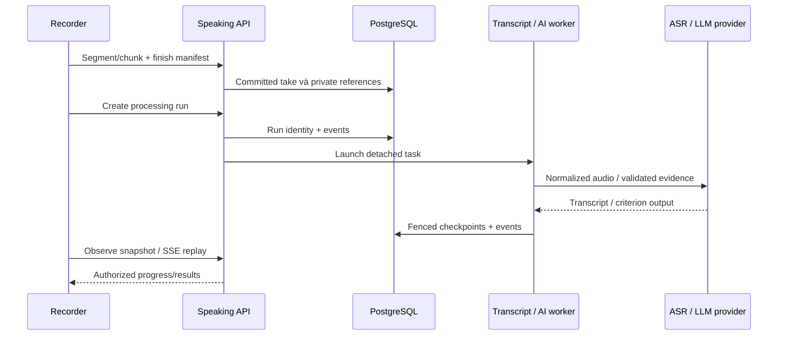

# AI engineering: Writing, Speaking và provider boundaries

> Mục đích và phạm vi: Pipeline hiện có, worker durability, benchmark và giới hạn advisory.
> Đối chiếu mã nguồn tại `aca8e0418a56e44d7e06f370ba5f3ebe5bf41778`. Đây là kiểm tra tĩnh; không xác nhận trạng thái deployment đang chạy.

## Ba lớp phải phân biệt

1. **Domain orchestration**: service kiểm quyền, snapshot dữ liệu, tạo run/cache identity.
2. **Provider transport**: adapter gọi model API; backend validation kiểm output trước lưu.
3. **Inference hosting**: API ngoài hoặc GPU Modal khởi tạo model/cache. Không phải Web CPU.

Nguồn chuẩn cho thuật toán Writing là [ai-writing](../ai-writing.md); Speaking là [ai-speaking](../ai-speaking.md) và [binding spec](../superpowers/specs/2026-10-11-speaking-engine-ai-grading-design.md). Handbook giải thích cách nối các lớp, không sao chép toàn bộ prompt/rubric.

## Capability và cấu hình

| Pipeline | Implementation | Config names / trạng thái |
| --- | --- | --- |
| Task 2 text-only multi-trait | `mts_writing.py`, Writing provider factory | `AI_WRITING_ENABLED`, `AI_WRITING_PROVIDER`, `AI_WRITING_VLLM_BASE_URL`, `AI_WRITING_VLLM_MODEL`; optional |
| Task 1 visual + text | `task1_writing.py`, grounding/claims/facts services | Cùng transport, visual contracts riêng |
| Chart specialist | DePlot adapter và Modal function | `AI_WRITING_CHART_SPECIALIST_ENABLED`, `AI_WRITING_DEPLOT_BASE_URL`; optional, fail-open specialist |
| ASR (speech to text) | Local faster-whisper / Modal adapter | `SPEAKING_ASR_ENABLED`, `SPEAKING_ASR_PROVIDER`, `SPEAKING_ASR_BASE_URL` |
| Speaking grading | configured Speaking LLM + evidence | `SPEAKING_AI_ENABLED`, `SPEAKING_AI_PROVIDER`, `SPEAKING_AI_MODEL` |
| Web-level feature gate | Modal runtime config | `IELTS_WEB_AI_ENABLED` quyết định bật grader; ASR cấu hình riêng |

Provider factory cũng hỗ trợ `openai`; model name/base URL configurable. Model mặc định deploy vLLM: `mistralai/Ministral-3-8B-Instruct-2512`; Modal ASR dùng `Systran/faster-whisper-large-v3`, optional specialist `google/deplot`. Các tên này là source default, không chứng minh provider hiện được deploy. Credentials chỉ ở backend Secrets/env, không frontend. [Settings](../../backend/app/core/config.py), [provider factories](../../backend/app/providers/), [deploy](../../deploy/modal/).

## Writing Task 2

Bài textarea giữ nguyên nội dung; source IDs như P1S1 map về original spans để feedback trích đúng câu. Pipeline hiện hành mỗi criterion: **score-only → evidence selection → structured feedback**; nhận điểm hợp lệ rồi checkpoint trước khi sinh feedback. TR chờ relevance gate; CC/LR/GRA độc lập, không truyền điểm lẫn nhau. Relevance chỉ short-circuit TA/TR khi wholly-unrelated + high confidence; lỗi auxiliary fail-open, không mặc định phạt bài.

Bounded concurrency trong `writing_execution.py` hạn chế provider calls; không giữ transaction DB khi chờ inference. Output JSON/schema, finish reason, band và source IDs được kiểm tra. Repair có giới hạn theo stage; không vòng lặp đến khi model đưa điểm mong muốn. Feedback thất bại vẫn giữ điểm checkpoint hợp lệ. Không fine-tune hay tự calibration online từ nhãn benchmark.

## Writing Task 1

Primary visual grounding đọc ảnh trước; claim extraction/verification, facts và optional chart specialist hỗ trợ TA. Ngữ liệu CC/LR/GRA không cần chờ toàn bộ TA pipeline. TA flow giữ evidence → score-only → feedback, khác Task 2. Grounding unusable phải thể hiện failure/giới hạn, không bịa dữ liệu biểu đồ. DePlot chỉ một nguồn kiểm tra bổ sung và có thể fail-open; không tự thay mọi visual family bằng bảng số.

Xem [Writing module](../modules/writing.md), [latency experiment](../enhance_latency.md), [Task 1 benchmark protocol](../../benchmarks/writing_task1/README.md), [Task 2 protocol](../../benchmarks/writing_task2/README.md).

## Speaking

FFmpeg chuẩn hóa audio trước ASR. Transcript VERBATIM/CLEAN, word timings và quality/fluency/pronunciation evidence có fingerprint; recording thay đổi không tái dùng transcript cũ. PR cần acoustic evidence, không chấm pronunciation chỉ từ văn bản. Pitch/energy/alignment là proxy có giới hạn, không chứng minh phoneme accuracy hay giám khảo tương đương.

Run input loại scratch notes, raw paths và superseded takes. Human final FC/LR/GRA/PR là mutation riêng; AI result không tự thành official score. [Recording](../speaking-recording.md), [transcription](../speaking-transcription.md), [grading](../speaking-grading.md).

## Background jobs và durability

**Detached task** là asyncio task không phụ thuộc thời gian HTTP observer sống. PostgreSQL giữ run/event checkpoints; process memory giữ task đang chạy. Đây không phải một queue service triển khai riêng. Speaking dùng heartbeat + lease token để fencing: worker cũ không được ghi sau khi worker mới tiếp quản. Startup recover Speaking runs; Writing có stale-run recovery qua service/read paths. Không hứa exactly-once provider invocation khi process chết giữa call và commit.

SSE là **Server-Sent Events**, luồng một chiều từ server tới client; sequence IDs phục vụ replay/reconnect. Observer đóng tab chỉ dừng đọc, explicit cancel mới dừng job theo policy. Nginx buffering off được giữ cho streaming. Worker shutdown và [main lifespan](../../backend/app/main.py) phối hợp stop/cleanup; không tự khởi động mọi AI run trên mỗi page load.

## Model initialization, cost và đánh giá

[Writing serving config](../../deploy/modal/writing_llm_config.py) có profile cost/interactive và bounded sequences; [ASR deploy](../../deploy/modal/speaking_asr.py) load model một lần mỗi container, model cache Volume khác candidate audio. **Cold start** gồm cấp container và nạp model; warm call tái dùng model. Giữ GPU warm giảm startup nhưng tăng chi phí idle; không chữa queue HTML bằng tăng GPU.

Benchmark bank lưu human labels riêng, export để so sánh offline; labels không vào production prompt. Metrics cần phân biệt score agreement, error/coverage và latency; synthetic tests chỉ xác nhận contract, không xác nhận chấm chính xác. Không tự chạy inference khi đọc guide này. Chưa có chứng cứ production-wide examiner agreement, bias fairness đầy đủ hoặc chi phí mỗi học sinh ổn định. [Benchmark bank](../writing-benchmark-bank.md), [AI module tests](../modules/writing.md), [Speaking tests](../modules/speaking.md).
