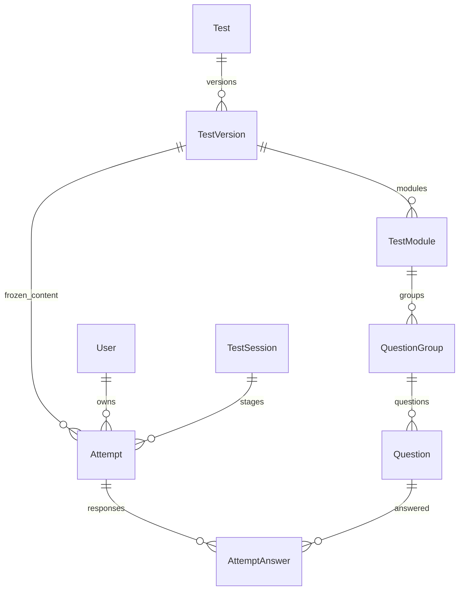
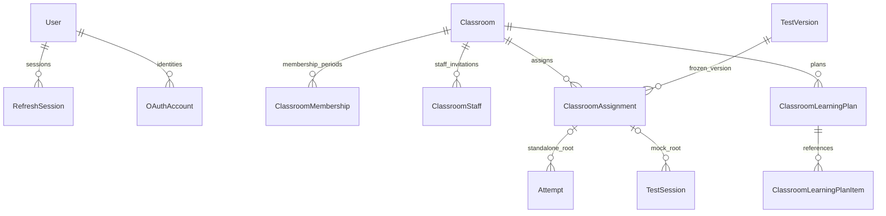

# Data architecture và transaction boundaries

> Mục đích và phạm vi: Mô hình PostgreSQL, định danh, tính nhất quán và migration.
> Đối chiếu mã nguồn tại `aca8e0418a56e44d7e06f370ba5f3ebe5bf41778`. Đây là kiểm tra tĩnh; không xác nhận trạng thái deployment đang chạy.

## Authority, keys và cấu trúc

PostgreSQL là **source of truth**: nơi quyết định user có quyền gì, attempt đã kết thúc chưa, đáp án nào đã lưu và điểm nào là final. UUID là identity, số câu và vị trí là presentation metadata. SQLAlchemy models tách core entities và domain-specific files; [models index](../../backend/app/models/__init__.py) đăng ký model, [Alembic env](../../backend/alembic/env.py) dùng metadata đó.

[Database factory](../../backend/app/core/database.py) tạo async engine với `pool_pre_ping=True`, `expire_on_commit=False`. Code không cấu hình một pool cực lớn. `AsyncSession` là unit of work (phạm vi thay đổi), service mở transaction `session.begin()`; router không tự commit từng hàng. Các kiểm tra/locks và writes cùng operation dùng cùng session.

## Nội dung và lịch sử

Diagram chỉ biểu diễn các quan hệ chính, không thay DDL. [entities.py](../../backend/app/models/entities.py) chứa `Test`, `TestVersion`, `TestModule`, `QuestionGroup`, `Question`, `Attempt`, `TestSession`, answer/score/highlight/asset models. QuestionGroup có thể gắn passage/Listening part; Writing/Speaking dùng authored task/prompt thay objective Question.

Unique `(test_id, version_number)` và các index lifecycle phối hợp service locks; published version không được sửa qua service. Thay đổi đề tạo draft mới, lịch sử attempt vẫn trỏ bản frozen. Đừng diễn giải thành mọi cột lifecycle của row đều không thể đổi: publish/archive là transition hợp lệ; **authored content** là phần bất biến. Referential integrity dùng FK với CASCADE/RESTRICT/SET NULL tùy retention, không một quy tắc xóa chung.

`AttemptAnswer` duy nhất theo attempt/question, Writing response/score theo attempt/task. Revision phát hiện stale writes; replay cùng payload có semantics riêng. Parent TestSession phải lock trước child Attempt để tránh deadlock; xem [concurrency evidence](../concurrency-audit.md). Timer dùng timestamp và pause accounting, không đếm số lần client interval chạy.

## Identity, lớp và provenance

[Classroom models](../../backend/app/models/classroom.py), [staff](../../backend/app/models/classroom_staff.py), [learning plans](../../backend/app/models/classroom_learning.py) và [scheduling](../../backend/app/models/assignment_scheduling.py) lưu thời điểm membership, policy events và typed capabilities. Assignment provenance (nguồn gốc bài giao) là quyền truy cập kết quả, không suy ra từ trùng student/test.

Full Mock giữ assignment ở TestSession; standalone giữ ở Attempt, child mock không giữ cả hai. Composite FKs của classwork/learning-plan ngăn liên kết xuyên lớp. Constraint không thay authorization: foreign key đúng vẫn có thể là đối tượng người gọi không được xem.

## JSONB có cấu trúc và score provenance

**JSONB** là JSON được PostgreSQL lưu có cấu trúc. Dùng cho cấu hình/layout question, response và AI result/evidence biến thể; Pydantic/Zod và registry kiểm tra schema. Quan hệ identity/ownership/version/attempt vẫn normalize thành bảng/FK để join và constrain. Không tìm thấy vector column hoặc pipeline RAG trong models/providers được kiểm tra.

`AttemptWritingScore` và `AttemptSpeakingScore` là human final; AI runs/events nằm ở bảng riêng. Gradebook dùng native objective scores và human final subjective scores; thiếu điểm là null/pending, không phải 0. Snapshot focused Writing advisory không cập nhật final score. [Grading policy](../../backend/app/services/grading_policy.py), [classroom grade resolver](../../backend/app/services/classroom_grades.py).

## Database và binary storage không atomic chung

**Atomicity** nghĩa là các writes trong một database transaction cùng thành công hoặc rollback. Blob write ra filesystem/S3 không tham gia transaction đó.

Ví dụ Builder upload: bounded staging ghi file → lock actor/test/version → kiểm tra draft còn mutable → tạo Asset metadata → commit. Nếu publish thắng lock, upload phải từ chối và bù trừ file do operation tạo. Nếu DB đã commit nhưng kết nối mất trước acknowledgement, không được xóa file dựa riêng vào exception.

[compensate_files](../../backend/app/services/asset_cleanup.py) mở session kiểm tra mới sau transaction, tìm durable references của Asset, TestCover, Speaking chunk/normalized media, ClassroomResource, benchmark image. Chỉ xóa path không còn reference. Nếu DB không xác định được outcome, giữ file và báo reconciliation; orphan tạm thời tốt hơn mất file đã commit. Đây là **compensation**, không phải distributed transaction.

Transfer validate graph/checksum trước persistence, remap IDs và lưu trong transaction; failed import dùng compensation tương tự. ZIP transfer chỉ mang content, không backup attempts/users. [Transfer contract](../TEST_TRANSFER_FORMAT.md).

Backup cần write-free maintenance window giữa DB snapshot và object inventory; kiểm checksum không tự chứng minh snapshot đồng thời nếu writer vẫn chạy. Portable restore dùng destination riêng, xác minh bytes trước reconcile DB và completion marker. [Backup runbook](../storage-backup-restore.md), [migration](../storage-migration.md). Provider switch không copy dữ liệu.

## Migration và giới hạn

[Versions](../../backend/alembic/versions/) là lịch sử schema; head source hiện `20261028_0043` (test covers). DDL không được edit trực tiếp trên production để đi vòng Alembic. Kiểm tra upgrade trên database rỗng và bản có dữ liệu đại diện, downgrade có thể chủ động từ chối retained history. Không suy từ source head rằng database local/cloud đã migrate.

Nguồn và tài liệu liên quan: [modules](module-catalog.md), [storage](../modules/assets-transfer.md), [attempt lifecycle](../modules/attempts.md). Audit này không kiểm tra dữ liệu thật, execution plan SQL, integrity toàn bộ DB hay restore drill trực tiếp.
