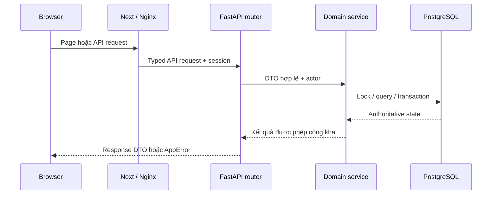
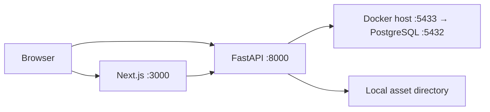
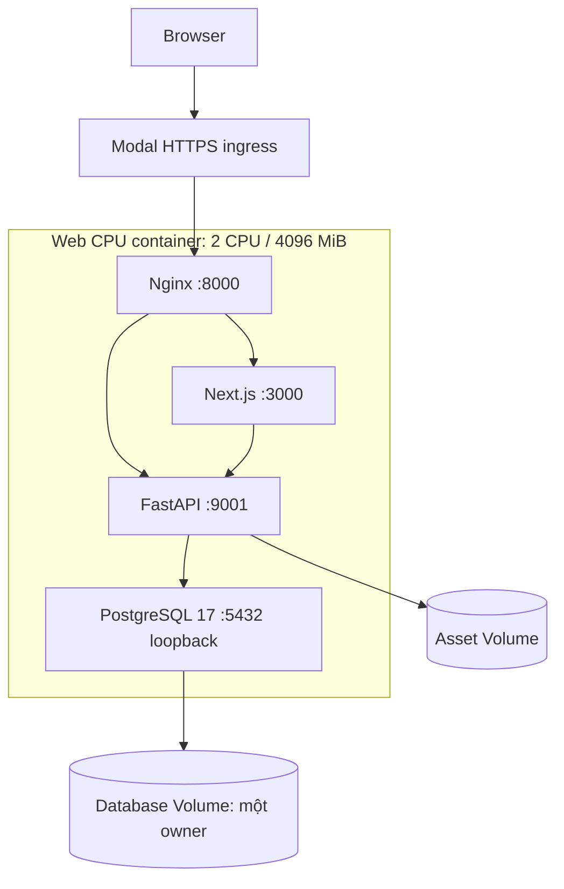
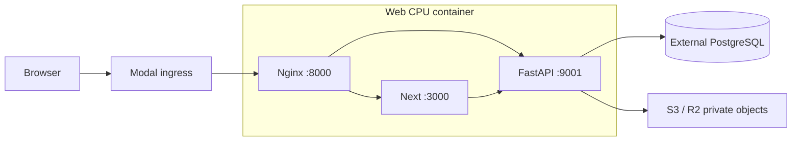
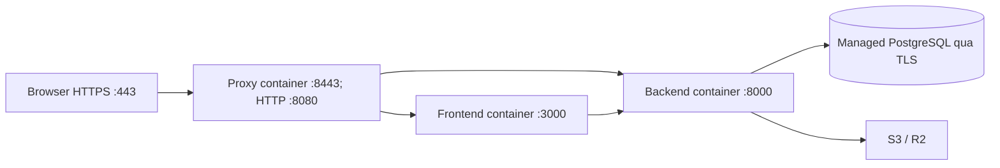
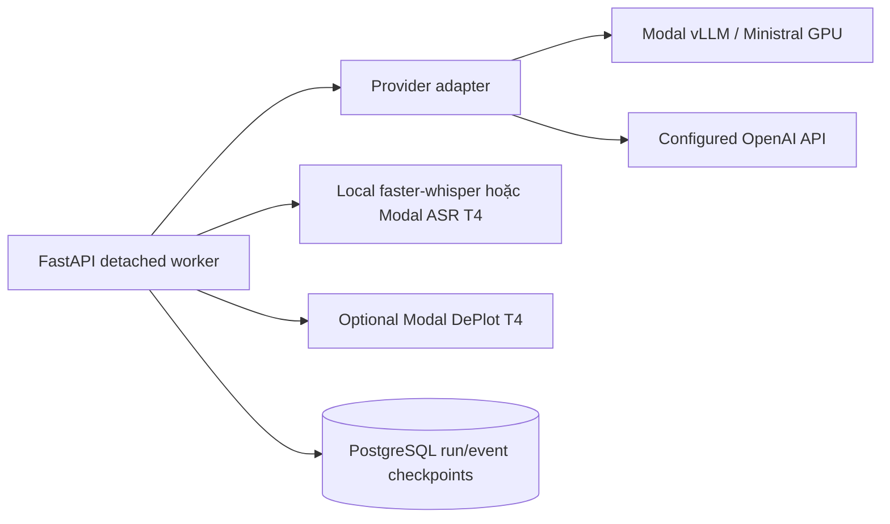

# Runtime architecture: tiến trình và đường đi request

> Mục đích và phạm vi: Phân biệt năm topology hiện có, request lifecycle và failure boundaries.
> Đối chiếu mã nguồn tại `aca8e0418a56e44d7e06f370ba5f3ebe5bf41778`. Đây là kiểm tra tĩnh; không xác nhận trạng thái deployment đang chạy.

## Một request đi qua đâu?

**Reverse proxy** là tiến trình chuyển request đến upstream thích hợp: Nginx gửi `/api/` vào FastAPI, còn page/static sang Next.js. Next App Router dùng server components cho dữ liệu/guard phía server và client components cho input, recording, trạng thái tương tác. Browser clients gửi cookie với `credentials: include`; server clients dùng cấu hình API nội bộ và forward cookie theo contract. Cả hai trả lỗi có cấu trúc `ApiError`, không kết nối database.

Repositories chứa query tái sử dụng; service có thể query nhỏ trực tiếp. SQLAlchemy `AsyncSession` thuộc operation, không chia một session qua các worker provider đồng thời. Workers AI dùng session ngắn riêng cho checkpoint. Không có message broker Celery/Redis được xác nhận trong dependency và entrypoint hiện tại.

## 1. Local development

Nguồn: [root scripts](../../package.json), [dev backend launcher](../../scripts/dev_backend.py), [Compose](../../docker-compose.yml), [client](../../frontend/src/lib/api/client.ts), [server client](../../frontend/src/lib/api/server-client.ts). `npm run dev` dùng concurrently; Windows launcher quản lý cây process riêng. Default browser API là localhost:8000/api/v1; hostname/env có thể thay đổi.

## 2. Modal demo: một CPU container

[Web class](../../deploy/modal/app.py) có `max_inputs=8`, `min_containers=1`, `max_containers=1`. **Input concurrency** là số request được nhận cùng lúc; không phải số core hay replica. `WebRuntime` quản lý child processes, kiểm tra readiness, dừng process rồi mới commit Volumes. Dict guard chống đồng thời sở hữu PostgreSQL directory; restart/deploy phải tôn trọng guard. Volume commit không phải transaction commit của PostgreSQL. Đọc [case study](../case-studies/modal-web-performance.md).

## 3. Modal external database/cloud assets

Frozen topology markers và backend Secret phải khớp. Cloud topology bỏ phụ thuộc persistent local Volumes; không init/seed embedded PostgreSQL. Migration database ngoài là operator action riêng. Code vẫn giữ giới hạn một Web container; external DB không tự động bật replicas. [Runtime validation](../../deploy/runtime_config.py), [Modal runbook](../modal-web.md).

## 4. EC2 / Docker template

Chỉ proxy publish host ports 80/443. Container backend/frontend non-root; database CA và TLS certificate được bind read-only; secrets backend không thành build args frontend. `migrate` thuộc Compose tools profile. Nguồn: [compose](../../deploy/aws/compose.yml), [Nginx](../../deploy/aws/nginx.conf), [runbook](../aws-deployment.md). Đây là template, không phải chứng cứ một EC2 đang chạy.

## 5. AI inference riêng

[Writing deploy](../../deploy/modal/writing_llm.py), [ASR](../../deploy/modal/speaking_asr.py), [DePlot](../../deploy/modal/chart_derenderer.py) có lifecycle/model cache riêng. CPU Web không dùng GPU để render HTML. Provider lỗi có thể làm AI run thất bại nhưng không được thay đổi câu trả lời hoặc human final scores.

## Failure boundaries và giới hạn

Modal demo chung container nên CPU/RAM/startup failure ảnh hưởng cả Web/API/DB. AWS tách process/container nhưng vẫn có thể chung một EC2 host; không tự tạo HA. Database transaction không rollback object storage. SSE observer không phải worker; ngắt tab không phải lệnh cancel. Chi tiết: [data](data-architecture.md), [AI](ai-architecture.md), [security/reliability](security-and-reliability.md). Số port trên là cấu hình mặc định của revision đã kiểm tra, không phải kết quả port scan hay runtime discovery.
