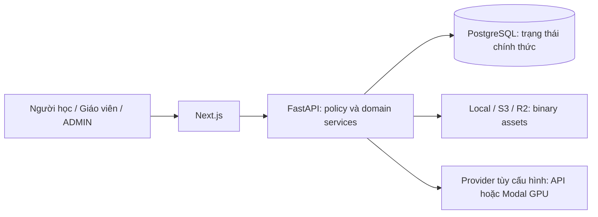

# BandPilot: tổng quan hệ thống

> Mục đích và phạm vi: Hiểu sản phẩm, vai trò, năng lực đã có và giới hạn kiến trúc.
> Đối chiếu mã nguồn tại `aca8e0418a56e44d7e06f370ba5f3ebe5bf41778`. Đây là kiểm tra tĩnh; không xác nhận trạng thái deployment đang chạy.

BandPilot là nền tảng tự luyện IELTS và quản lý hoạt động học tập. Người học làm Reading, Listening, Writing, Speaking; giáo viên biên soạn đề và giao bài; quản trị viên quản lý tài khoản, nội dung và quan sát lớp học. Điểm trong ứng dụng không phải chứng nhận IELTS. Nội dung fixture phải hư cấu.

## Kiến trúc và hành trình

Đây là **modular monolith** — ứng dụng có nhiều module nghiệp vụ nhưng dùng chung FastAPI và PostgreSQL. Tách Next.js thành tiến trình riêng là ranh giới trình bày; tách GPU inference là ranh giới tài nguyên tính toán, chưa biến từng domain thành microservice.

| Hành trình | Chủ sở hữu nghiệp vụ | Điều cần giữ |
| --- | --- | --- |
| Đăng nhập → khôi phục phiên → trang riêng | AuthService và HTTP clients | Cookie/session được backend kiểm tra; UI không cấp quyền |
| Builder → validate → publish → Library | TestService, AccessPolicy, question registries | Published content bất biến; sửa bằng draft mới |
| Practice hoặc Full Mock → autosave → submit → review | AttemptService, TestSessionService | Deadline và correctness ở server; lịch sử giữ phiên bản gốc |
| Ghi âm → transcript → AI → điểm human final | Speaking services/workers | Dữ liệu riêng tư; AI advisory tách khỏi điểm cuối |
| Giao bài → học sinh làm → Gradebook/Analytics | Classroom capabilities và provenance | Không lộ bài luyện cá nhân cùng test cho giáo viên |

## Quyền theo ngữ cảnh

USER có luyện tập, profile, mục tiêu, lớp được mời và lịch sử của mình. TEACHER thêm quyền biên soạn nội dung thuộc mình và sở hữu lớp. ADMIN quản trị tài khoản/Builder/moderation; trong workspace lớp là observer đọc theo capability hiện hành, không được suy ra toàn quyền tham gia/ghi bài lớp. Co-teacher và TA là vai trò theo lớp, không phải role toàn cục. Xem [Identity](../modules/identity.md), [Classroom](../modules/classrooms.md) và [Administration](../modules/administration.md).

## Trạng thái năng lực

| Năng lực | Trạng thái từ code | Giới hạn |
| --- | --- | --- |
| Bốn kỹ năng, Full Mock, focused practice | Implemented | Scope/điểm/đồng hồ khác nhau, không tự quy đổi bài nhỏ thành band đầy đủ |
| Builder, moderation, ZIP transfer, draft import | Implemented | Import có cấu trúc; không có OCR tích hợp |
| Classwork, feed, staff, scheduling, Gradebook, learning plans | Implemented | Reminder định kỳ cần host scheduler; invitation không tự gửi email |
| Writing/Speaking AI, ASR, DePlot | Optional/configuration-dependent | Không chạy được chỉ nhờ có UI; model/provider/credentials phải hợp lệ |
| Local, S3/R2, Modal, EC2 templates | Implemented, vận hành phụ thuộc cấu hình | Không đồng nghĩa đã nghiệm thu production cloud/IAM/DR |
| Recommendation lớp | Implemented deterministic rules | Không phải machine learning personalization, RAG hay band prediction |
| Vector search / pgvector / RAG | Không thấy implementation trong models/providers/routers đã kiểm tra | Không được trình bày như tính năng đang hoạt động |

## Local và deployed

Local dùng hai tiến trình Next/FastAPI và PostgreSQL Docker. Modal demo gom Nginx, Next, FastAPI, PostgreSQL vào một CPU container; model AI dùng function khác. AWS template tách proxy/frontend/backend thành container riêng và dùng database ngoài. [Runtime](runtime-architecture.md) là bản đồ tiến trình; [Infrastructure](infrastructure.md) dẫn tới runbook thao tác.

Giới hạn: source review không cho biết số người dùng, throughput production hay chất lượng model ngoài dữ liệu benchmark. Không suy ra SLA từ test pass. Nguồn: [architecture boundaries](../architecture.md), [models](../../backend/app/models/), [router composition](../../backend/app/api/v1/router.py), [AGENTS](../../AGENTS.md). Tiếp theo: [module catalog](module-catalog.md).
