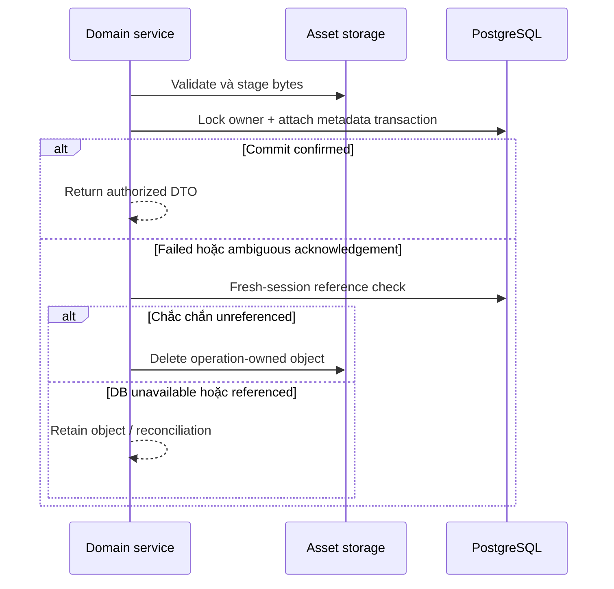

# Asset storage, transfer, migration và recovery

> Mục đích và phạm vi: Giữ bytes ngoài PostgreSQL, truy cập riêng tư và chuyển nội dung/dữ liệu có kiểm chứng.
> Đối chiếu mã nguồn tại `aca8e0418a56e44d7e06f370ba5f3ebe5bf41778`. Đây là kiểm tra tĩnh; không xác nhận trạng thái deployment đang chạy.

## A–C. Mục đích, workflow và ownership

Giữ bytes ngoài PostgreSQL, truy cập riêng tư và chuyển nội dung/dữ liệu có kiểm chứng.

Builder upload audio/image/cover; Speaking gửi private chunks; Classroom upload resources; benchmark bank giữ ảnh. Download qua FastAPI authorized media. ADMIN Transfer export/import ZIP đề. Operator backup/migrate/restore chạy riêng trong maintenance window.

AssetStorage interface/factory chọn local/s3/r2; domain service kiểm quyền/metadata. Delivery đọc bounded ranges. TransferService sở hữu validation/DB transaction/compensation; migration/recovery tools là operator workflow, không tự động đổi backend.

## D. Implementation map

| Lớp | Source |
| --- | --- |
| Pages/clients | [frontend/src/app/transfer/page.tsx](../../frontend/src/app/transfer/page.tsx); [frontend/src/features/transfer/](../../frontend/src/features/transfer/); [frontend/src/lib/api/assets.ts](../../frontend/src/lib/api/assets.ts); [frontend/src/lib/api/transfer.ts](../../frontend/src/lib/api/transfer.ts) |
| Router/schema | [backend/app/api/v1/assets.py](../../backend/app/api/v1/assets.py); [backend/app/api/v1/transfer.py](../../backend/app/api/v1/transfer.py); [backend/app/schemas/assets.py](../../backend/app/schemas/assets.py); [backend/app/schemas/transfer.py](../../backend/app/schemas/transfer.py); [backend/app/schemas/draft_import.py](../../backend/app/schemas/draft_import.py) |
| Services/storage | [backend/app/services/asset_access.py](../../backend/app/services/asset_access.py); [backend/app/services/asset_uploads.py](../../backend/app/services/asset_uploads.py); [backend/app/services/asset_cleanup.py](../../backend/app/services/asset_cleanup.py); [backend/app/services/test_covers.py](../../backend/app/services/test_covers.py); [backend/app/services/transfer.py](../../backend/app/services/transfer.py); [backend/app/services/transfer_ids.py](../../backend/app/services/transfer_ids.py); [backend/app/storage/](../../backend/app/storage/) |
| Models/tools | [backend/app/models/entities.py](../../backend/app/models/entities.py); [backend/app/backup_restore.py](../../backend/app/backup_restore.py); [backend/app/import_draft.py](../../backend/app/import_draft.py); [scripts/backup.py](../../scripts/backup.py); [scripts/restore.py](../../scripts/restore.py); [scripts/migrate_asset_storage.py](../../scripts/migrate_asset_storage.py) |
| Tests | [backend/tests/test_transfer.py](../../backend/tests/test_transfer.py); [backend/tests/test_transfer_cross_storage.py](../../backend/tests/test_transfer_cross_storage.py); [backend/tests/test_asset_access.py](../../backend/tests/test_asset_access.py); [backend/tests/test_backup_restore.py](../../backend/tests/test_backup_restore.py); [frontend/tests/transfer-api.test.ts](../../frontend/tests/transfer-api.test.ts) |

## E–F. Data flow và API contracts

Các đường dẫn sau dùng prefix `/api/v1`; DTO, dependency và response model ở router được dẫn trong bảng. [Source map](../handbook/source-map.md) liệt kê toàn bộ route cùng khai báo gốc.

- `POST /assets/images`
- `POST /assets/question-images`
- `POST /assets/audio`
- `GET /assets/{asset_id}/content`
- `POST /tests/{test_id}/cover`
- `GET /tests/{test_id}/cover/{cover_id}/content`
- `POST /transfer/export`
- `POST /transfer/import`

## G. Persistence

Asset/TestCover và domain-specific key fields tham chiếu opaque paths; bytes ở local filesystem hoặc S3-compatible storage. PostgreSQL foreign keys lưu ownership, object store không hiểu permission. Cloud switch không thay key semantics và không copy bytes.

## H. Business rules

Factory duy nhất, cloud misconfiguration fail closed. SDK blocking I/O chạy ngoài event loop. Export không chứa attempts/user audio; schema v1 không cover, v2 thêm cover của Test; import accept cả hai và remap UUID/structured references. ZIP checksum chỉ integrity, không xác nhận bản quyền.

## I. Security

Authorize trước media/range access; key/path traversal và archive expansion có limits. Download private/no-store theo delivery contract. Không đưa bucket URL/credentials vào DTO. CLI owner explicit, không fake actor bằng userId từ client.

## J. Failure và recovery

Write trước attach có compensation kiểm durable references sau ambiguous commit. DB outage thì giữ bytes để reconciliation. Backup cần freeze writers, verify hashes và isolated restore. Kill process/cross-store outage không được gọi atomic rollback; cleanup outbox/reconcile có giới hạn.

## K. Focused testing

Cross-storage export/import, image/cover/private media ports, range/authorization, malicious ZIP/checksum/graph, lost-ack/cancellation, migration/recovery dry-run và isolated DB tests. Fake S3/Stubber xác nhận adapter contract nhưng không live IAM/bucket durability.

## L. Extension guide

Thêm asset-backed feature: chọn metadata owner, typed key, upload validation, authorize read, compensation reference query, deletion/cleanup, transfer/migration inventory và backup. Không chỉ thêm upload button; thiếu inventory làm restore mất dữ liệu.

## M. Giới hạn

Local Modal Volume durability không immediate snapshot guarantee. Cloud/live DR chưa được audit này chạy. Draft import là cấu trúc JSON từ ngoài, không OCR. Transfer package không phải full database backup.

## N. Câu hỏi phỏng vấn

**1. Vì sao file ngoài DB?** Tách binary I/O/lifecycle khỏi relational transactions; đổi lại phải xử lý consistency bằng compensation.

**2. Tại sao không xóa file khi commit trả lỗi?** DB có thể đã commit trước khi mất acknowledgement; cần kiểm reference trước xóa.

**3. Migration khác provider switch?** Migration copy/verify bytes; switch chỉ đổi selector, không đảm bảo dữ liệu tồn tại đích.

## Tài liệu liên quan

[Storage contract](../storage-architecture.md), [Transfer format](../TEST_TRANSFER_FORMAT.md), [Draft format](../draft-import-format.md), [migration](../storage-migration.md), [backup](../storage-backup-restore.md).
