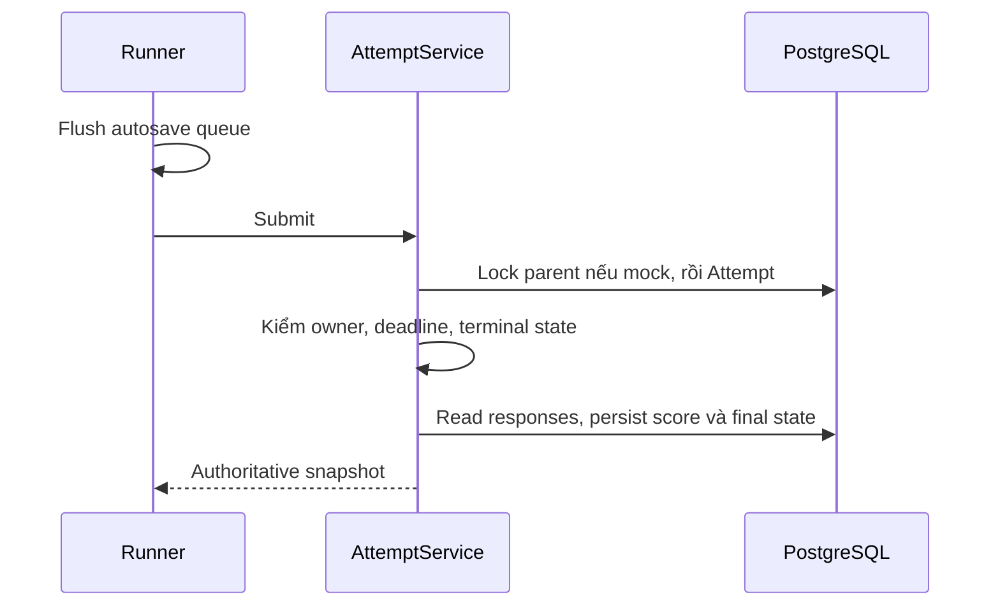

# Attempts, Full Mock, timers và history

> Mục đích và phạm vi: Giữ lifecycle bài làm nhất quán qua reload, cạnh tranh autosave và nhiều kỹ năng.
> Đối chiếu mã nguồn tại `aca8e0418a56e44d7e06f370ba5f3ebe5bf41778`. Đây là kiểm tra tĩnh; không xác nhận trạng thái deployment đang chạy.

## A–C. Mục đích, workflow và ownership

Giữ lifecycle bài làm nhất quán qua reload, cạnh tranh autosave và nhiều kỹ năng.

Practice tạo Attempt theo full/focused scope; Full Mock tạo TestSession rồi mỗi stage khi advance. Người học hoạt động, pause/resume khi policy cho phép, autosave và submit. History dùng finalized state và provenance để tiếp tục/review/xóa đúng loại.

AttemptService sở hữu mutation và finalization; TimerService tính thời gian; TestSessionService điều phối thứ tự. Speaking có prompt deadline/recovery riêng nhưng vẫn thuộc Attempt. Frontend queue và terminal latch bảo vệ UX, backend quyết định cuối.

## D. Implementation map

| Lớp | Source |
| --- | --- |
| Pages/UI | [frontend/src/app/attempt/](../../frontend/src/app/attempt/); [frontend/src/app/test-session/](../../frontend/src/app/test-session/); [frontend/src/app/history/](../../frontend/src/app/history/); [frontend/src/features/exam/](../../frontend/src/features/exam/); [frontend/src/features/history/](../../frontend/src/features/history/) |
| Clients | [frontend/src/lib/api/attempts.ts](../../frontend/src/lib/api/attempts.ts); [frontend/src/lib/api/test-sessions.ts](../../frontend/src/lib/api/test-sessions.ts); [frontend/src/lib/api/history.ts](../../frontend/src/lib/api/history.ts) |
| Backend | [backend/app/api/v1/attempts.py](../../backend/app/api/v1/attempts.py); [backend/app/api/v1/test_sessions.py](../../backend/app/api/v1/test_sessions.py); [backend/app/services/attempts.py](../../backend/app/services/attempts.py); [backend/app/services/test_sessions.py](../../backend/app/services/test_sessions.py); [backend/app/services/attempt_scope.py](../../backend/app/services/attempt_scope.py); [backend/app/repositories/attempts.py](../../backend/app/repositories/attempts.py) |
| Contracts/models | [backend/app/domains/attempts/state_machine.py](../../backend/app/domains/attempts/state_machine.py); [backend/app/domains/timers/service.py](../../backend/app/domains/timers/service.py); [backend/app/schemas/attempts.py](../../backend/app/schemas/attempts.py); [backend/app/models/entities.py](../../backend/app/models/entities.py) |
| Tests | [backend/tests/test_attempt_response_concurrency.py](../../backend/tests/test_attempt_response_concurrency.py); [backend/tests/test_full_mock_sessions.py](../../backend/tests/test_full_mock_sessions.py); [backend/tests/test_concurrency_hardening.py](../../backend/tests/test_concurrency_hardening.py); [frontend/tests/exam-draft-recovery.test.ts](../../frontend/tests/exam-draft-recovery.test.ts); [frontend/tests/attempt-lifecycle.test.ts](../../frontend/tests/attempt-lifecycle.test.ts) |

## E–F. Data flow và API contracts

Các đường dẫn sau dùng prefix `/api/v1`; DTO, dependency và response model ở router được dẫn trong bảng. [Source map](../handbook/source-map.md) liệt kê toàn bộ route cùng khai báo gốc.

- `POST /attempts`
- `POST /attempts/{attempt_id}/activity`
- `POST /attempts/{attempt_id}/pause`
- `POST /attempts/{attempt_id}/resume`
- `POST /attempts/{attempt_id}/submit`
- `POST /test-sessions`
- `POST /test-sessions/{session_id}/advance`
- `GET /history`

## G. Persistence

Attempt stores user/version/module/scope/timestamps/status; Answer/WritingResponse revisions, flags, highlights và AttemptEvent cùng nguồn dữ liệu. TestSession freezes module order. New mocks Listening → Reading → Writing → Speaking; legacy order giữ trong migration/data, không tự thêm stage vào history.

## H. Business rules

Timestamp tính elapsed trừ paused duration; interval chỉ display. Deadline được server kiểm sau lock. Terminal states không reopen. Parent session lock trước child; child module attempt unique. New stage được tạo lazy để timer không chạy trước. Review/key của mock locked tới completion.

## I. Security

Ownership và assignment provenance phải được kiểm cho cả read/mutate/delete. Retained assignment attempts khác personal deletable history; administrative classroom deletion là workflow explicit khác, không dùng nút delete personal để bypass.

## J. Failure và recovery

Client queue flush trước submit; ambiguous save/finalization cần read/reconcile thay gửi vô hạn. Stale revision trả conflict; same committed payload replay có thể idempotent. AFK và timeout do server sync state; không đợi browser báo đúng.

## K. Focused testing

State machine/timer pure tests; PostgreSQL competing connections cho save-submit/deadline-lock/duplicate advance. Frontend revision-autosave, recovery, terminal latch, test-session-transition tests. Không dùng sleep để giả định lock interleaving.

## L. Extension guide

Thêm transition phải cập nhật state machine, service lock/deadline behavior, DTO, UI lifecycle và history/classroom consequences. Đừng tách một đường submit mới cho từng page hoặc tạo Attempt trước khi full-mock stage bắt đầu.

## M. Giới hạn

Offline drafts hỗ trợ khôi phục ngắn hạn, không phải offline-first thi không cần server. Speaking timer không thay được bằng generic countdown. History/analytics bands phụ thuộc đủ human final/score scope.

## N. Câu hỏi phỏng vấn

**1. Tại sao lock parent trước child?** Tránh hai transaction chờ ngược nhau khi advance và submit cùng session.

**2. Tại sao timer ở backend?** Client clock có thể trễ, bị sửa hoặc tab bị suspend; deadline phải được enforce khi mutation.

**3. Idempotency có nghĩa retry mọi lỗi được không?** Không; chỉ replay đúng identity/payload theo contract, conflict cần reconcile.

## Tài liệu liên quan

[Data](../handbook/data-architecture.md), [concurrency evidence](../concurrency-audit.md), [Speaking](speaking.md).
