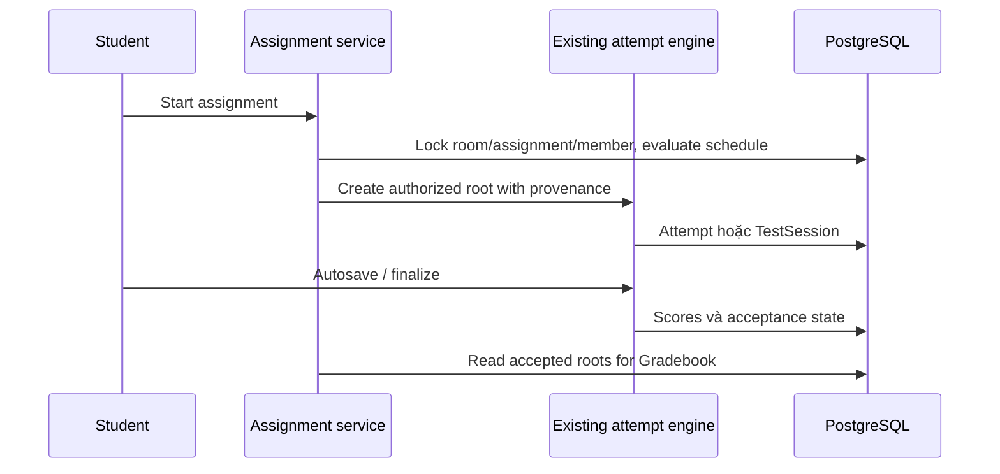

# Classrooms, staff, assignments, content và gradebook

> Mục đích và phạm vi: Quản lý hoạt động học theo lớp bằng capability, immutable content và submission provenance.
> Đối chiếu mã nguồn tại `aca8e0418a56e44d7e06f370ba5f3ebe5bf41778`. Đây là kiểm tra tĩnh; không xác nhận trạng thái deployment đang chạy.

## A–C. Mục đích, workflow và ownership

Quản lý hoạt động học theo lớp bằng capability, immutable content và submission provenance.

Owner tạo lớp, mời học sinh/staff; recipient accept. Stream chứa posts và assignments; Classwork sắp sections/resources/items; Assignments cấu hình lịch/target, học sinh start qua policy. Staff có quyền đọc kết quả và lưu human grade; Gradebook chọn accepted root theo policy. Archive/restore và explicit deletion có lifecycle khác nhau.

Classroom services owns membership/content; scheduling/progress owns availability và accepted decision; capability matrix tách global roles. Attempts/TestSession vẫn là engine thi duy nhất. Gradebook/learning plans không tạo attempt/scoring engine khác.

## D. Implementation map

| Lớp | Source |
| --- | --- |
| Pages/UI | [frontend/src/app/classrooms/](../../frontend/src/app/classrooms/); [frontend/src/app/teacher/classrooms/](../../frontend/src/app/teacher/classrooms/); [frontend/src/features/classrooms/](../../frontend/src/features/classrooms/) |
| Clients | [frontend/src/lib/api/classrooms.ts](../../frontend/src/lib/api/classrooms.ts); [frontend/src/lib/api/classroom-content.ts](../../frontend/src/lib/api/classroom-content.ts); [frontend/src/lib/api/classroom-lms.ts](../../frontend/src/lib/api/classroom-lms.ts); [frontend/src/lib/api/assignment-scheduling.ts](../../frontend/src/lib/api/assignment-scheduling.ts); [frontend/src/lib/api/classroom-results.ts](../../frontend/src/lib/api/classroom-results.ts) |
| Routers/schemas | [backend/app/api/v1/classrooms.py](../../backend/app/api/v1/classrooms.py); [backend/app/api/v1/classroom_assignments.py](../../backend/app/api/v1/classroom_assignments.py); [backend/app/api/v1/classroom_classwork.py](../../backend/app/api/v1/classroom_classwork.py); [backend/app/api/v1/classroom_posts.py](../../backend/app/api/v1/classroom_posts.py); [backend/app/api/v1/classroom_lms.py](../../backend/app/api/v1/classroom_lms.py); [backend/app/schemas/classroom_assignments.py](../../backend/app/schemas/classroom_assignments.py); [backend/app/schemas/assignment_scheduling.py](../../backend/app/schemas/assignment_scheduling.py) |
| Services | [backend/app/services/classroom_capabilities.py](../../backend/app/services/classroom_capabilities.py); [backend/app/services/classroom_assignments.py](../../backend/app/services/classroom_assignments.py); [backend/app/services/classroom_posts.py](../../backend/app/services/classroom_posts.py); [backend/app/services/classroom_classwork.py](../../backend/app/services/classroom_classwork.py); [backend/app/services/assignment_policy.py](../../backend/app/services/assignment_policy.py); [backend/app/services/assignment_progress.py](../../backend/app/services/assignment_progress.py); [backend/app/services/classroom_grades.py](../../backend/app/services/classroom_grades.py); [backend/app/services/classroom_deletion.py](../../backend/app/services/classroom_deletion.py) |
| Repositories/models | [backend/app/repositories/classroom_grades.py](../../backend/app/repositories/classroom_grades.py); [backend/app/repositories/assignment_progress.py](../../backend/app/repositories/assignment_progress.py); [backend/app/models/classroom.py](../../backend/app/models/classroom.py); [backend/app/models/classroom_staff.py](../../backend/app/models/classroom_staff.py); [backend/app/models/classroom_classwork.py](../../backend/app/models/classroom_classwork.py); [backend/app/models/classroom_posts.py](../../backend/app/models/classroom_posts.py); [backend/app/models/assignment_scheduling.py](../../backend/app/models/assignment_scheduling.py) |
| Tests | [backend/tests/test_classroom_admin_observer_rest.py](../../backend/tests/test_classroom_admin_observer_rest.py); [backend/tests/test_classroom_staff_gradebook.py](../../backend/tests/test_classroom_staff_gradebook.py); [backend/tests/test_assignment_scheduling.py](../../backend/tests/test_assignment_scheduling.py); [frontend/tests/classroom-lms.test.tsx](../../frontend/tests/classroom-lms.test.tsx); [frontend/tests/classroom-content.test.tsx](../../frontend/tests/classroom-content.test.tsx) |

## E–F. Data flow và API contracts

Các đường dẫn sau dùng prefix `/api/v1`; DTO, dependency và response model ở router được dẫn trong bảng. [Source map](../handbook/source-map.md) liệt kê toàn bộ route cùng khai báo gốc.

- `POST /classrooms`
- `POST /classrooms/{classroom_id}/invitations`
- `POST /classroom-invitations/{invitation_id}/accept`
- `GET /classrooms/{classroom_id}/classwork`
- `GET /classrooms/{classroom_id}/feed`
- `POST /classroom-assignments/{assignment_id}/start`
- `GET /classrooms/{classroom_id}/gradebook`
- `GET /classrooms/{classroom_id}/gradebook/export`

## G. Persistence

Classroom has teacher_id owner; memberships retain periods. Staff rows retain invitation/capability flags/events. Assignments refer frozen TestVersion; policy/extension events preserve historical acceptance. Section/resource/item composite FKs prevent cross-classroom placements. Post/comment/feed data remain separate from authored exam content.

## H. Business rules

Owner/co-teacher/TA capability hiện hành, ADMIN observer không tham gia/mutate lớp theo vai trò admin. Student chỉ own progress; staff score policies FIRST/LATEST/BEST_ACCEPTED chọn root có provenance, mixed contexts không rank bừa. Missing human grade là pending/null. Schedule due/cutoff, extension và root-start limits do backend quyết định. Reminders là CLI định kỳ cần host scheduler.

## I. Security

Assignment result không được query bằng student + version để lộ personal practice. Student nhìn published content và published section; file URL kiểm lại quyền. Notifications không bypass membership. ADMIN vẫn có governance/account quyền riêng nhưng không được suy ra classroom write.

## J. Failure và recovery

Content revision conflict cần refresh/reconcile; feed cursor có stable order/filter binding. Invitation notifications dedup trong transaction. Explicit hard-delete theo classroom service fence jobs, remove dependent records và queue private media cleanup; không xóa shared frozen test content. Archive giữ retained reads, không đồng nghĩa permanent deletion.

## K. Focused testing

Permission matrix owner/co-teacher/TA/student/ADMIN/outsider, hidden section/file, archive/restore, schedule boundaries, concurrent invitation, grade selection, CSV formula safety và removal tests. UI kiểm contextual actions và mobile table overflow, không tự coi ẩn button là security.

## L. Extension guide

Thêm classroom feature phải chọn capability cụ thể, lock room và revision nếu đổi content, schema/client và notification event nếu cần. Nếu gắn bài thi, lưu reference/provenance vào existing assignment engine. Thay accepted-result semantics phải cập nhật cả Gradebook và learning analytics.

## M. Giới hạn

In-app notifications, không email delivery/realtime transport tổng quát. Staff role không cấp global Builder. Những tài liệu P1/P3 cũ nói ADMIN write/deletion unavailable chỉ là phase history, không contract hiện hành.

## N. Câu hỏi phỏng vấn

**1. Capability khác role?** Role toàn cục nói USER/TEACHER/ADMIN; capability là quyền actor trong lớp cụ thể.

**2. Vì sao Full Mock chỉ một root?** Đó là một submission, child attempts chỉ cung cấp skill breakdown; đếm child tạo double-count.

**3. Vì sao không biến AI thành Gradebook score?** Gradebook đòi nguồn final có authority, AI advisory chưa được human xác nhận không đủ.

## Tài liệu liên quan

[Scheduling](../classroom-assignment-scheduling.md), [Gradebook](../classroom-gradebook.md), [workspace](../classroom-workspace.md), [archive/calendar](../classroom-archive-calendar.md), [learning analytics](analytics.md).
