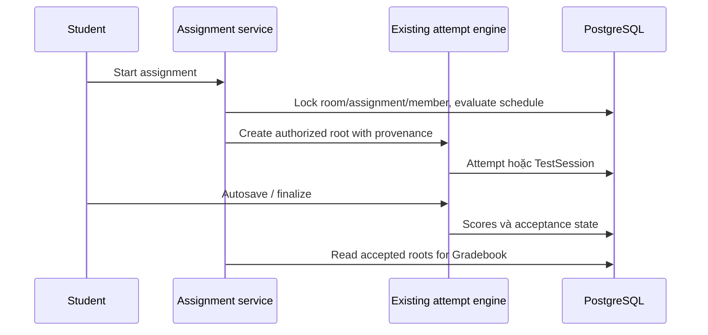

# Lớp học, nhân sự, bài giao, nội dung và sổ điểm

> Mục đích và phạm vi: Quản lý hoạt động học theo lớp bằng quyền thao tác cụ thể, nội dung bất biến và nguồn gốc bài nộp.
> Đối chiếu mã nguồn tại `aca8e0418a56e44d7e06f370ba5f3ebe5bf41778`. Đây là kiểm tra tĩnh; không xác nhận trạng thái triển khai đang chạy.

## A–C. Mục đích, quy trình và phân chia trách nhiệm

Quản lý hoạt động học theo lớp bằng quyền thao tác cụ thể, nội dung bất biến và nguồn gốc bài nộp.

Chủ lớp tạo lớp, mời học sinh/nhân sự; người nhận chấp nhận lời mời. Luồng tin chứa bài đăng và bài giao; Classwork sắp xếp section/tài nguyên/mục; bài giao cấu hình lịch/đối tượng, học sinh bắt đầu theo chính sách. Nhân sự có quyền đọc kết quả và lưu điểm do người chấm; sổ điểm chọn bản ghi gốc được chấp nhận theo chính sách. Lưu trữ/khôi phục và xóa tường minh có vòng đời khác nhau.

Service lớp học quản lý thành viên/nội dung; service lịch/tiến độ quyết định khả dụng và chấp nhận kết quả; ma trận quyền thao tác tách khỏi role toàn cục. Attempts/TestSession vẫn là bộ máy thi duy nhất. Sổ điểm/kế hoạch học không tạo bộ máy attempt/chấm điểm khác.

## D. Bản đồ triển khai

| Lớp | Mã nguồn |
| --- | --- |
| Trang/UI | [frontend/src/app/classrooms/](../../frontend/src/app/classrooms/); [frontend/src/app/teacher/classrooms/](../../frontend/src/app/teacher/classrooms/); [frontend/src/features/classrooms/](../../frontend/src/features/classrooms/) |
| Client API | [frontend/src/lib/api/classrooms.ts](../../frontend/src/lib/api/classrooms.ts); [frontend/src/lib/api/classroom-content.ts](../../frontend/src/lib/api/classroom-content.ts); [frontend/src/lib/api/classroom-lms.ts](../../frontend/src/lib/api/classroom-lms.ts); [frontend/src/lib/api/assignment-scheduling.ts](../../frontend/src/lib/api/assignment-scheduling.ts); [frontend/src/lib/api/classroom-results.ts](../../frontend/src/lib/api/classroom-results.ts) |
| Router/schema | [backend/app/api/v1/classrooms.py](../../backend/app/api/v1/classrooms.py); [backend/app/api/v1/classroom_assignments.py](../../backend/app/api/v1/classroom_assignments.py); [backend/app/api/v1/classroom_classwork.py](../../backend/app/api/v1/classroom_classwork.py); [backend/app/api/v1/classroom_posts.py](../../backend/app/api/v1/classroom_posts.py); [backend/app/api/v1/classroom_lms.py](../../backend/app/api/v1/classroom_lms.py); [backend/app/schemas/classroom_assignments.py](../../backend/app/schemas/classroom_assignments.py); [backend/app/schemas/assignment_scheduling.py](../../backend/app/schemas/assignment_scheduling.py) |
| Service | [backend/app/services/classroom_capabilities.py](../../backend/app/services/classroom_capabilities.py); [backend/app/services/classroom_assignments.py](../../backend/app/services/classroom_assignments.py); [backend/app/services/classroom_posts.py](../../backend/app/services/classroom_posts.py); [backend/app/services/classroom_classwork.py](../../backend/app/services/classroom_classwork.py); [backend/app/services/assignment_policy.py](../../backend/app/services/assignment_policy.py); [backend/app/services/assignment_progress.py](../../backend/app/services/assignment_progress.py); [backend/app/services/classroom_grades.py](../../backend/app/services/classroom_grades.py); [backend/app/services/classroom_deletion.py](../../backend/app/services/classroom_deletion.py) |
| Repository/model | [backend/app/repositories/classroom_grades.py](../../backend/app/repositories/classroom_grades.py); [backend/app/repositories/assignment_progress.py](../../backend/app/repositories/assignment_progress.py); [backend/app/models/classroom.py](../../backend/app/models/classroom.py); [backend/app/models/classroom_staff.py](../../backend/app/models/classroom_staff.py); [backend/app/models/classroom_classwork.py](../../backend/app/models/classroom_classwork.py); [backend/app/models/classroom_posts.py](../../backend/app/models/classroom_posts.py); [backend/app/models/assignment_scheduling.py](../../backend/app/models/assignment_scheduling.py) |
| Kiểm thử | [backend/tests/test_classroom_admin_observer_rest.py](../../backend/tests/test_classroom_admin_observer_rest.py); [backend/tests/test_classroom_staff_gradebook.py](../../backend/tests/test_classroom_staff_gradebook.py); [backend/tests/test_assignment_scheduling.py](../../backend/tests/test_assignment_scheduling.py); [frontend/tests/classroom-lms.test.tsx](../../frontend/tests/classroom-lms.test.tsx); [frontend/tests/classroom-content.test.tsx](../../frontend/tests/classroom-content.test.tsx) |

## E–F. Luồng dữ liệu và hợp đồng API

Các đường dẫn sau dùng tiền tố `/api/v1`; DTO, dependency và model phản hồi nằm ở router được dẫn trong bảng. [Bản đồ mã nguồn](../handbook/source-map.md) liệt kê toàn bộ tuyến cùng khai báo gốc.

- `POST /classrooms`
- `POST /classrooms/{classroom_id}/invitations`
- `POST /classroom-invitations/{invitation_id}/accept`
- `GET /classrooms/{classroom_id}/classwork`
- `GET /classrooms/{classroom_id}/feed`
- `POST /classroom-assignments/{assignment_id}/start`
- `GET /classrooms/{classroom_id}/gradebook`
- `GET /classrooms/{classroom_id}/gradebook/export`

## G. Lưu trữ

Classroom có teacher_id chỉ chủ lớp; quan hệ thành viên giữ các giai đoạn tham gia. Bản ghi nhân sự giữ lời mời/cờ quyền thao tác/sự kiện. Bài giao tham chiếu TestVersion bất biến; sự kiện chính sách/gia hạn giữ lịch sử chấp nhận. Khóa ngoại ghép của section/tài nguyên/mục ngăn đặt nội dung sang lớp khác. Dữ liệu bài đăng/bình luận/luồng tin tách khỏi nội dung đề do tác giả soạn.

## H. Quy tắc nghiệp vụ

Áp dụng quyền hiện hành của chủ lớp/đồng giáo viên/trợ giảng; ADMIN quan sát không tham gia hay sửa lớp bằng role admin. Học sinh chỉ xem tiến độ của mình; chính sách điểm cho nhân sự FIRST/LATEST/BEST_ACCEPTED chọn bản ghi gốc có nguồn gốc xác định, không xếp hạng tùy tiện các ngữ cảnh trộn lẫn. Chưa có điểm người chấm là đang chờ/null. Backend quyết định hạn nộp/hạn đóng, gia hạn và giới hạn số lần bắt đầu bản ghi gốc. Nhắc hạn là CLI định kỳ, cần bộ lập lịch trên host.

## I. Bảo mật

Không truy vấn kết quả bài giao chỉ bằng học sinh + phiên bản để lộ bài luyện cá nhân. Học sinh thấy nội dung và section đã xuất bản; URL tệp kiểm tra lại quyền. Thông báo không bỏ qua kiểm tra thành viên. ADMIN vẫn có quyền quản trị/tài khoản riêng, nhưng không được suy ra quyền ghi lớp học.

## J. Lỗi và khôi phục

Xung đột revision nội dung cần tải lại/đối chiếu; cursor luồng tin có thứ tự ổn định và ràng buộc với bộ lọc. Thông báo lời mời được chống trùng trong transaction. Xóa vĩnh viễn tường minh qua service lớp học chặn job bằng quyền sở hữu, xóa bản ghi phụ thuộc và xếp việc dọn media riêng tư; không xóa nội dung đề bất biến dùng chung. Lưu trữ vẫn giữ quyền đọc dữ liệu được lưu, không đồng nghĩa xóa vĩnh viễn.

## K. Kiểm thử tập trung

Kiểm tra ma trận quyền chủ lớp/đồng giáo viên/trợ giảng/học sinh/ADMIN/người ngoài, section/tệp ẩn, lưu trữ/khôi phục, biên lịch, lời mời đồng thời, chọn điểm, an toàn công thức CSV và xóa. UI kiểm tra hành động theo ngữ cảnh và bảng tràn trên di động, không coi ẩn nút là bảo mật.

## L. Hướng dẫn mở rộng

Thêm tính năng lớp học phải chọn quyền thao tác cụ thể, khóa lớp và kiểm tra revision nếu đổi nội dung, cập nhật schema/client và sự kiện thông báo khi cần. Nếu gắn bài thi, lưu tham chiếu/nguồn gốc vào bộ máy bài giao hiện có. Đổi ngữ nghĩa kết quả được chấp nhận phải cập nhật cả sổ điểm và phân tích học tập.

## M. Giới hạn

Thông báo trong ứng dụng, không có hệ thống gửi email/truyền thời gian thực tổng quát. Role nhân sự không cấp Builder toàn cục. Tài liệu P1/P3 cũ nói ADMIN chưa có quyền ghi/chưa xóa được chỉ mô tả lịch sử giai đoạn, không phải hợp đồng hiện hành.

## N. Câu hỏi phỏng vấn

**1. Quyền thao tác khác role thế nào?** Role toàn cục là USER/TEACHER/ADMIN; quyền thao tác là quyền của một người trong lớp cụ thể.

**2. Vì sao Full Mock chỉ có một bản ghi gốc?** Đó là một bài nộp; attempt con chỉ cung cấp phân tích theo kỹ năng, đếm attempt con sẽ tính trùng.

**3. Vì sao không biến AI thành điểm sổ điểm?** Sổ điểm đòi nguồn điểm cuối có thẩm quyền; AI tham khảo chưa được người chấm xác nhận là chưa đủ.

## Tài liệu liên quan

[Lịch bài giao](../classroom-assignment-scheduling.md), [sổ điểm](../classroom-gradebook.md), [workspace](../classroom-workspace.md), [lưu trữ/lịch](../classroom-archive-calendar.md), [phân tích học tập](analytics.md).
