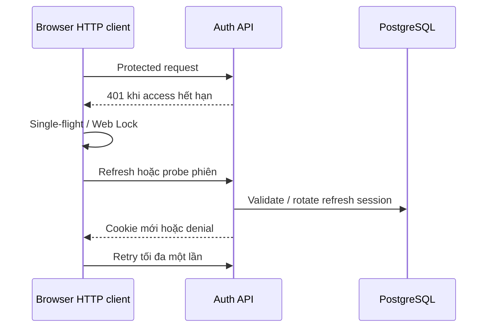

# Identity, accounts, profile và preferences

> Mục đích và phạm vi: Quản lý danh tính, session và tùy chọn tài khoản; tách authentication khỏi quyền truy cập resource.
> Đối chiếu mã nguồn tại `aca8e0418a56e44d7e06f370ba5f3ebe5bf41778`. Đây là kiểm tra tĩnh; không xác nhận trạng thái deployment đang chạy.

## A–C. Mục đích, workflow và ownership

Quản lý danh tính, session và tùy chọn tài khoản; tách authentication khỏi quyền truy cập resource.

Người dùng đăng ký/login local hoặc Google nếu đã cấu hình. AuthForm gọi API, confirmSession rồi đi tới safe destination. Khi access cookie hết hạn, browser HTTP client điều phối refresh; proxy đưa trang cần quyền về `/session/restore`. Profile cập nhật thông tin và mục tiêu; logout thu hồi phiên tương ứng.

AuthService sở hữu password/session; dependencies nạp User hiện hành. AuthProvider giữ trạng thái UI với sessionVersion chống stale responses. Profile/learning-goal services giữ dữ liệu PostgreSQL; personalization provider đồng bộ locale/theme/accent theo tài khoản.

## D. Implementation map

| Lớp | Source |
| --- | --- |
| Pages | [frontend/src/app/login/page.tsx](../../frontend/src/app/login/page.tsx); [frontend/src/app/register/page.tsx](../../frontend/src/app/register/page.tsx); [frontend/src/app/profile/page.tsx](../../frontend/src/app/profile/page.tsx); [frontend/src/app/session/restore/page.tsx](../../frontend/src/app/session/restore/page.tsx) |
| UI/client | [frontend/src/features/auth/](../../frontend/src/features/auth/); [frontend/src/features/personalization/](../../frontend/src/features/personalization/); [frontend/src/lib/api/auth.ts](../../frontend/src/lib/api/auth.ts); [frontend/src/lib/api/profile.ts](../../frontend/src/lib/api/profile.ts); [frontend/src/lib/api/preferences.ts](../../frontend/src/lib/api/preferences.ts); [frontend/src/lib/api/client.ts](../../frontend/src/lib/api/client.ts) |
| Router/schema | [backend/app/api/v1/auth.py](../../backend/app/api/v1/auth.py); [backend/app/api/dependencies.py](../../backend/app/api/dependencies.py); [backend/app/schemas/auth.py](../../backend/app/schemas/auth.py); [backend/app/schemas/preferences.py](../../backend/app/schemas/preferences.py) |
| Service/model | [backend/app/services/auth.py](../../backend/app/services/auth.py); [backend/app/services/preferences.py](../../backend/app/services/preferences.py); [backend/app/services/learning_goals.py](../../backend/app/services/learning_goals.py); [backend/app/models/entities.py](../../backend/app/models/entities.py); [backend/app/models/preferences.py](../../backend/app/models/preferences.py) |
| Tests | [backend/tests/test_auth.py](../../backend/tests/test_auth.py); [backend/tests/test_auth_refresh_concurrency.py](../../backend/tests/test_auth_refresh_concurrency.py); [frontend/tests/auth-session-restore.test.tsx](../../frontend/tests/auth-session-restore.test.tsx) |

## E–F. Data flow và API contracts

Các đường dẫn sau dùng prefix `/api/v1`; DTO, dependency và response model ở router được dẫn trong bảng. [Source map](../handbook/source-map.md) liệt kê toàn bộ route cùng khai báo gốc.

- `POST /auth/register`
- `POST /auth/login`
- `POST /auth/refresh`
- `POST /auth/logout`
- `GET /auth/me`
- `GET /auth/profile`
- `PATCH /auth/profile`
- `POST /auth/change-password`
- `GET /auth/oauth/google/start`
- `GET /auth/oauth/google/callback`
- `GET /me/preferences`
- `PATCH /me/preferences`
- `GET /me/learning-goals`
- `PUT /me/learning-goals`

## G. Persistence

User, OAuthAccount, RefreshSession và UserPreference là entities chính. Password hash scrypt; refresh fingerprint/revocation không dựa vào localStorage. User có bốn skill targets, target_band tính từ đủ kỹ năng và optional target_overall_band riêng cho learning goals; không đồng nhất hai khái niệm.

## H. Business rules

Registration không nhận role đặc quyền. Backend kiểm user active và role hiện hành. Refresh rotation một lần phối hợp row locks; browser retry chỉ một vòng, Web Locks giảm cross-tab races khi hỗ trợ. Cookie secrets không đưa vào DTO.

## I. Security

HttpOnly/Secure/SameSite được cấu hình ở backend. Next safeAuthDestination không chấp nhận redirect tùy ý. Google state và identity xử lý ở AuthService, không tự viết OAuth route khác trong UI.

## J. Failure và recovery

401 được phân biệt với 403 ACCOUNT_INACTIVE và network/server error. Refresh mất acknowledgement probe lại session; AbortSignal/sessionVersion ngăn response tài khoản cũ ghi đè tài khoản mới. Không nuốt transient error thành logout.

## K. Focused testing

Auth backend tests kiểm rotation và ownership; frontend auth, auth-proxy-browser-race, auth-session-restore và personalization tests kiểm redirect/recovery/account switch. Test thay đổi field phải kiểm cả request validation lẫn không đổi role.

## L. Extension guide

Thêm profile field qua schema → User/migration nếu cần → AuthService/profile presentation → typed client → profile UI. Nếu là learning goal, đồng bộ learning_goals thay vì tạo nguồn mục tiêu thứ hai. Không sửa refresh ownership để chữa riêng một màn hình.

## M. Giới hạn

Google optional. Không thấy reset-password hoặc remember-me flow hoàn chỉnh, global rate limiter chưa được xác nhận. Settings mặc định không chứng minh production cookies đang cấu hình an toàn.

## N. Câu hỏi phỏng vấn

**1. Authentication và authorization khác gì?** Session xác định actor; AccessPolicy/capability quyết định actor được tác động resource nào.

**2. Vì sao frontend lock không đủ?** Nhiều browser/process vẫn gọi đồng thời; database rotation/locks mới bảo vệ trạng thái chính thức.

**3. Vì sao không cache user vô hạn?** Role/deactivation có thể đổi; dependency đọc User hiện hành để thu hồi quyền.

## Tài liệu liên quan

[Security](../handbook/security-and-reliability.md), [shared platform](shared-platform.md).
