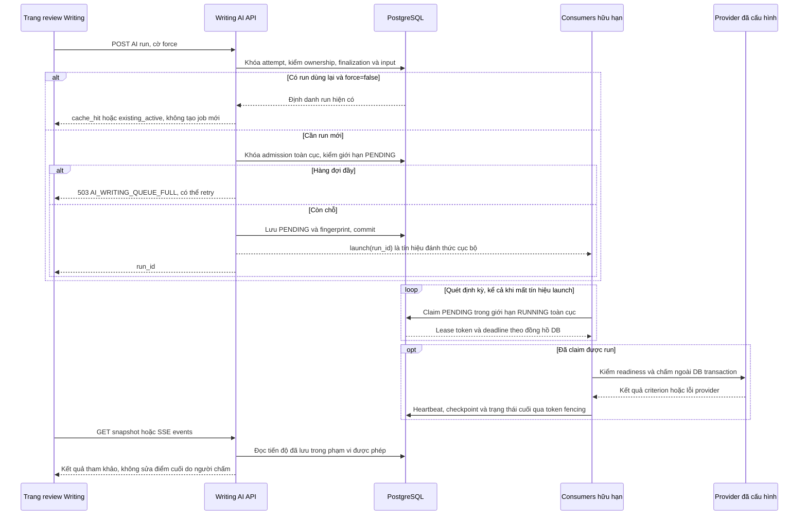

# Writing: bài tác giả soạn, chấm thủ công và AI tham khảo

> Mục đích và phạm vi: Phân biệt bài viết đã lưu, điểm human final và phản hồi AI theo task.
> Đối chiếu mã nguồn tại `aca8e0418a56e44d7e06f370ba5f3ebe5bf41778`. Đây là kiểm tra tĩnh; không xác nhận trạng thái deployment đang chạy.

## A–C. Mục đích, quy trình và phân chia trách nhiệm

Phân biệt bài viết đã lưu, điểm human final và phản hồi AI theo task.

Tác giả tạo Task 1/2 và ảnh nếu cần. Người học viết/autosave từng task, submit rồi review. Người có quyền nhập human criteria; AI assessment là thao tác riêng, có tiến độ/cancel. Focused Writing cho lưu advisory snapshot rõ nguồn run.

WritingService quản lý authored task; AttemptService lưu responses/human scores; WritingAIService và detached worker quản lý run. MTS và Task1 services điều phối provider. Benchmark bank là domain riêng cho ADMIN labels, không gắn nhãn vào production inference.

## D. Bản đồ triển khai

| Lớp | Source |
| --- | --- |
| UI/pages | [frontend/src/features/writing/](../../frontend/src/features/writing/); [frontend/src/features/test-builder/writing-builder.tsx](../../frontend/src/features/test-builder/writing-builder.tsx); [frontend/src/app/admin/writing-benchmark/page.tsx](../../frontend/src/app/admin/writing-benchmark/page.tsx); [frontend/src/features/writing-benchmark/](../../frontend/src/features/writing-benchmark/) |
| Clients | [frontend/src/lib/api/writing-ai.ts](../../frontend/src/lib/api/writing-ai.ts); [frontend/src/lib/api/grading.ts](../../frontend/src/lib/api/grading.ts); [frontend/src/lib/api/writing-benchmark.ts](../../frontend/src/lib/api/writing-benchmark.ts) |
| Router/schema | [backend/app/api/v1/writing.py](../../backend/app/api/v1/writing.py); [backend/app/api/v1/writing_ai.py](../../backend/app/api/v1/writing_ai.py); [backend/app/api/v1/writing_benchmark.py](../../backend/app/api/v1/writing_benchmark.py); [backend/app/schemas/writing_ai.py](../../backend/app/schemas/writing_ai.py); [backend/app/schemas/grading.py](../../backend/app/schemas/grading.py) |
| Services/workers | [backend/app/services/writing.py](../../backend/app/services/writing.py); [backend/app/services/writing_ai.py](../../backend/app/services/writing_ai.py); [backend/app/services/writing_ai_worker.py](../../backend/app/services/writing_ai_worker.py); [backend/app/services/mts_writing.py](../../backend/app/services/mts_writing.py); [backend/app/services/task1_writing.py](../../backend/app/services/task1_writing.py); [backend/app/services/writing_benchmark.py](../../backend/app/services/writing_benchmark.py) |
| Repositories/models | [backend/app/repositories/writing_ai.py](../../backend/app/repositories/writing_ai.py); [backend/app/repositories/writing_benchmark.py](../../backend/app/repositories/writing_benchmark.py); [backend/app/models/writing_ai.py](../../backend/app/models/writing_ai.py); [backend/app/models/writing_benchmark.py](../../backend/app/models/writing_benchmark.py); [backend/app/models/entities.py](../../backend/app/models/entities.py) |
| Tests | [backend/tests/test_writing_score_first.py](../../backend/tests/test_writing_score_first.py); [backend/tests/test_writing_concurrency.py](../../backend/tests/test_writing_concurrency.py); [backend/tests/test_writing_attempts.py](../../backend/tests/test_writing_attempts.py); [frontend/tests/writing-ai-assessment.test.tsx](../../frontend/tests/writing-ai-assessment.test.tsx) |

## E–F. Luồng dữ liệu và hợp đồng API

Input persisted → permission/cache check → durable run → worker/provider → validated criterion checkpoints → SSE/snapshot → advisory cards. Human final save đi API grading riêng, không do stream event tự ghi.

### Trình tự: tạo và quan sát một run AI

Đối chiếu [create_run router](../../backend/app/api/v1/writing_ai.py), [WritingAIService.create](../../backend/app/services/writing_ai.py) và [worker](../../backend/app/services/writing_ai_worker.py). Diagram giản lược pipeline từng criterion; Task 1 và Task 2 vẫn có thứ tự riêng trong [AI handbook](../handbook/ai-architecture.md).

`force=true` bỏ nhánh tái sử dụng kết quả nhưng vẫn chịu admission của hàng đợi toàn cục. Bổ sung ngày 2026-11-02: consumers hữu hạn quét định kỳ và dispatch các hàng PENDING đã commit, kể cả khi process chết trước `launch`. Lease token/deadline ngăn worker mất quyền ghi checkpoint hoặc trạng thái cuối. RUNNING hết lease chuyển sang `RUN_INTERRUPTED`, giữ điểm từng phần để người dùng retry bằng run mới; chưa tự tiếp tục MTS stage. Đóng SSE không hủy worker. Xem [báo cáo và hướng dẫn rollout](../performance/5000-user-capacity.md), [consumer riêng](../../backend/app/workers/writing.py).

Các đường dẫn sau dùng prefix `/api/v1`; DTO, dependency và response model ở router được dẫn trong bảng. [Source map](../handbook/source-map.md) liệt kê toàn bộ route cùng khai báo gốc.

- `PUT /writing/tasks/{task_id}`
- `PUT /attempts/{attempt_id}/writing/{writing_task_id}`
- `PUT /attempts/{attempt_id}/writing-scores/{writing_task_id}`
- `POST /attempts/{attempt_id}/writing/{writing_task_id}/ai-grading-runs`
- `GET /ai-writing-grading-runs/{run_id}/events`
- `PUT /attempts/{attempt_id}/writing/{writing_task_id}/ai-practice-feedback`

## G. Lưu trữ

WritingTask, AttemptWritingResponse và AttemptWritingScore tách khỏi WritingAIGradingRun/Event/PracticeFeedback. BenchmarkSample giữ ground truth và optional private image. Run identity gồm input/config/version; một run cũ vẫn đọc được nhưng không nhất thiết được reuse.

## H. Quy tắc nghiệp vụ

TA/TR, CC, LR, GRA cần valid half-band theo contract. Task 2 score-only đi trước evidence/feedback; Task 1 giữ visual grounding và evidence trước score. Điểm checkpoint không bị feedback lỗi xóa. Task-specific relevance không được coi mọi bài yếu/ngắn là unrelated. Human final phải explicit Save, AI snapshot không sửa history score.

## I. Bảo mật

Owner có quyền AI run/cancel; classroom observer đọc theo provenance không tự chạy/cancel AI. Personal human grading và classroom staff grading có policy khác, dùng grading_policy. Benchmark CRUD/export ADMIN-only; labels không đưa vào scorer input.

## J. Lỗi và khôi phục

SSE reconnect đọc durable events; tab cleanup chỉ stop observation. Provider not configured/unavailable, invalid output, context/length budget, timeout được thể hiện riêng. Repair bị giới hạn; không sinh fallback band. Stale-run logic trong service giữ valid score checkpoints.

## K. Kiểm thử tập trung

Score-first, source-ID, paragraph preservation, relevance, annotations, output normalization và worker concurrency tests. Benchmark metrics/capacity/export tests kiểm labels riêng. Không thay scripted tests bằng khẳng định model đạt examiner accuracy.

## L. Hướng dẫn mở rộng

Thêm feedback field qua schemas/result validation → worker checkpoint/presenter → typed client/card → fixtures backward compatibility. Thêm provider ở adapter/factory; không gọi API trực tiếp từ React. Nếu đổi scoring semantics, version cache và benchmark tách Task1/Task2.

## M. Giới hạn

Provider optional và có chi phí. Numeric calibration/latency trong báo cáo chỉ đúng workload đó. Visual grounding có thể lỗi; không tự nhập lại ảnh bằng mô tả bịa. Không có chứng nhận IELTS chính thức.

## N. Câu hỏi phỏng vấn

**1. Vì sao score-first?** Điểm hợp lệ được lưu trước feedback; lỗi sinh giải thích không phá kết quả score đã validate.

**2. Task 1 khác Task 2?** Task 1 cần grounding ảnh và verification; Task 2 text-only, source mapping từ essay.

**3. Tại sao ground-truth labels không vào prompt?** Tránh leakage khiến benchmark agreement không còn đo năng lực thực.

## Tài liệu liên quan

[Canonical AI Writing](../ai-writing.md), [AI architecture](../handbook/ai-architecture.md), [benchmark bank](../writing-benchmark-bank.md), [latency evidence](../enhance_latency.md).
