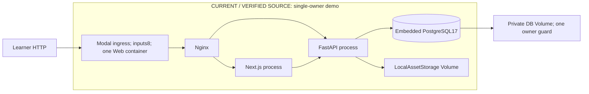
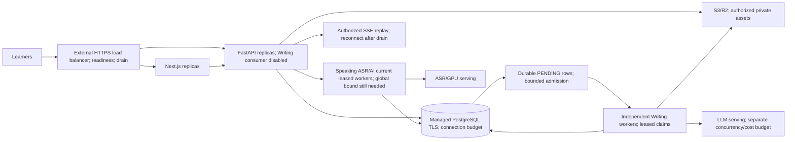

# BandPilot: năng lực cho 5.000 người học đồng thời

**Kết luận: NOT VERIFIED.** Chưa chạy kiểm thử tải xuyên suốt hệ thống với 5.000 người học ảo trên hạ tầng cách ly được cấp phép. Các phép đo local bên dưới kiểm tra vòng đời nghiệp vụ và một số ranh giới xử lý lỗi, chưa chứng minh thông lượng production. Đợt này không deploy, gọi LLM trả phí, truy cập database/assets production hoặc thay cấu hình concurrency của Modal.

Baseline sau `git fetch origin main`: **`9027c413f2bf48c6fe760940e6e324848c496d98`**, ngày 2026-11-02 (Asia/Saigon). Nhánh làm việc `perf/5000-user-capacity`, worktree do ứng dụng quản lý riêng; thay đổi cục bộ có sẵn ở checkout chính bị loại khỏi phần bàn giao. Báo cáo này là nguồn có thẩm quyền của thí nghiệm mới; [báo cáo Modal P2](../modal-web-performance.md) và [audit 27/10](../performance-2026-10-27.md) giữ nguyên phạm vi lịch sử.

Đọc [hướng dẫn tái hiện](../../benchmarks/load/README.md) để chạy công cụ; [nghiên cứu tình huống](../case-studies/5000-user-scalability.md) giải thích quá trình; [Q&A](../interview/5000-user-scalability-qa.md) phục vụ phỏng vấn.

## 1. Câu hỏi đo lường

5.000 tài khoản đăng ký chỉ là số bản ghi; 5.000 phiên đã xác thực có thể không hoạt động. Mục tiêu là 5.000 **người học ảo hoạt động đồng thời**, mỗi người có cookie/session, lượt làm bài và think time riêng. Tại mỗi thời điểm, một phần gửi request, phần còn lại đọc, nghe hoặc viết. Không đồng nhất workload này với 5.000 request HTTP hoặc 5.000 tác vụ GPU cùng lúc.

`RPS = tổng requests / thời gian quan sát`. Trong các báo cáo đã lưu, successful RPS chỉ đếm phản hồi **2xx không có lỗi contract**. Phản hồi 409 dự kiến vẫn có thể là kiểm tra contract thành công nhưng không được cộng vào successful 2xx RPS. Requests/người/phút mô tả nhịp hành vi, không phải số kết nối. Theo Little's law, `in-flight ≈ arrival_rate × mean_response_time` chỉ áp dụng khi tải ổn định; dùng **trung bình**, không dùng p95, và không xem kết quả công thức là năng lực đã được kiểm chứng.

Ví dụ lập kế hoạch: 5.000 người gửi 6 request/phút/người tạo khoảng 500 RPS. Nếu độ trễ trung bình từ máy khách đến khi nhận xong phản hồi là 200 ms thì có khoảng 100 request đang xử lý, chưa tính SSE. Giá trị 200 ms ở đây là **giả thiết minh họa**, không phải kết quả BandPilot. Một SSE có thể giữ kết nối nhiều phút dù ít byte; cần tính riêng ngân sách sockets và request/giây.

## 2. Trạng thái sáu giả thuyết tại baseline

| Nhận định | Kiểm mã nguồn thực tế | Kết quả |
| --- | --- | --- |
| Modal Web một container, concurrency 8 | [app.py](../../deploy/modal/app.py), `Web` class | Đúng: 2 CPU, 4096 MiB, min=max 1, `@modal.concurrent(max_inputs=8)`; cloud mode cũng chưa tự tăng replicas |
| Demo gom Next/FastAPI/Nginx/PG | [web_runtime.py](../../deploy/modal/web_runtime.py), `WebRuntime.start` | Đúng ở embedded mode; external mode không chạy PostgreSQL nhúng hoặc mount local assets bền vững |
| AWS Compose tách services nhưng không autoscale | [compose](../../deploy/aws/compose.yml), [Nginx](../../deploy/aws/nginx.conf) | Đúng; backend chạy một process Uvicorn, chưa có chính sách tăng giảm quy mô của orchestrator |
| Async pool dùng mặc định | [database.py](../../backend/app/core/database.py) tại baseline | Đúng: chỉ đặt `pool_pre_ping=True`; kiểm engine không kết nối cho thấy mặc định duy trì 5 connections, tối đa 10 overflow, đợi 30 s |
| Writing dùng local tasks, Speaking có leases | [Writing worker](../../backend/app/services/writing_ai_worker.py), [Speaking worker](../../backend/app/services/speaking_ai_worker.py), [ASR worker](../../backend/app/services/speaking_transcript_worker.py) | Đúng tại baseline; Writing được củng cố trong đợt này. Speaking vẫn dispatch cục bộ, chưa có ngân sách tiếp nhận toàn cục |
| Đã hỗ trợ database và storage bên ngoài | [kiểm tra runtime](../../deploy/runtime_config.py), [storage factory](../../backend/app/storage/factory.py) | Đúng: PostgreSQL ngoài, S3/R2 và migration do operator thực hiện; không cần xây lại kiến trúc storage/nghiệp vụ |

Các nhận định deployment đã được **đối chiếu mã nguồn**, chưa xác nhận một cloud app đang chạy đúng cấu hình đó. [Tài liệu Modal](https://modal.com/docs/guide/concurrent-inputs) giải thích concurrency của đầu vào; decorator không phải cam kết về request/giây.

## 3. Môi trường và quyền thực thi

| Thuộc tính | Thông tin đã kiểm |
| --- | --- |
| Host/máy tạo tải | Windows 11 Home Single Language, version 10.0.26100; Intel Core i5-13500H, 12 cores/16 logical processors; RAM 16.834 GB thập phân (15.68 GiB) |
| Runtime | Python 3.13.9; Node 24.21.0; PostgreSQL 17.11; SQLAlchemy 2.0.54/asyncpg 0.31.0/FastAPI 0.141.1/httpx 0.28.1/Locust 2.43.3/psutil 7.2.2; [môi trường](5000-user/environment.json) |
| Docker | Engine 29.4.3; image PostgreSQL 17 có sẵn trong cache; container riêng `bandpilot-capacity-test-20261102` |
| Giới hạn container DB | 2 CPU, 1 GiB; `shared_buffers=128MB`, `max_connections=100`; tmpfs `/var/lib/postgresql/data`; bind `127.0.0.1:5548` |
| Backend | Một process Uvicorn trên host, chỉ loopback; baseline lấy source từ checkout gốc, bản sau sửa từ feature worktree. ASGI wrapper chỉ dành cho benchmark yêu cầu token chứng minh quyền sở hữu môi trường |
| Frontend/proxy | Không nằm trên đường request của workload local; chưa có phép đo mới về Next.js SSR, nội dung tĩnh hoặc throughput Nginx |
| Cách ly database | Mỗi load run có database `ielts_load_<12hex>`, role `load_<12hex>` không phải superuser và mật khẩu riêng; DB comment chứa hash bằng chứng sở hữu. Hai database kiểm thử tách khỏi database chứa load fixtures |
| Storage/thông tin xác thực | Thư mục local mới cho từng run; JWT secret/issuer/audience riêng. Credentials của fixtures chỉ nằm trong `.runs/` được Git bỏ qua; không dùng S3/R2 hay âm thanh riêng tư thật |
| Vị trí/mạng | Máy tạo tải và API cùng Windows host, DB qua Docker Desktop loopback. Vị trí địa lý/RTT của Modal/AWS: NOT RECORDED trong thí nghiệm này |
| Giới hạn process host | Uvicorn/Locust không có giới hạn CPU/RAM ở cấp container. Giới hạn ngoài của Docker VM: NOT RECORDED; không coi giới hạn DB container là giới hạn toàn VM |
| AI | Workload HTTP thông thường tắt AI/ASR bên ngoài; các phép đo riêng dùng provider giả có kết quả xác định. Thông lượng GPU thật, giá token và chi phí inference: NOT VERIFIED |

Docker ban đầu không sẵn sàng, một lần khởi động lỗi Inference-manager socket. Không reset Docker. User bật engine rồi mới tạo container mới. Portable PostgreSQL binaries đã tải vào thư mục tạm như phương án dự phòng, **không được dùng** để tạo kết quả. Không sửa service hoặc dữ liệu PostgreSQL đã có.

## 4. Công cụ và mô hình tải

Chọn **Locust**, với phụ thuộc riêng trong [requirements](../../benchmarks/load/requirements.txt), vì Python dùng lại được Pydantic contracts và quy trình tạo dữ liệu domain hiện có. Uvicorn thực nhận HTTP; không gọi ASGI trực tiếp để thay cho phép đo mạng. Setup dùng httpx, máy tạo tải dùng Locust/gevent. Không mở trình duyệt. Mỗi VU nhận tài khoản và IDs riêng, không có hai VUs dùng đồng thời một tài khoản.

Harness từ chối chạy khi thiếu bằng chứng cách ly: địa chỉ viết trực tiếp `127.0.0.1`, danh tính source/runtime/resources, manifest có hạn dùng, role không phải superuser, database/storage mới, private proof và header `X-Load-Token`. Máy khách tắt redirects và proxy từ môi trường. `staging=true`, hostname có chữ staging hoặc tên DB có chữ test đều chưa đủ. Profile high 5.000 chỉ là **thiết kế**: code không cho chạy quá 10 VUs local hoặc đổi host tùy ý. Cloud cần adapter được review, inventory DB/storage/Secret/deployment và quyền rõ ràng cho target/tài nguyên/chi phí; đợt này không có đường bỏ qua guard.

| Kịch bản | Hành vi/contract | Phạm vi |
| --- | --- | --- |
| A Exam | Đăng nhập, xem danh mục, bắt đầu Reading/Listening, nhận đề không lộ đáp án, lưu từng câu với `expected_revision`, điều hướng, nộp và đối chiếu review đã finalize | Dùng IDs/DTO thực; mỗi người có attempt riêng |
| B Full Mock | Tạo session, Listening→Reading→Writing→Speaking, autosave, submit, `advance`, review/history | Speaking kết thúc không có audio là luồng được hỗ trợ; chưa đo recorder hoặc ASR |
| C Classroom | Tài khoản teacher/student cùng lớp và assignment riêng; đọc classwork, assignments, notifications, progress, results rồi đổi sang đúng vai trò giáo viên | Không dùng admin token đại diện học viên; lỗi làm dừng journey |
| D AI | Phép đo Writing/Speaking riêng bằng provider giả, kiểm admission/claim/checkpoints/recovery | Không đo inference thật; số jobs không cộng vào RPS HTTP |

Fixtures là nội dung IELTS-like **hư cấu**, được tạo qua API soạn đề/quản trị/lớp học thực có xác thực: 3 Reading passages với 40 câu, 4 Listening parts với 40 câu và audio im lặng tự sinh, 2 Writing tasks, 3 Speaking prompts. Mỗi VU có teacher/student/classroom/assignment riêng. Request setup và warmup không nằm trong thống kê HTTP steady-state. Lần tạo fixtures chưa thành công không được tính là benchmark thành công.

Smoke mặc định gồm ramp 5 s, steady 70 s, drain 10 s và 5 VUs. Các lần đã chạy dùng nhịp tăng tốc để kiểm vòng đời: nghỉ 0,15 s giữa answers, 0,5 s ở bước Writing của B, 2–4 s giữa journeys; Listening dùng audio im lặng dài 4 s, không phát bài nghe đầy đủ. Đây không phải kỳ thi IELTS dài hai giờ hoặc nhịp học thực. LOAD_THINK_SCALE=100 đưa khoảng nghỉ autosave lên khoảng 15 s; vẫn phải hiệu chỉnh theo hành vi thực. Giả định 6,6 requests/phút/người ở mục 11 độc lập với smoke và chưa được hiệu chỉnh. Burst giữ attempts độc lập, không đồng bộ submit nếu chưa thiết kế riêng. Soak 30 phút mới là thiết kế, chưa chạy.

| Giai đoạn đề nghị | VUs | Quyền/điều kiện |
| --- | ---: | --- |
| Smoke | 5–10 | Loopback cách ly, chỉ kiểm chứng local có giới hạn theo yêu cầu; thực tế đã chạy tối đa 5 |
| Nhỏ/vừa | 25–50 / 100–250 | Chưa chạy; cần staging cách ly và ngân sách máy tạo tải |
| Cao/vượt ngưỡng/đích | 500–1.000 / 2.500 / 5.000 | NOT RUN; cần DB/storage/credentials/deployment riêng và quyền phát sinh chi phí |
| Burst/soak | Cấu hình riêng | Theo dõi tài nguyên và ổn định DB; dừng khi lỗi dây chuyền, hỏng dữ liệu hoặc máy tạo tải bão hòa |

## 5. Nguồn số liệu và giới hạn thống kê

Hook phía máy khách lưu histogram mili giây theo endpoint/từng giây, HTTP status và mã lỗi đã loại thông tin nhạy cảm. p50/p95/p99 dùng nearest-rank `ceil(q×n)` trên histogram; sai số làm tròn khoảng 0,5 ms, chưa có khoảng tin cậy. Lỗi gồm HTTP status ngoài dự kiến và contract sai; không coi mọi 4xx là thành công hoặc mọi 401 là dự kiến. Báo cáo giữ request count, successful RPS, journeys hoàn tất/thất bại và cửa sổ đo thực. p99 dưới 1.000 mẫu/endpoint chỉ dùng chẩn đoán; ngay 1.000 mẫu cũng chỉ có khoảng 10 quan sát ở đuôi, chưa bảo đảm SLO chắc chắn. Không tính global percentile bằng trung bình percentiles của các endpoints.

[Telemetry](../../benchmarks/load/telemetry.py) chỉ gắn vào benchmark wrapper: psutil đo CPU/RSS process; heartbeat 20 ms đo độ trễ event loop; SQLAlchemy cursor events đếm query/thời gian/lỗi; sampler 1 s đọc `pg_stat_activity` và `pg_stat_database`. Observer thêm một kết nối DB. Cursor time **không** gồm chờ lấy connection từ pool, xử lý ORM hoặc commit, nên không phải thời gian backend handler. Bộ đếm deadlocks/transactions tích lũy cần tính delta. Mẫu 1 s có thể bỏ lỡ đỉnh lock/connections/memory. ASGI timing middleware hiện có cũng bao gồm streaming/backpressure, không phải CPU time.

Chưa có phép đo mới cho ingress queue, pool checkout wait, phân rã TCP connect, băng thông mạng, phân bố slow queries qua `pg_stat_statements` hoặc frontend rendering. Các mục này là **NOT RECORDED**, không phải 0. Raw reports không chứa SQL text, cookies, credentials hoặc bài làm. CPU/RSS Locust giúp phát hiện sơ bộ generator saturation; generator cùng host vẫn tranh chấp tài nguyên và không đại diện mạng của người học từ xa.

## 6. Chứng cứ thực thi

[Chỉ mục bằng chứng](5000-user/evidence.json) liệt kê raw reports, timestamps và danh tính source. Mọi số liệu mới phải đối chiếu file ở đó. Các mức NOT RUN không có percentiles giả.

| Test ID | Revision/kịch bản | VUs/jobs | Ramp/steady/drain | Requests tổng/steady | Successful 2xx RPS steady | Lỗi | Kết quả/bằng chứng |
| --- | --- | ---: | --- | ---: | ---: | --- | --- |
| HTTP-BEFORE-5 | `9027c413` A/B/C | 5 VUs | 5 s/69 s thực đo/10 s drain; tổng 85,56 s | 930/748 | 10,696 | 0 ngoài dự kiến; tổng 13 phản hồi 409 dự kiến | PASS smoke; capacity INCONCLUSIVE — [raw](5000-user/http-baseline-smoke.json), [tóm tắt](5000-user/http-baseline-summary.json) |
| HTTP-AFTER-5 | `d871ae1` A/B/C | 5 VUs | 5 s/69 s thực đo/10 s drain; tổng 85,80 s | 692/572 | 8,174 | 0 ngoài dự kiến; tổng 8 phản hồi 409 dự kiến | PASS smoke; capacity INCONCLUSIVE — [raw](5000-user/http-candidate-smoke.json), [tóm tắt](5000-user/http-candidate-summary.json) |
| HTTP-BURST-5 | `d871ae1` A | 5 VUs | 2 s/43 s thực đo/15 s drain; tổng 61,03 s | 609/519 | 12,070 | 0 lỗi ngoài dự kiến, 0 phản hồi 4xx/5xx | PASS smoke — [raw](5000-user/http-candidate-burst.json), [tóm tắt](5000-user/http-burst-summary.json) |
| AUTH-COMPONENT-BEFORE/AFTER | AuthService, working tree trước commit | 5 calls đồng thời, 50 calls | Component, không HTTP | 50/50 calls | Không áp dụng | 0 | PASS component — [trước](5000-user/auth-component-baseline.json), [sau](5000-user/auth-component-after.json) |
| WRITING-QUEUE-10 | Working tree, bàn giao trong `d871ae1` | 10 jobs, 2 consumers | Fake 20 ms/call | 130 fake calls | Không áp dụng | 10 hoàn tất, 0 thất bại | PASS component — [raw](../../benchmarks/load/results/writing-queue-local.json) |
| WRITING-QUEUE-FINAL-10 | Sau sửa backoff, working tree có digest | 10 jobs, 2 consumers | Cùng fake 20 ms/call | 130 fake calls | Không áp dụng | 10 hoàn tất, 0 thất bại | PASS chức năng; so latency INCONCLUSIVE — [raw](5000-user/writing-queue-final.json) |
| SPEAKING-COMPONENT-5 | `d871ae1`, scorer thật | 5 jobs, gate 2 của generator | Fake 20 ms/call | 40 fake calls | Không áp dụng | 5 hoàn tất, 20 score checkpoints | PASS component — [raw](5000-user/speaking-component.json) |
| QUERY-PLAN-10000 | `d871ae1`, root SQL queries | 1 kết nối, 10.000 attempts hư cấu | Rollback-only | 2 plans | Không áp dụng | Rollback xác nhận 27→27 rows | PASS component — [raw](5000-user/query-plans.json) |
| SMALL→TARGET | A/B/C/D trên staging | 25/50/100/250/500/1.000/2.500/5.000 | NOT RUN | NOT RUN | NOT RUN | NOT RUN | **NOT VERIFIED** |

Revision/digest và UTC timestamps của từng HTTP run có trong raw JSON. Auth component và Writing queue probe chưa ghi đủ exact working-tree digest/timestamp tại lúc đo: trường thiếu được đánh **NOT RECORDED** trong [chỉ mục](5000-user/evidence.json), không gán hồi tố final commit làm source revision đã đo. [Các thử nghiệm thất bại](5000-user/failed-experiments.json) giữ tóm tắt các lỗi fixtures/assertion/CLI và NullPool timeout; chúng không được đổi nhãn thành bằng chứng capacity thành công.

Hai smoke dùng cùng hình dạng fixtures, 5 VUs, 44 saves/module, think time mặc định và steady thực đo 69 s. Baseline hoàn tất A 3/B 3/C 1; bản sau sửa A 3/B 2/C 1. Cùng mô hình tải đóng nhưng tỷ lệ endpoints thực tế khác vì request chậm làm ít journeys hoàn tất hơn. Successful 2xx RPS giảm 23,6%; autosave p95 tăng 752→1.064 ms. **Chưa chứng minh HTTP nhanh hơn.** Chỉ một cặp localhost khác thời điểm, có hoạt động tests/biên tập ngắn trùng warmup bản sau sửa, nên chưa đủ quy chênh lệch cho auth hoặc queue. Giữ thay đổi vì đã có bằng chứng về giới hạn thực thi, fencing và khả năng phản hồi của component; cần đo lặp trong staging cách ly từng replica trước khi gọi đây là tối ưu throughput.

| Endpoint (steady) | Trước: n; p50/p95/p99 (ms) | Sau: n; p50/p95/p99 (ms) |
| --- | --- | --- |
| auth.login | 7; 277/561/561 | 4; 222/515/515 |
| answer.autosave | 557; 239/752/1.057 | 452; 404/1.064/1.342 |
| attempt.exam | 16; 332/1.877/1.877 | 12; 719/1.606/1.606 |
| attempt.submit | 14; 200/1.559/1.559 | 11; 244/996/996 |
| attempt.review | 10; 129/744/744 | 3; 217/306/306 |
| catalog | 1; 842/842/842 | 1; 691/691/691 |
| mock.advance | 10; 70/359/359 | 8; 195/487/487 |

Mọi endpoint trong bảng đều dưới 1.000 mẫu nên p99 chỉ dùng chẩn đoán; catalog chỉ có một mẫu, không tạo bằng chứng SLO latency. Percentiles không phải khoảng tin cậy. Không gặp lỗi ngoài dự kiến ở cỡ mẫu nhỏ cũng chưa chứng minh tỷ lệ lỗi thực dưới 0,1%.

| Tài nguyên trong toàn cửa sổ đo | Trước | Sau | Burst |
| --- | ---: | ---: | ---: |
| CPU API: delta (s)/số lõi trung bình | 72,422/0,846 | 71,313/0,831 | 37,750/0,619 |
| RSS API lớn nhất đã lấy mẫu (MiB) | 161,57 | 161,03 | 162,01 |
| Connections DB lớn nhất đã lấy mẫu, không tính observer | 11 | 11 | 11 |
| Connections đang được app pool sử dụng, đỉnh đã lấy mẫu | 10 | 10 | 8 |
| Số phiên chờ lock lớn nhất đã lấy mẫu | 0 | 1 | 0 |
| Tuổi transaction lớn nhất đã lấy mẫu (s) | 2,006 | 2,537 | 0,517 |
| SQL cursor count delta | 20.876 | 15.810 | 13.472 |
| CPU generator lớn nhất đã lấy mẫu (%) | 13,9 | 9,3 | 9,4 |

Nguồn CPU/RSS/DB và giới hạn lấy mẫu nằm ở mục 5. Chưa đo pool checkout wait hoặc p99 steady riêng cho SQL/event-loop lag vì các distributions telemetry tích lũy từ startup. Deadlock counters giữa các HTTP-run snapshots không tăng; một mẫu chờ lock không đồng nghĩa deadlock. Raw telemetry trước/sau giữ dữ liệu chẩn đoán, không thay đại lượng chưa đo bằng 0.

## 7. Nút thắt đã xác nhận và các thay đổi

### Xác thực: phép tính CPU đồng bộ chặn event loop

[AuthService](../../backend/app/services/auth.py) tại baseline gọi `hash_password`/`verify_password` đồng bộ ngay trong async transaction; [security.py](../../backend/app/core/security.py) dùng scrypt. Thí nghiệm component thực hiện 50 lần xác minh thật, chia 10 đợt × 5, với ranh giới DB được kiểm soát, tham số scrypt giữ nguyên `(n=16384,r=8,p=1,dklen=32)` và heartbeat 10 ms.

| Đại lượng | Baseline chạy trên event loop | Chạy trên threads có giới hạn |
| --- | ---: | ---: |
| Wall time (s) | 2,381339 | 1,630024 |
| Process CPU (s) | 2,296875 | 2,718750 |
| Heartbeat p95/độ trễ lớn nhất (ms) | 264,1801 / 264,1801 | 9,6247 / 10,0101 |
| Số mẫu heartbeat | 10 | 107 |
| Số password callbacks chạy đồng thời lớn nhất | 1, trên event loop | 2, ngoài event loop |

Bản sửa dùng `asyncio.to_thread`, với gate giới hạn 2 thao tác được gửi vào executor trên mỗi event loop; khi request bị hủy nhiều lần, vẫn đợi thread kết thúc trước khi trả suất. Chỉ hàm mật khẩu thuần chạy trên thread, session/transaction vẫn ở event loop. CPU tăng 18,4%, wall time giảm 31,5% trong một cặp component runs; không suy ra đăng nhập HTTP nhanh hơn 31,5%. Độ trễ heartbeat lớn nhất giảm khoảng 26 lần chỉ chứng minh khả năng phản hồi trong thí nghiệm này. Baseline có 10 mẫu heartbeat, không đủ kết luận tail latency. [Tests](../../backend/tests/test_auth_password_offload.py) dùng barriers/thread identity, kiểm cancellation và nhiều event loops; auth/refresh integration giữ ngữ nghĩa hiện có. Transaction vẫn mở trong lúc đợi gate nên login burst vẫn có thể chiếm connections; đây là đánh đổi còn lại.

### Writing: local dispatch không hữu hạn, thiếu ownership fencing và recovery

Baseline `launch` tạo task theo từng run; `_tasks` chỉ chống launch trùng trong một process. Claim theo DB status ngăn hai executors bắt đầu cùng PENDING row, nhưng chưa có token/deadline bảo vệ quyền sở hữu hoặc ngân sách pending/running toàn cục. PENDING đã commit trước khi process chết ở bước launch có thể chờ tới đường đọc rồi bị coi là stale. Semaphore LLM trên từng run không giới hạn tổng số runs của nhiều người. Đây là phát hiện về tính đúng đắn và giới hạn tài nguyên, chưa phải mức giảm latency đã đo.

Thay đổi nhỏ nhất dùng lại các bảng run/event:

1. PENDING rows tạo hàng đợi bền vững; `launch` chỉ đánh thức dispatcher, không tạo task cho mỗi request. Số consumers cố định và scanner độc lập không phụ thuộc observer.
2. Claim dùng PostgreSQL advisory transaction lock ngắn để tuần tự hóa ngân sách chung, `FOR UPDATE SKIP LOCKED` và lease token/deadline theo đồng hồ DB. Provider chạy ngoài transaction.
3. Ghi checkpoint/complete/fail phải khớp status, token và lease còn hạn. Heartbeat phát hiện mất ownership, mất DB hoặc cancellation đã commit ở process khác sẽ hủy child đang chạy; consumer còn sống để nhận việc tiếp.
4. Mặc định tối đa 100 PENDING toàn cục, 4 RUNNING toàn cục và 2 consumers/process. Tra kết quả cache/run tương đương trước khi từ chối admission; quá tải trả 503 có thể retry. Operator phải đặt limits thống nhất giữa replicas.
5. Scanner xử lý PENDING bền vững sau restart. RUNNING hết lease chuyển `RUN_INTERRUPTED`, giữ scores/checkpoints đã commit; retry rõ ràng tạo run mới. MTS chưa có contract tiếp tục mọi stage nên không tự chạy lại toàn pipeline với partial state. External calls đã gửi có thể vẫn tốn token; **không bảo đảm exactly-once provider execution**.

[Migration 0044](../../backend/alembic/versions/20261102_0044_writing_durable_dispatch.py) thêm lease columns nullable và indexes cho đường dispatch/expiry mới; không sửa exam tables hoặc nội dung đóng băng. Đây là indexes hỗ trợ queue mới, không phải tuyên bố đã tìm được missing index làm chậm exam. [Regression suite](../../backend/tests/test_writing_durable_dispatch.py) kiểm sessions độc lập, admission/claim cạnh tranh, cancel khác process khi provider bị chặn, fencing/checkpoint/recovery và phân quyền khác người dùng. Tests score-first, partial feedback và SSE bảo vệ contract hiện có.

Phép đo Writing đầu gồm 10 jobs, 2 consumers, giới hạn RUNNING 2, mỗi fake call 20 ms: hoàn tất 10/10, 130 calls, drain 4.388,099 ms; queue wait median/max 1.709,499/3.248,031 ms; từ admission đến hoàn tất median/max 2.369,529/4.357,927 ms. Đỉnh là 2 RUNNING rows, 2 local tasks và 4 provider calls. Hủy qua session khác được phát hiện sau 3.193,665 ms; quét lease hết hạn mất 12,784 ms và giữ checkpoint. Đây là thời gian của provider giả và database local, không phải inference capacity thật. Speaking component riêng hoàn tất 5 jobs/40 calls với gate 2 **của generator**, không phải giới hạn production của Speaking; xem [raw report](5000-user/speaking-component.json).

Review cuối phát hiện lỗi trên đường DB failure: nếu chưa commit claim mà kết nối bị từ chối, `execute` trước đó vẫn trả thành công khiến consumer bỏ qua thời gian đợi. Bản sửa chỉ báo đã nhận việc sau khi claim transaction commit; lỗi trước đó đi qua poll delay, lease commit không rõ kết quả được để hết hạn theo fencing. [Hai tests](../../backend/tests/test_writing_dispatch_backoff.py) đã fail trước và pass sau bản sửa, gồm lỗi mở kết nối và lỗi commit. Đây là sửa độ tin cậy khi DB gián đoạn, chưa phải tối ưu throughput. Các HTTP measurements ở mục 6 được ghi **trước bản sửa backoff cuối**, với source identity chính xác trong JSON; không gán chúng cho source cuối chưa chạy lại HTTP.

Review cũng siết Writing probe: thay chọn một database có tên `_test` bằng manifest/ownership proof, role không phải superuser, domain trống và không có DB peer đang chạy. [Safety tests](../../backend/tests/test_load_probe_safety.py) giữ điều kiện này. `psutil` được khóa trong nhóm dev để CI thu thập telemetry tests; benchmark auth dùng fallback `os.cpu_count` khi Python chưa có `os.process_cpu_count`. Không thêm Locust vào dependencies API.

Lặp lại fake queue với guard mới hoàn tất 10/10 jobs, 130 calls, vẫn tối đa 2 RUNNING/tasks và 4 calls. Drain 5.109,968 ms; queue wait median/max 1.904,208/4.076,994 ms; completion median/max 2.904,756/5.091,813 ms; remote cancellation 3.169,529 ms; quét expiry 20,500 ms, checkpoint được giữ. [Raw report](5000-user/writing-queue-final.json) ghi source digest và timestamp. Focused tests lúc đó chạy trên database khác nhưng cùng host/Docker VM, nên lần này chỉ xác nhận chức năng và giới hạn sau sửa, **không dùng làm so sánh hiệu năng công bằng** hoặc tuyên bố speedup.

### Database pool: làm rõ ngân sách, giữ nguyên mặc định

Thêm cấu hình có validation `DATABASE_POOL_SIZE=5`, `DATABASE_MAX_OVERFLOW=10`, `DATABASE_POOL_TIMEOUT_SECONDS=30`; giữ mặc định và pre_ping. Từ chối overflow vô hạn, pool size bằng 0 và timeout không hữu hạn. [Tests](../../backend/tests/test_database_pool.py) kiểm engine config thực mà không mở DB. Đây là cải thiện khả năng vận hành, **chưa đo được speedup** vì hành vi mặc định không đổi. Ngữ nghĩa pool theo [SQLAlchemy](https://docs.sqlalchemy.org/en/20/errors.html#queuepool-limit-of-size-x-overflow-y-reached-connection-timed-out-timeout-z).

## 8. PostgreSQL và API: điều gì chưa được chứng minh?

`AttemptRepository.get` giữ thứ tự khóa session cha→attempt con và tải nhiều relationships. Mỗi save_answer còn truy vấn Question/Group/current answer. Tuần tự hóa cùng attempt là cần thiết để revisions và save/submit đúng; không bỏ locks để tăng benchmark. Catalog/history chưa phân trang; `include_details` tải full version graph, chia batch 100 IDs chỉ giới hạn IN-clause chứ không giới hạn toàn response. Đây là giả thuyết cần dữ liệu đại diện/EXPLAIN, chưa phải N+1 defect đã đo.

Sau HTTP load, đã chạy EXPLAIN ANALYZE trong transaction luôn rollback với 10.000 attempts hư cấu của 1.000 users, 10 attempts/user và cùng một frozen version. [Plans](5000-user/query-plans.json): root history query dùng `ix_attempts_user_id` rồi sort 10 rows trong bộ nhớ, execution 0,057 ms; khóa attempt dùng `pk_attempts`, execution 0,035 ms. Đây chỉ là một mẫu SQL component với warm cache, chưa gồm đồ thị ORM selectinload, answers/media hoặc HTTP. Rollback xác nhận số attempts thực 27→27. Chưa có plans cho catalog/classroom lớn; chưa thấy bằng chứng cần index mới cho hai root queries này. Không thêm exam index suy đoán, authorization cache, PgBouncer hoặc đổi transaction isolation. Lần staging tiếp cần dataset lớn có manifest kích thước, thu `EXPLAIN (ANALYZE, BUFFERS, FORMAT JSON)` cho catalog/history/autosave, active/waiting connections, transaction age, deadlock delta và blockers; không xuất query parameters/nội dung riêng tư. Chỉ xét PgBouncer khi connection budget là nút thắt, kèm kiểm tương thích prepared statements/cache của asyncpg.

Writing SSE dùng sessions ngắn; mỗi observer poll 1 s và khóa run row khi đọc snapshot. 5.000 observers có thể tạo khoảng 5.000 polls/s cùng queries/events tương ứng. Không giữ connection suốt stream vẫn phát sinh chi phí DB/socket. Chưa đổi polling/replay vì chưa có benchmark này. Reading/Listening autosave debounce 400 ms; activity khoảng 20 s khi có hoạt động; Writing debounce 750 ms; timer 1 s chỉ phục vụ hiển thị. Không chuyển timer thành poll server mỗi giây.

## 9. Kiến trúc hiện tại và bước tăng quy mô

**CURRENT / SOURCE-VERIFIED — Modal demo:** đã đối chiếu cấu hình nguồn, không kiểm live deployment trong đợt này.

Không mount cùng PostgreSQL data Volume vào nhiều database processes. Guard và min=max 1 bảo vệ durability/quyền sở hữu, không chỉ là tuning latency. Nếu mỗi container dùng DB riêng thì trạng thái có thẩm quyền lại bị chia cắt. Production cần external DB và shared object storage; code đã hỗ trợ nhưng cloud Web vẫn tối đa 1 container. Đợt này không sửa max_inputs/max_containers.

**IMPLEMENTED BUT NOT DEPLOYED — Writing durable dispatch; PROPOSED — cụm production:**

HTTP cookie/JWT dùng secret chung đúng môi trường; mỗi request vẫn kiểm tài khoản hoạt động và policy, không cần sticky sessions cho trạng thái nghiệp vụ. Shared storage giữ opaque keys và access policy hiện có. Scheduled jobs cần ownership riêng: không chạy assignment-reminder CLI như cron trên mọi replica. SSE reconnect dùng Last-Event-ID; rollout/drain phải kiểm replay, không hủy job chỉ vì tab đóng.

Hướng AWS thực tế: giữ modular monolith, đóng gói API/frontend thành ECS services trên EC2 hoặc Fargate; ALB route `/api/*` tới API, phần còn lại tới Next.js; dùng managed PostgreSQL, S3/R2 và Writing consumer service riêng. Có thể bắt đầu với fleet cố định trên EC2 trước autoscaling. Compose hiện tại là mẫu một máy; static Nginx upstream resolution và `worker_connections=1024` chưa chứng minh routing/socket budget cho nhiều replicas. Chạy `docker compose --scale` không tự tạo cloud autoscaling.

Readiness `/api/v1/ready` kiểm DB với timeout; liveness `/health` chỉ kiểm process còn phản hồi. Migrations do operator chạy riêng trước rollout. Cần startup grace, drain/stop timeouts phù hợp và kiểm shutdown khi provider bị chặn. [ECS service autoscaling](https://docs.aws.amazon.com/AmazonECS/latest/developerguide/service-auto-scaling.html) là cơ chế có thể dùng, chưa triển khai trong repository. Modal external mode cần staging xác nhận routing/health, vòng đời worker và resource isolation trước khi tăng containers. Thêm GPU không giải quyết hàng đợi HTML.

## 10. Cấu hình, migration và hoàn tác

| Cấu hình mới | Mặc định | Phạm vi |
| --- | ---: | --- |
| DATABASE_POOL_SIZE | 5 | Mỗi engine/tiến trình; kết nối duy trì |
| DATABASE_MAX_OVERFLOW | 10 | Mỗi engine; giới hạn kết nối tạm |
| DATABASE_POOL_TIMEOUT_SECONDS | 30 | Thời gian đợi lấy connection, tính bằng giây; không phải query timeout |
| AI_WRITING_WORKER_ENABLED | true | Giữ tương thích API demo; đặt false trên replicas chỉ phục vụ HTTP |
| AI_WRITING_WORKER_CONCURRENCY | 2 | Consumer cố định/tiến trình |
| AI_WRITING_MAX_RUNNING_RUNS | 4 | Giới hạn DB toàn cục, phải thống nhất giữa workers |
| AI_WRITING_MAX_PENDING_RUNS | 100 | Giới hạn pending toàn cục, không gồm lịch sử đã kết thúc |
| AI_WRITING_WORKER_POLL_SECONDS | 2 | Chu kỳ quét dispatch/recovery |
| AI_WRITING_LEASE_SECONDS | 60 | Hạn sở hữu job, được gia hạn qua heartbeat/checkpoint |

Quy trình operator, sau khi xác minh DB/provider/storage đích: drain và dừng **Writing workers cũ** → backup → chạy tường minh `alembic upgrade head` → khởi động HTTP/consumers tương thích. Không chạy lẫn old workers chưa biết fencing với new consumers trong rolling rollout. Consumer riêng dùng `python -m app.workers.writing`, cùng DB/storage/provider/limits; HTTP đặt `AI_WRITING_WORKER_ENABLED=false`, consumer bật true. Nếu rollback về old code, không bảo đảm PENDING cũ được tự dispatch.

Rollback: ngừng admission/consumers mới, đợi hoặc cancel jobs theo đúng phân quyền, giữ run/events làm bằng chứng, rồi quay về image và chế độ worker tương thích. Có thể giữ schema 0044 bổ sung khi chạy old code, nhưng worker cũ không có limits/fencing. Nếu buộc downgrade schema, dừng toàn bộ Writing executors trước `alembic downgrade 20261028_0043`; thao tác bỏ lease columns/indexes nullable, không xóa content/answers/events. Không downgrade DB trong Web startup. Khôi phục pool config mặc định không đổi ngữ nghĩa; rollback auth sẽ đưa trở lại hành vi chặn event loop đã đo.

## 11. Lập kế hoạch năng lực: ước lượng, không phải nghiệm thu

Tỷ lệ tải đề nghị để lập kế hoạch: 60% Exam × 4 requests/phút + 20% Full Mock × 6 + 20% Classroom × 3 = 4,2 domain requests/phút/người. Cộng activity heartbeat tối đa 3/phút cho 80% Exam/Mock được **6,6 requests/phút/người**, khoảng 0,11 RPS/người; tính login bursts, media và SSE riêng. Đây là **giả định cần hiệu chỉnh từ telemetry không chứa dữ liệu riêng tư**, không suy ra từ short smoke.

| Người học hoạt động | RPS HTTP ước tính | Tài nguyên khởi điểm để thử, chưa xác minh | Ví dụ connection budget | Bước kiểm chứng tiếp |
| --- | ---: | --- | --- | --- |
| 500 | 55 | 2 API × 2 vCPU/2 GiB; 2 Next × 1 vCPU/1 GiB; DB 4 vCPU/8 GiB để thử | API 2 × (5+5)=20; 1 Writing × (2+0)=2; dự phòng 20 → 42 | Staging 50→100→250→500, dữ liệu/history đại diện |
| 1.000 | 110 | 3 API × 2 vCPU/2 GiB; 2 Next; DB 4–8 vCPU/16 GiB để thử | 30 + worker 4 + dự phòng 20 = 54 | Kiểm queries/pool/locks/egress và failover trước scale |
| 5.000 | 550 | 8–12 API × 2 vCPU/2 GiB; 3–4 Next; DB 8–16 vCPU/32–64 GiB để thử | 12 API × (5+0)=60; 2 workers × (2+0)=4; dự phòng 20 → 84; chạy chồng 2 × API khi rollout → 144 | Tăng 500→1.000→2.500→5.000; steady 30 phút và soak, generator riêng |

Cả ba mức 500, 1.000 và 5.000 người học đều **NOT VERIFIED**; chưa chạy các mức đó. Độ tin cậy của ước tính thấp vì chưa đo sustained throughput/bottleneck ở từng replica.

Các cấu hình replicas/RAM/DB trên chỉ là **khung tài nguyên ban đầu**, chưa dựa trên điểm bão hòa thực đo của từng replica; không dùng để mua capacity hoặc cam kết SLA. Sau khi đo, tính `ceil(target_RPS / measured_sustainable_RPS_per_replica)` rồi thêm headroom và dự phòng sự cố. Chưa đo nghĩa là chưa biết mẫu số. Ví dụ connection budget dùng config giả định khác mặc định, operator phải đặt rõ. Mặc định 12 API × 15 = 180 connections, chưa gồm workers/dự phòng/rollout overlap. Không dùng hết max_connections; phải dành phần cho superuser/admin/maintenance và dịch vụ khác.

Storage/network: audio egress có thể lớn hơn JSON. Nếu tỷ lệ x người học nghe stream với bitrate b kb/s thì băng thông xấp xỉ `U×x×b`; x phải viết dưới dạng tỷ lệ 0–1, chưa tính retries, headers, tải nội dung/ảnh. Chưa đo bitrate/egress cloud nên không gán TB/tháng hoặc giá. Signed media URLs trực tiếp mới là phương án tương lai, phải giữ Speaking privacy, authorization và range contracts; không giảm bảo mật để giảm băng thông API.

Tính AI capacity riêng: `arrival_jobs/s = active_users × grading_jobs_per_user_per_hour /3600`; `service_rate ≈ workers_concurrency / mean_job_seconds`, với tải ổn định và provider thật không bị throttle. Nếu 5.000 users trung bình 0,2 grading jobs/giờ thì arrival khoảng 0,278 jobs/s. Giả sử mean job 30 s, cần 9 active slots ở 100% utilization hoặc khoảng 14 slots ở 60%; **30 s chưa được xác minh**, retries/cold starts và pipeline nhiều calls làm ngân sách tăng. Mặc định 4 RUNNING toàn cục không đáp ứng giả định này; queue 100 chỉ hấp thụ burst, không tăng throughput. Speaking ASR/audio/LLM có nút thắt riêng, chưa có giới hạn fleet hoặc GPU capacity được kiểm chứng. Chưa có token/runtime measurements và giá đã xác minh nên không ước tính chi phí inference.

## 12. Tiêu chí cho lần nghiệm thu tiếp theo

Operator cần xác nhận SLO cho region/network đích trước khi kiểm thử: reads thông thường p95≤500 ms/p99≤1.500 ms; autosave p95≤400 ms/p99≤1.000 ms; start/submit/review p95≤1.000 ms/p99≤2.000 ms; login p95≤1.000 ms. Đây là đề xuất, chưa phải kết quả đã đạt. Media TTFB/range và AI queue/completion cần SLO riêng. Loại setup/warmup khỏi steady statistics nhưng vẫn công bố lỗi ngoài cửa sổ đó.

Tiêu chí tính đúng đắn: không xác nhận trường hợp mất answers, lộ dữ liệu khác user hoặc finalized attempt trùng; không có deadlock cạnh tranh tái hiện được; tỷ lệ 5xx ngoài dự kiến dưới 0,1% trong steady với đủ mẫu; memory/connections/queue không tăng không giới hạn; lịch sử Full Mock nhất quán; AI advisory scores không ghi đè human final. Không có thử nghiệm hữu hạn nào chứng minh đã hết mọi race; vẫn cần forced-interleaving tests và kiểm DB sau chạy.

## 13. Xác minh và các giới hạn còn lại

Baseline focused pure tests: 111 pass, 1 Windows symlink skip. Baseline PostgreSQL suites dùng connections độc lập: 203 pass, 0 skip trong 255,51 s; gồm revisions/save-submit/Full Mock locks, auth refresh, Writing và Speaking leases/transcript. Focused suite trước review cuối: 469 pass, 1 Windows symlink skip trong 307,22 s. Sau các bản sửa review, chạy lại cùng nhóm và thêm regressions mới: **476 pass, 1 Windows symlink skip trong 263,05 s**. Môi trường dev sạch tạo từ lockfile cũng chạy 66 offline tests pass trong 8,14 s; các nhóm có overlap, không cộng tổng. Nhóm Writing bổ sung 268 pass, 0 skip trong 167,20 s, có overlap nên không cộng thành unique coverage. Frontend TypeScript/ESLint pass. Migration trên database thứ ba dùng một lần: upgrade 0044→downgrade 0043→upgrade 0044 pass, một head 20261102_0044. Ruff app/tests/benchmark pass khi chạy từ backend; format/diff và doc QA ghi trong [verification](5000-user/verification.json). Không chạy toàn bộ backend/frontend suites hoặc browser/E2E; đây là kiểm chứng tập trung.

Speaking vẫn tạo local task cho mỗi run, recovery theo startup/request và có thể tranh chấp provider/resources. Không tuyên bố toàn bộ AI fleet sẵn sàng production chỉ vì Writing đã được củng cố. Cần đo riêng catalog/history lớn, SSE nhiều observers, imports lớn, classroom datasets lớn, GPU/ASR thật, Next.js SSR/static caching, cloud TLS/IAM/network, routing nhiều replicas và shutdown/drain. Các regressions đã chạy không thấy answers bị hỏng, nhưng chưa bao phủ mọi hình dạng dữ liệu production.

**Trả lời câu hỏi nhiệm vụ:** chưa đủ bằng chứng để khẳng định BandPilot phục vụ ổn định 5.000 người học IELTS hoạt động đồng thời. Kết luận **NOT VERIFIED**; bằng chứng local tối đa 5 VUs và correctness tests là bước chuẩn bị cho staging capacity test cách ly. Kiến trúc production đề nghị dùng managed PostgreSQL bên ngoài, S3/R2, API/frontend không giữ trạng thái nghiệp vụ cục bộ và Writing consumers riêng có giới hạn. Cần hoàn tất admission/resource isolation của Speaking và kiểm chứng trước khi mở AI quy mô lớn.
