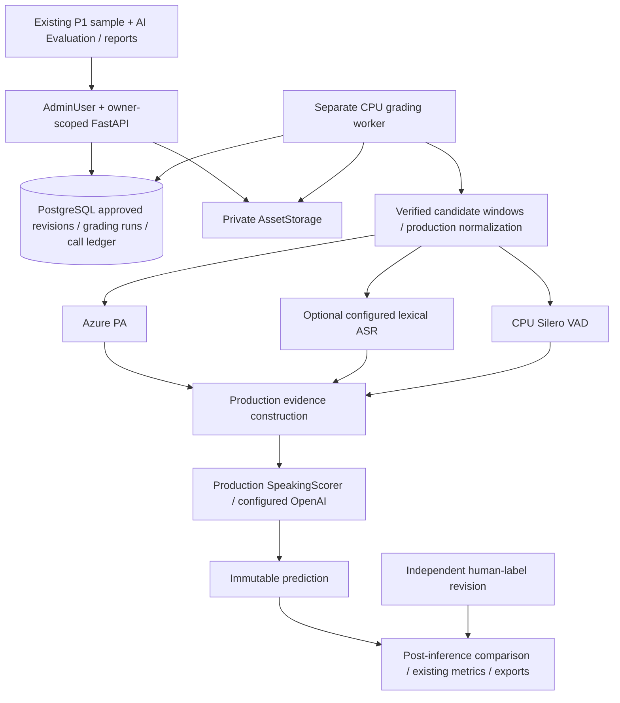

# Admin Speaking Benchmark Lab Phase 2 — design

Baseline inspected: `5fb734e27b2c782dbaaaaca4eb3168c6150bf8d6`. Phase 1 remains the dataset-preparation authority. This design implements the user's supplied Phase 2 architecture; it does not authorize live inference, deployment, commits or pushes. Existing unrelated untracked files remain untouched.

## Intent and selected approach

An owner ADMIN selects a frozen approved review, explicitly authorizes provider processing, runs the existing Speaking grading stack through a separate CPU worker, and evaluates immutable predictions against independent human-label revisions. The purpose is honest measurement, including missing predictions and failures.

The request selects a PostgreSQL-backed modular-monolith extension. The alternatives are recorded for clarity:

- **Selected in the request:** reuse production audio/features/scorer/metrics behind a database-backed adapter and durable request ledger. It adds lifecycle/persistence orchestration while preserving scoring semantics.
- Filesystem replay wrapping alone would leave cloud-call recovery dependent on ephemeral files and would require pretending a DB approval is a CLI receipt. The request explicitly rules this out.
- A second scorer, prompts or grading service would diverge from production and violate the requested architecture. It is excluded.

No new inference model, rubric, prompt or scientific calibration is introduced. Missing evidence remains unavailable; missing predictions never become zero bands.

## Confirmed reuse boundaries

- P1 `SpeakingBenchmarkService.owned`, review/job source linkage and `manifest_for_review` provide owner and approval policy. `SpeakingBenchmarkReview.manifest` is the immutable input; a mutable draft is never selected implicitly.
- `replay_audio.probe_audio`, `normalize_window` and `pcm_digest` already validate/decode exact source-relative candidate windows with production FFmpeg normalization and playback mappings.
- `speaking_hybrid.analyze_response`/`analysis_to_asr`, existing lexical analyzers and `build_feature_bundle(..., speech_analysis=..., lexical_analysis=...)` provide independent PA/lexical evidence and real CPU VAD. `build_attempt_evidence` is the inference allowlist.
- `SpeakingScorer.score_criterion` commits score-first through a callback; `feedback_for_scored` resumes feedback without re-scoring. `speaking_overall` owns project rounding and completeness.
- `SpeakingScorer` can make a schema-repair call. The configured OpenAI transport can additionally make a known-length budget-repair POST inside a single completion. A ledger around only `score_criterion` or `complete` is therefore insufficient for per-request durability.
- `metrics.score_metrics` already provides coverage, MAE/RMSE/bias/agreement, Pearson/Spearman and QWK. Its defaults require three paired samples for correlation and five for QWK. Null values/statuses are retained.
- Existing `run_replay` owns filesystem receipts/checkpoints. DB-backed evaluation will reuse the pure/provider boundaries rather than call it with fabricated approval files. CLI behavior remains intact.

## Architecture

The grading worker does not import pyannote or rerun diarization. Web readiness performs local configuration/dependency/asset checks only, without provider requests or model/GPU startup. Static readiness is labelled configured/unverified, never live-proven.

## Persistence and identities

Add migration after actual head `20261107_0045` with two focused tables:

1. `speaking_benchmark_grading_runs`: sample/owner and approved-review binding; source SHA and manifest fingerprint; safe frozen provider/model/version configuration; candidate duration/counts; idempotency key/request fingerprint; status/stage/progress; authorization and accepted estimates; lease/heartbeat/timestamps; immutable finalized prediction JSON and limitations.
2. `speaking_benchmark_grading_checkpoints`: run/stage/segment/provider identity, source/PCM/evidence fingerprints, attempt UUID/number, status/billing state, normalized bounded result/usage/error, timestamps and optional reference to a completed checkpoint reused from another run of the same sample. Completed attempt records are immutable. Prior interrupted attempts are retained when renewed consent creates another attempt.

Use existing P1 review and human-label tables; do not copy their labels into run configuration or evidence. Run identity excludes all human scores and label revisions. Criteria and final prediction are stored once in the finalized run; detailed evidence belongs to response/stage checkpoints, referenced by IDs/fingerprints.

Provider cache identity is independent per stage. PA excludes lexical and Luna prompt/model identities. Lexical excludes PA/Luna identities. Features bind actual lexical/PA/VAD evidence. Scores bind full inference evidence and scorer/model/prompt/rubric identity. Reuse stays owner- and sample-scoped, and validates the complete identity before reading a result. New run/configuration never overwrites previous predictions.

Database checks enforce statuses, band half-steps, nonnegative bounds, owner/sample/review FKs, unique submission keys and stage attempts. A finalized-run update guard prevents mutation of frozen prediction/configuration/source fields; lifecycle/accounting observations remain in the attempt ledger.

## Preflight and consent

`grading-availability` reports safe static provider/topology options. Preflight is bound to an explicit approved revision and selected lexical strategy. It revalidates owner, originating P1 result, approval/source/model fingerprints, manifest policy, source bytes, bounds, all Parts, long turn, actual prompt context, candidate-only windows and total selected duration. Worker rechecks before any external request.

A historical approved revision is permitted only when explicitly chosen, with a warning if it differs from the current draft. Submission carries the preflight/configuration fingerprint; changed input/configuration produces a conflict requiring a new preflight.

Preflight lists normal and maximum request stages across all windows/providers. OpenAI estimates include possible transport budget repairs and scorer schema repairs, not merely eight nominal score/feedback stages. Exact upper bounds are derived from the current transport policy and tested. Operator-supplied estimates must cover every selected provider, be finite, and fit the accepted estimate ceiling. These are admission estimates, not pricing facts or invoice caps.

The server requires explicit consent to Azure candidate-audio disclosure, configured OpenAI evidence-text disclosure, optional independent provider disclosure, the exact approved revision/providers and the accepted estimate. Existing Azure billing-mode/allow-paid and lexical additional-request/GPU/budget guards remain authoritative. Missing or unknown authorization fails closed.

New grading execution/live permission defaults are disabled. `azure_pa` is the baseline. `azure_stt` is selectable only with SDK, credential, billing and extra-request permission. Faster-Whisper options require their existing optional dependency/model/endpoint and explicit policy; unsupported topology is disabled with a reason, never silently substituted.

## Durable request and worker lifecycle

Run states: `PENDING`, `RUNNING`, `INTERRUPTED`, `COMPLETED`, `PARTIAL`, `FAILED`, `CANCELLED`. One worker processes one run at a time. PostgreSQL `SKIP LOCKED`, expiring UUID leases, heartbeats and fencing are reused in concept, not CPU retry policy. No database transaction spans a provider request.

For each actual Azure analysis/independent-ASR request and each physical OpenAI POST:

1. Validate run ownership/source/configuration/consent and current lease; locate any matching completed checkpoint.
2. Commit a distinct `ATTEMPTED` ledger row before submission.
3. Submit outside the transaction; persist a bounded normalized result/usage immediately.
4. Continue only after durable persistence succeeds and the run is still authorized.

An OpenAI transport decorator around the existing transport supplies this physical-request boundary, including known length-repair requests, while leaving production messages/scoring unchanged. It forwards non-inference readiness behavior only inside an authorized worker; page/preflight paths never call provider readiness over the network. The implementation must test the real production transport's internal repair path using a fake HTTP transport.

A timeout, lost lease, shutdown, crash or uncertain result leaves `INTERRUPTED_BILLING_UNKNOWN`. Expired runs with an attempted unresolved call become INTERRUPTED and are never automatically requeued for that call. A run interrupted before any call may resume CPU work after revalidation. Completed checkpoints survive restart and are reused.

Explicit recovery identifies the exact interrupted attempt/stage, preserves prior attempts, records reconciliation/renewed disclosure and cost consent, and authorizes a new attempt only for that stage. Completed scores remain available when feedback fails. Known feedback failure may produce a finalized PARTIAL result; a new explicitly authorized run can reuse speech/score checkpoints and retry missing feedback without changing the earlier prediction.

Cancellation fences new calls immediately and preserves known usage/uncertainty. SIGTERM cancels once and awaits bounded cleanup. Already submitted requests cannot be recalled or assumed free. Late results can update their still-valid attempt ledger without reopening a cancelled/finalized prediction.

### Sample deletion

Ordinary P1 deletion remains unchanged when there is no grading work in flight. For active or possibly in-flight grading, add an internal deletion-pending timestamp: atomically hide the sample from owner queries, fence/cancel grading and P1 jobs, and enqueue private media cleanup. No subsequent stage may start. Retain a bounded private tombstone while in-flight outcomes settle, then purge the sample and derived rows through retryable cleanup after the existing grace period, which must exceed supported provider timeouts. Late callbacks cannot recreate deleted data or start new calls. The UI explains that deletion/cancellation cannot refund calls already submitted.

## Human labels and reporting

Inference code receives a source-bound approved manifest and provider evidence only. Human-label loading lives in comparison/report services after prediction. Changing Ground Truth recomputes metrics without re-running inference.

Comparison accepts an explicit human-label revision. Default: latest verified revision containing reported bands; if none exists, the latest unverified revision may be displayed as reference with `UNVERIFIED`, excluded from verified metrics. No labels yields `UNLABELLED`. The exact revision and verification state are always visible. A newer unverified label does not silently replace an older verified revision in default verified metrics.

Aggregate policy is versioned: latest finalized run per sample matching one selected configuration, including partial/failure outcomes rather than selecting the best score. Configuration encompasses model/rubric/prompt versions. Multiple incompatible configurations require explicit selection. Historical runs remain separately inspectable. Missing runs/criteria count toward coverage, never toward paired error statistics.

Filters: DEV/HOLDOUT/all, configuration, rubric/prompt versions, status, verified-only policy and sample-upload date range. Denominator is the eligible human-labelled sample set under metadata filters; prediction availability follows the explicit run policy. Return per-criterion metric statuses, split metrics and DEV/HOLDOUT pseudonym-leakage warnings. Do not infer scientific calibration from small sample counts.

The reports UI uses native accessible SVG/HTML charts with table equivalents: real-count summary panels, criterion error comparison, band distribution, scatter, signed error distribution, sample table and ordered outliers. Paginate rows; bound chart points with a disclosed deterministic sample, while metrics use the full eligible set. Enforce a documented report row limit with an explicit error requiring narrower filters, not silent statistical truncation.

CSV/JSON exports use the same owner-scoped query and metrics, selected revisions/configuration and a stable versioned schema. Include IDs/split/versions, reported human and AI bands, differences, status/duration/latency/observed usage/limitations. Omit transcripts, human examiner notes, raw provider payloads, audio, keys, paths and credentials. Escape spreadsheet formula prefixes. Exports never construct providers.

## UI and API

Extend existing sample detail with focused AI Evaluation components: approved-revision/provider selectors, static readiness, candidate windows/count/duration, cost inputs, explicit disclosure dialog, run progress/cancellation/recovery, prior runs, partial criterion scores/feedback and human comparison. Preserve dirty P1/label forms; polling must not remount them. Integrate evidence-window playback with the existing single source player.

Add `/admin/speaking-benchmark/reports` and typed Zod clients. Backend routes follow the request's grading availability/preflight/run/cancel/retry/comparison/report/export endpoints, all ADMIN and owner-scoped. HTTP never executes inference; clients cannot submit AI predictions. Safe DTOs allowlist curated feedback, evidence references and accounting, not raw request/response payloads.

## Local/cloud execution and verification

Separate `scripts/speaking_benchmark_grading_worker.py` supports local Windows and remote external-PostgreSQL/shared-S3/R2 CPU execution. Keep P1 worker and regular Modal Web free of pyannote/PyTorch/GPU additions. A separate grading CPU image may include Azure SDK and ONNX VAD; optional Whisper remains separately configured, never automatically provisioned. Reject embedded-Modal/local-storage remote topology. No deployment is authorized.

Use disposable PostgreSQL and private synthetic audio, fake Azure/lexical analyzers and fake OpenAI transport with real production scorer/features/metric boundaries. Verify billing/crash/deletion races, no human leakage, immutable results, exact approved windows, reuse, missing evidence, reports/exports and P1 compatibility. Browser checks cover consent, partial states, comparison, filters and responsive/keyboard behavior. No real Azure/OpenAI/Modal GPU requests or scientific quality claims during implementation.

A real low-cost evaluation remains a separate explicitly authorized operator action after local/offline verification; document exact setup, preflight, consent, bounded sample and post-run usage inspection.
