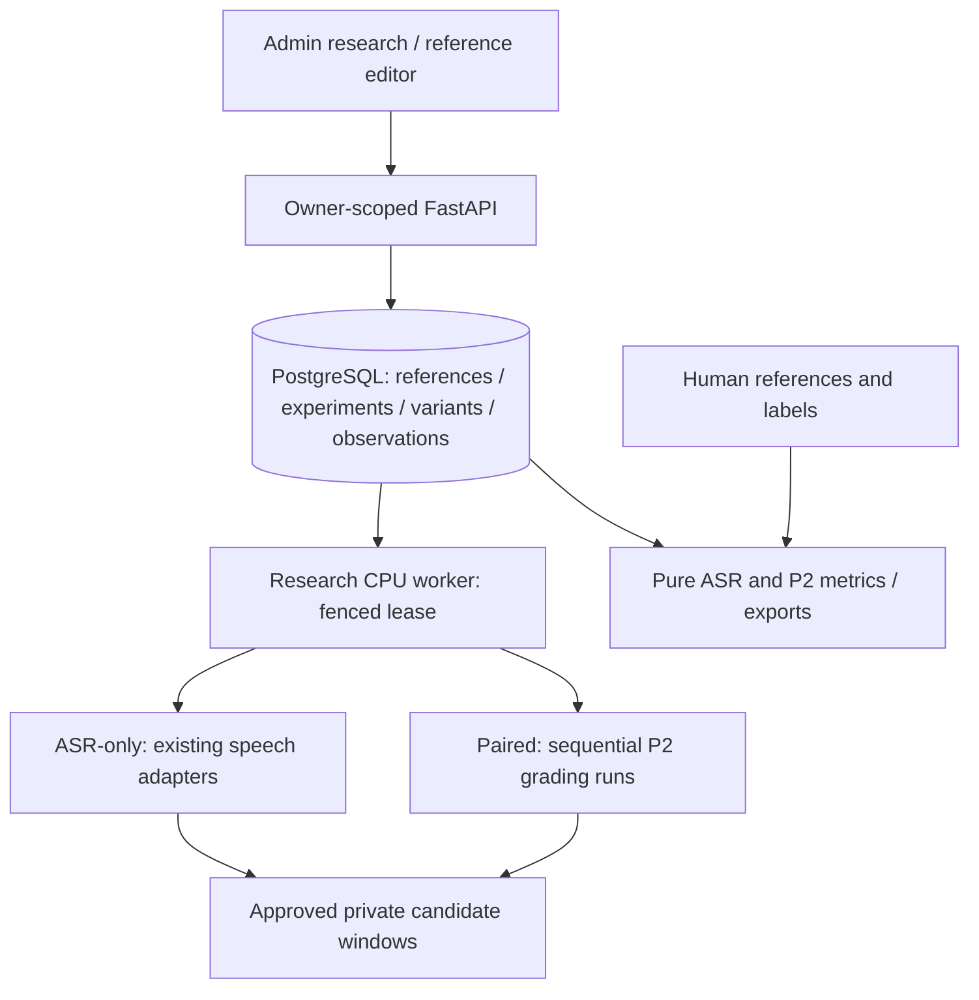

# Speaking Benchmark Research, Phase 3

Inspected baseline: `ba458360eb9a42f2237ef66b3c28daa098864b4e`. P1 approval,
P2 grading and learner Speaking remain separate authorities. This extends the
modular monolith; no paid requests or deployments are part of implementation.

## Boundaries

References are append-only, owner/source/review/window-bound human annotations.
Verification requires independent human provenance. Unknown speech is annotated,
never invented. Reference text and human bands are evaluation inputs only.

An experiment freezes its cohort, approved revisions, exact windows, provider
identities, options, metric protocol and initial reference/label revision selection.
Reference refresh is an explicit report policy; it cannot change inference identity.
Variants are one provider/sample pair. ASR observations double as a physical-request
ledger: ATTEMPTED is committed before submission; terminal observations are immutable.
Cache receipts retain their original request ID and do not count as submissions.

ASR-only has independent static readiness and never constructs an LLM. The research
worker uses the existing lexical adapters and normalized approved audio. Paired
grading schedules P2 runs serially per sample, retaining P2 uniqueness and its
physical OpenAI repair-call ledger. Only lexical identity may differ; all other P2
configuration fields must match the frozen experiment. No independent scorer.

## Safety and reproducibility

Start requires explicit providers, exact cohort/windows, finite positive admission
estimates for cloud providers, duration/request ceilings and separate GPU consent.
Unknown requests block further submissions until exact reconciliation and renewed
consent. Lease loss never authorizes a replacement call. Cancellation fences future
submissions; a late result may settle accounting only. Deletion cancels research
variants before existing private-media retention cleanup.

Cloud workers require external PostgreSQL and shared private S3/R2. Embedded Modal
PostgreSQL/local volumes are unsupported, explicitly gated. No Torch/Whisper model
loads in HTTP, import, preflight, reports or the Modal Web CPU image.

## Measurement

Reuse bounded alignment, lexical/coverage/aggregate and P2 score_metrics. New metric
protocol NFC/casefold/punctuation/whitespace normalization is explicit; raw text is
unchanged and CLI v1 remains compatible. Exclude uncertain human-reference windows
from accuracy rather than fabricating intelligible words. Publish micro WER plus
sample/speaker macro WER, denominators, missing/failed and unavailable counts.
Paired differences use matched samples and identical label revisions. Bootstrap
resamples candidate clusters only, with at least 10 known independent candidates;
otherwise intervals are unavailable. No automatic winners or causal claims.

DEV/HOLDOUT membership is frozen, overlap warns, holdout requires explicit consent.
No tuning or split reassignment. Lower WER and lower band error remain separate.

## UI direction

Use existing BandPilot tokens, Taste app-screen rules and UI/UX Pro Max. Research
is a persistent list/detail workspace. Progressive disclosure keeps configuration,
consent and results distinct. One player per comparison; tables and text diffs
are authoritative accessible views. Reference editor reuses sample playback.
