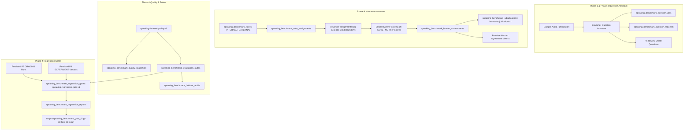

# Admin Speaking Benchmark Quality, Consensus and Regression Gates — Phase 4

Baseline inspected: `b62bbeeeacdc2c7969c568ae425ba9b6b3d6ebd8`. This is an additive
modular-monolith extension of [Phase 1 (Ingestion & Diarization)](admin-speaking-benchmark.md),
[Phase 2 (Scoring Evaluation)](admin-speaking-benchmark-evaluation.md), and
[Phase 3 (ASR Research & References)](admin-speaking-benchmark-research.md).
Implementation and verification are strictly offline. Real live inference, deployment,
and model scoring remain **UNVERIFIED**.

---

## Architecture and Authority



The Phase 4 architecture adheres strictly to engineering invariants:
- **Modular Monolith**: Additive tables, services, and routes within FastAPI and Next.js.
- **Authoritative Database**: PostgreSQL schema revision `20261108_0048` following `20261108_0047`.
- **Zero Live Paid Calls**: No automatic cloud inference, model grading, or billing requests during page view or evaluation.
- **Pure Statistical Evaluation**: Regression gates and quality evaluations project only over immutable persisted artifacts.

---

## Schema and Persistence (`20261108_0048`)

Alembic migration `20261108_0048_speaking_benchmark_quality.py` introduces eleven tables with composite foreign keys and database immutability triggers:

| Table | Purpose |
| --- | --- |
| `speaking_benchmark_question_jobs` | Owner-scoped examiner question suggestion jobs, configuration, proposals, and append-only decision history |
| `speaking_benchmark_question_requests` | Physical ASR requests for examiner windows, attempt tracking, billing state, and exact reconciliation |
| `speaking_benchmark_raters` | Human rater identities: `INTERNAL` (authenticated user) or `EXTERNAL` (owner-recorded external identifier; no automatic identity verification) |
| `speaking_benchmark_rater_assignments` | Sample/review-bound scoring assignments for blind or external evaluations |
| `speaking_benchmark_human_assessments` | Immutable submitted criterion half-bands (FC, LR, GRA, PR, Overall), rationales, and provenance |
| `speaking_benchmark_adjudications` | Explicit owner/adjudicator consensus records under policy `human-adjudication-v1` |
| `speaking_benchmark_quality_snapshots` | Point-in-time frozen dataset QA evaluations under `speaking-dataset-quality-v1` |
| `speaking_benchmark_evaluation_suites` | Immutable evaluation suites with frozen sample cohorts, label policies, and metric requirements |
| `speaking_benchmark_regression_gates` | Immutable regression gate definitions with suite, baseline, candidate, and thresholds |
| `speaking_benchmark_regression_reports` | Gate evaluation reports with metric differences, bootstrap CIs, and PASS/FAIL/INCONCLUSIVE/INVALID status |
| `speaking_benchmark_holdout_audits` | Append-only audit trail logging access and evaluations against holdout test suites |

---

## Domain 1: Examiner Question Assistant

The Question Assistant extracts examiner questions from clean diarized turns without acoustically separating voices or making unverified speech recognition claims:

1. **Examiner Confirmation Requirement**: The operator must explicitly confirm that the selected speaker ID corresponds to the examiner role.
2. **Regular Turn Overlap Elimination**: Turns with positive overlap with candidate speech or unknown speakers are excluded. Only non-overlapping regular examiner turns are submitted.
3. **Deterministic Association**: Examiner questions are chronologically linked to subsequent candidate responses within the same test Part (bounded gap).
4. **Ambiguity Flagging**: Proposals identify ambiguities (`MULTIPLE_TURNS`, `OVERLAP`, `INTERRUPTION`, `UNCLEAR_PART`).
5. **P1 Draft Integration**: Accepted proposals append to the review draft's verified questions without triggering automatic review approval.
6. **Billing Reconciliation**: Interrupted or uncertain billing requests enter `UNKNOWN` state. Automatic retries are forbidden; exact operator reconciliation is required.

---

## Domain 2: Multi-Rater Ground Truth & Blind Reviewer Security

Phase 4 establishes an authentic multi-rater ground truth architecture with strict blind privacy:

### 1. Rater Identities
- **INTERNAL Raters**: Bound to an authenticated `User.id`, unique per owner. An owner cannot self-assign as an independent rater.
- **EXTERNAL Raters**: Bound to a stable external key and provenance (e.g. British Council TRF examiner identifier).

### 2. Blind Reviewer Security Boundary
- Internal reviewers access recordings exclusively through scoped endpoints:
  - `GET /api/v1/admin/speaking-benchmark/reviewer-assignments/{id}`
  - `GET /api/v1/admin/speaking-benchmark/reviewer-assignments/{id}/audio`
- **Strict Privacy Invariant**: Blind endpoints resolve the assignment directly and **never return model scores, AI predictions, other reviewer ratings, adjudication decisions, or ground truth labels**, before or after submission. This boundary is enforced server-side, not in CSS.
- **Audio Access Control**: Reviewers can only stream audio for assignments explicitly granted to them that have not been revoked.

### 3. IELTS Criterion Band Validation
- Criteria evaluated: Fluency and Coherence (FC), Lexical Resource (LR), Grammatical Range and Accuracy (GRA), Pronunciation (PR), and Overall.
- Values must be valid IELTS half-bands ($0.0, 0.5, \dots, 9.0$) or null. Overall is never fabricated or averaged automatically.
- Submissions require explicit reviewer attestation: *"I attest this assessment was independently performed."*

### 4. Inter-Rater Agreement & Adjudication
- **Agreement Engine**: Computes pairwise MAE, exact agreement rate, and agreement within 0.5 bands using existing `score_metrics`.
- **Adjudication Policy (`human-adjudication-v1`)**: When raters disagree, the dataset owner records an explicit adjudication with final half-bands and mandatory justification rationale. Adjudications are immutable once recorded.

---

## Domain 3: Dataset QA Protocol (`speaking-dataset-quality-v1`)

The quality engine performs exhaustive, non-destructive validation of evaluation cohorts:

### Readiness States
- **`READY`**: Cohort passes all criteria and is suitable for frozen suite creation.
- **`NEEDS_REVIEW`**: Advisory issues detected (e.g. unadjudicated rater disagreement, missing optional ASR references).
- **`BLOCKED`**: Critical integrity violations (missing raw audio, unapproved reviews, corrupt files, unknown billing).
- **`INSUFFICIENT_DATA`**: Candidate count is below the minimum threshold (default: 10 independent candidates).

### Quality Snapshots
Operators can freeze dataset QA findings into immutable `SpeakingBenchmarkQualitySnapshot` records for reproducible auditability.

---

## Domain 4: Frozen Evaluation Suites

Evaluation suites lock an exact cohort of approved samples for continuous evaluation:
- **Immutability**: Once created, suite samples, review revisions, and label policies cannot be modified. Updates append a new revision.
- **Label Selection Policies**:
  - `LEGACY`: P1 single-rater human labels.
  - `INDEPENDENT`: Multi-rater submitted human assessments.
  - `ADJUDICATED`: Owner-adjudicated consensus labels.
- **Holdout Set Protection**: Suites marked as holdout evaluation sets enforce a prominent data-leakage disclosure and log every evaluation into `SpeakingBenchmarkHoldoutAudit`.

---

## Domain 5: Continuous Evaluation Regression Gates (`speaking-regression-gate-v1`)

Regression gates evaluate candidate configurations against baselines over frozen suites:

### 1. Persisted Evidence Selectors
Gates reference existing persisted artifacts only:
- **`GRADING`**: References a P2 grading configuration fingerprint (`configuration_fingerprint`).
- **`EXPERIMENT`**: References a P3 research experiment ID and variant key (`id`, `variant_key`).

### 2. Supported Metrics & Directional Thresholds
- **ASR & Transcript Metrics**: `wer`, `cer`, `filler_recall`, `repetition_recall`, `recognition_coverage`, `latency_ms`, `real_time_factor`.
- **Grading & Band Metrics**: `overall_mae`, `fc_mae`, `lr_mae`, `gra_mae`, `pr_mae`, `exact_agreement`, `within_0_5`, `signed_bias_abs`, `score_coverage`, `missing_overall_rate`.
- **Resource & Integrity Metrics**: `unknown_billing_attempts`, `provider_audio_ms`, `physical_requests`, `cache_reuse_rate`, `missing_artifact_count`.

### 3. Evaluation Status Outcomes
- **`PASS`**: All metric regressions are within defined thresholds, zero unknown billing attempts, and required coverage is satisfied.
- **`FAIL`**: One or more metrics exceed the maximum tolerable regression threshold.
- **`INCONCLUSIVE`**: Insufficient independent candidates or degenerate variance prevents statistical conclusion.
- **`INVALID`**: Missing evidence, mismatched cohorts, or data integrity errors.

---

## Domain 6: Offline CI CLI Gate Runner

The regression gate engine includes a zero-dependency offline CLI runner for automated CI/CD pipelines:

```bash
# Evaluate a saved regression report JSON
python scripts/speaking_benchmark_gate_cli.py path/to/regression_report.json
```

### Exit Codes:
- **`0`**: Gate status is **PASS** (deployment allowed).
- **`1`**: Gate status is **FAIL** (pipeline halted due to regression).
- **`2`**: Gate status is **INCONCLUSIVE** or **INVALID** (pipeline halted due to insufficient or invalid data).

---

## Native User Interface Integration

The Next.js frontend integrates Phase 4 across five specialized interfaces:

1. **Sample Detail (`/admin/speaking-benchmark/[sampleId]`)**:
   - **Examiner Question Assistant Tab**: Diarization window analysis, preflight budget display, proposal review, inline text/Part editing, batch acceptance.
   - **Human Ground Truth Tab**: Rater assignment, external verified report entry, pairwise agreement metrics, owner adjudication.
2. **Blind Reviewer Interface (`/admin/speaking-benchmark/reviewer/[assignmentId]`)**:
   - Clean, focused examiner scoring view with audio player, prompt context, IELTS criterion inputs, comment boxes, and attestation checkbox.
3. **Dataset Quality Dashboard (`/admin/speaking-benchmark/quality`)**:
   - QA policy toggles, cohort evaluation, issue table with severity badges, and snapshot history.
4. **Evaluation Suites Manager (`/admin/speaking-benchmark/suites`)**:
   - Suite listing, cohort selection wizard, label selection policy, holdout warnings, and audit log.
5. **Regression Gates & Reports (`/admin/speaking-benchmark/gates`)**:
   - Gate configuration, baseline/candidate selector, threshold builder, live gate evaluation, metric comparison table with bootstrap CIs, and CSV/JSON exports.

---

## Verification Summary

All Phase 4 backend and frontend domains have been exhaustively tested and verified:
- **Backend Tests**: 48 passed across 8 dedicated test suites in 55.59s.
- **P2/P3 Regressions**: 25 passed with complete backward compatibility.
- **Frontend Typecheck (`tsc --noEmit`)**: 0 errors.
- **Frontend Linter (`eslint .`)**: 0 errors.
- **Frontend Benchmark Tests (Vitest)**: 47 passed across 4 test suites.
- **Next.js Production Build (`next build`)**: Succeeded with all dynamic and static routes compiled.


## Review corrections and evidence (2026-11-08)

P4 review corrected real API/UI contract mismatches: the first reviewer submission
uses the assessment revision (0 before submission), internal rater creation supplies
the authenticated user ID, and score inputs begin unavailable. Question submission
requires operator-entered provider estimates and a budget; accepting suggestions
cannot overwrite an unsaved P1 review. The gate table reads the actual metric DTO.

Persisted gate evidence records exact run, variant, request and frozen reference IDs
along with suite/gate fingerprints and policy. Paired research reads only its linked
P2 lexical checkpoints. Failed/unknown attempts remain in operational denominators.
Missing windows cannot yield favorable ASR accuracy. Provider/source/rubric mismatches
produce INVALID. Primary comparisons use matched recordings; threshold ASR metrics
are explicitly macro recording means, not corpus micro WER. Missing criterion scores
remain nullable. Independent-candidate minima use the common metric cohort.
Absolute aggregate scoring bias has no bootstrap interval implemented; its report
states NONLINEAR_ABSOLUTE_BIAS_INTERVAL_UNAVAILABLE instead of showing an interval
for a different statistic. Higher-is-better intervals orient positive toward improvement.

An initial full backend run was interrupted because concurrent focused tests shared
the global worker queue. It is not passing evidence. A new full run uses a fresh,
exclusive primary/secondary database pair; its final result is recorded separately.
Full frontend before the last small form refinements: 171 files / 2018 tests passed.
Focused real-contract UI tests, Python lint/format, TypeScript, ESLint, production
build and fresh 0048 upgrade/downgrade/upgrade were exercised. Live inference and
P4 browser layout remain unverified; an offline browser fixture startup was rejected
by automatic approval review with “blocked by policy”. No authorization guard was bypassed.

The first exclusive Windows full run exposed environment-dependent legacy tests:
local `.env` selected Azure, whose settings validator activates hybrid profile even
when `SPEAKING_PROFILE=legacy`. The affected fake-ASR grading test passes with
`SPEAKING_ASR_PROVIDER=local`. Full offline reproduction must explicitly set that
provider and disable ASR/AI flags, while individual hybrid tests select their own
injected settings. The earlier interrupted runs are not full passing evidence.
Renewed retry consent does not settle an old physical request's unknown billing;
gate operational counts retain that uncertainty until its exact result settles.
