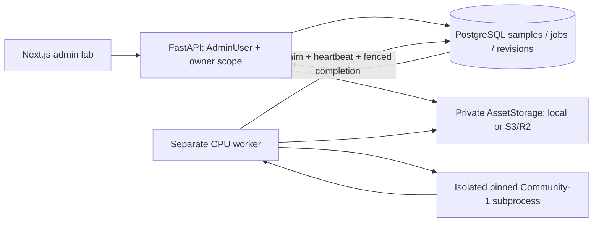

# Admin Speaking Benchmark Lab — Phase 1

Implementation baseline: `7ed863b568f614ba7942f4f3130fefcac5857e82`. This feature prepares private datasets; it does not grade recordings or call Azure, OpenAI, Luna, Whisper GPU or Modal inference. See the [design](../superpowers/specs/2026-11-07-admin-speaking-benchmark-design.md) and [implementation plan](../superpowers/plans/2026-11-07-admin-speaking-benchmark.md).



## Ownership, schema and approval

All `/api/v1/admin/speaking-benchmark` routes require the existing ADMIN dependency. Every sample operation additionally queries `owner_id`; another ADMIN receives 404 and sees no rows in their list. Private object keys, credentials and local runtime paths are never DTO fields. No learner attempt, production gradebook or Writing Benchmark row is changed.

Migration `20261107_0045_speaking_benchmark.py`, after `20261102_0044`, adds:

- `speaking_benchmark_samples`: owner, code, private audio key, SHA-256, actual MIME, byte size, duration, pseudonym, DEV/HOLDOUT, rights/source note, status and revision pointers. Unique `(owner_id, code)` and `(owner_id, source_sha256)` avoid cross-owner duplicate disclosure.
- `speaking_benchmark_jobs`: configuration/source fingerprint, bounded attempts/progress, model identity, lease token/expiry/heartbeat, safe error code and one compact regular/exclusive timeline result. A partial unique index permits only one active job per sample.
- `speaking_benchmark_reviews`: append-only numbered drafts, originating job, source/model identity and frozen approved `ReplayManifest` plus fingerprint/admin/time. Approval creates a new revision; later edits create another draft. Previous approved revisions remain retrievable by `?revision=N`.
- `speaking_benchmark_human_labels`: append-only revisions, nullable numeric half bands 0–9, independently human provenance, reference, verification, examiner and notes. Overall is stored as reported. It is never derived from criteria, and missing criteria remain null. AI predictions are rejected as label provenance.

Sample states are DRAFT → PROCESSING → REVIEW → APPROVED; edits after approval return to REVIEW. Human labels have an independent revision counter. Revision conflicts return `SPEAKING_BENCHMARK_REVISION_CONFLICT` (409), preserving the caller's unsaved form. Approved historical artifacts do not become the new draft implicitly.

The web service uses the shared pure `replay_segment_review.approved_manifest` validator. Approval requires a confirmed candidate, verified source/model fingerprint, valid Part 2/3 transitions, all three Parts, an explicitly selected Part 2 long turn, verified actual questions, candidate-supported windows without other detected voices, valid/nonoverlapping response boundaries and review of long internal pauses. The original bytes are hashed again at approval. Machine completion never sets `candidate_only_verified=true`.

An administrator attests human provenance; the system cannot independently authenticate an external examiner's report. Use **unverified** when the human source cannot be established. Human scores never enter the diarizer or question suggestions.

## API surface

All paths below are relative to `/api/v1/admin/speaking-benchmark` and require ADMIN authentication. Sample routes also require ownership; guessing another owner's ID returns 404.

| Method | Path | Purpose |
| --- | --- | --- |
| GET | `/availability` | Safe execution topology and upload limits |
| GET / POST | `/samples` | Paginated owner list / bounded private upload |
| GET / PATCH / DELETE | `/samples/{id}` | Reopen / revision-checked metadata / scheduled asset cleanup |
| GET | `/samples/{id}/audio` | Authenticated source audio with Range support |
| POST | `/samples/{id}/diarize` | Queue or reuse CPU job; never infer in HTTP |
| GET | `/samples/{id}/jobs` | Latest 20 durable job states |
| POST | `/samples/{id}/jobs/{jobId}/cancel` | Fence cancellation |
| GET / PATCH | `/samples/{id}/review` | Current or `?revision=N` review / append draft revision |
| POST | `/samples/{id}/review/suggest` | Propose source windows from the saved timeline |
| POST | `/samples/{id}/approve` | Validate source and freeze a new approved revision |
| GET / PUT | `/samples/{id}/human-labels` | Read / append independent human-label revision |

Mutations use typed Pydantic/Zod contracts and optimistic revisions. Multipart upload metadata is a bounded JSON form field; it never contains an object-store key. Explicit cross-origin mutation requests are rejected under the existing frontend-origin configuration.

## Local setup and exact commands

Run from the indicated directories. Use a development database/storage root and existing authentication configuration; do not point migration/test commands at production.

```powershell
# Repository root: isolated native runtime, once on a new machine.
uv sync --project tools/speaking_diarization --locked
# Explicit model setup/download only when needed, with accepted gated-model access.
uv run --project backend python scripts/replay_speaking.py --setup-diarization-model
uv run --project backend python scripts/replay_speaking.py --diagnose-diarization
```

The already-working Windows environment, pinned model, receipt checks, automatic shared FFmpeg DLL resolver and hidden subprocess startup are reused. See [tool setup](../../tools/speaking_diarization/README.md). Inference uses offline, receipt-verified model assets. Never put a Hugging Face token in a command argument or chat. The API packages only small model identity metadata (`diarization_model.json`), kept identical to the tool's pin file; it does not package native libraries or weights.

```powershell
# Terminal 1, backend/ (DATABASE_URL, JWT_SECRET, STORAGE_* set for development):
uv sync --locked
uv run --locked alembic upgrade head
uv run --locked uvicorn app.main:app --host 127.0.0.1 --port 8000

# Terminal 2, backend/, SAME database and storage configuration:
$env:SPEAKING_BENCHMARK_EXECUTION = "local"
uv run --locked python ../scripts/speaking_benchmark_worker.py
# Process at most one job instead:
uv run --locked python ../scripts/speaking_benchmark_worker.py --once

# Terminal 3, frontend/:
npm ci
npm run dev
```

`Settings` reads `.env` relative to the working directory. Starting web and worker from `backend/` ensures the same existing `backend/.env` is used. Environment variables take precedence. If running the root-level command, pass the environment explicitly or use `uv run --env-file backend/.env --project backend python scripts/speaking_benchmark_worker.py`; do not assume `--project` changes the process working directory. No worker is started by FastAPI lifespan or HTTP handlers.

Configuration:

| Variable | Default / meaning |
| --- | --- |
| `SPEAKING_BENCHMARK_EXECUTION` | `local`; `remote` requires shared services; `disabled` rejects queue submission |
| `SPEAKING_BENCHMARK_MAX_UPLOAD_MB` | 100; allowed 1–128 |
| `SPEAKING_BENCHMARK_MAX_DURATION_SECONDS` | 1200; allowed up to 1800 |
| `SPEAKING_BENCHMARK_DIARIZATION_PYTHON` | Existing isolated tool interpreter if empty |
| `SPEAKING_BENCHMARK_MODEL_DIR` | Existing `storage/models/pyannote-community-1` if empty |
| `SPEAKING_BENCHMARK_THREADS` | 2; allowed 1–8 |
| `SPEAKING_BENCHMARK_MEMORY_MB` | 4096; subprocess tree RSS bound |
| `SPEAKING_BENCHMARK_TIMEOUT_SECONDS` | 3600; allowed 5–7200 |

API readiness at `/availability` exposes safe size/duration limits, selected execution mode and topology availability. It does not claim that a running worker or its native model runtime is healthy; diagnostics and job results provide that evidence.

## Upload and review workflow

1. Open `/admin/speaking-benchmark` as ADMIN (linked beside Writing Benchmark in the admin dashboard).
2. Enter a private sample code, pseudonym/split and source/permission note. Confirm rights and upload MP3/WAV. Originals are spooled to a private temporary file in bounded chunks; actual signatures, ffprobe metadata and full bounded FFmpeg decoding are checked. The upload creates a DRAFT without inference.
3. Request **Run CPU diarization**. HTTP returns 202; the page polls PostgreSQL-backed status. Closing the tab does not terminate the job.
4. Listen to original audio, seek in source seconds, listen to speaker windows and inspect overlaps. Regular and exclusive source-relative turns are retained. Listening to a speaker's windows is source playback, not acoustic source separation: other voices can remain audible during overlap.
5. Correct roles and explicitly confirm the candidate. Set real Part 2/3 starts and confirm Part transitions. Request candidate-window suggestions; this replaces the current window draft only after a dialog. The model does not detect actual examiner text.
6. Adjust/add/exclude windows, enter real examiner questions/cue-card context and mark one Part 2 long turn. Trim or exclude overlap; approval does not accept an unchecked override of detected examiner speech.
7. Save the draft, inspect server validation and explicitly approve. Dirty edits cannot be approved. Reopening restores saved data. Saved revision inspection supports restoring an earlier review into a new draft; approved rows remain unchanged.
8. In the separate Ground Truth form, enter only reported bands, provenance/reference and optional examiner/notes. Save explicitly. Overall-only and partial labels are supported. Verification requires human provenance and an independently checked reference; there is no auto-scoring or auto-recalculation.

The player uses one native audio element and authenticated `Range` requests (`206`, suffix ranges, `416` for unsatisfiable ranges), `private, no-store` and `nosniff`. The timeline uses interval paths rather than PCM waveform decoding. Forms provide keyboard controls, visible labels/focus, explicit save/conflict states and responsive columns. Unsaved data is protected from job-refresh and language-switch reloads; explicit discard/reload remains available.

## Jobs, interruption and cleanup

Workers atomically claim with `FOR UPDATE SKIP LOCKED`. RUNNING jobs receive a fresh UUID lease, a 90-second expiry and a heartbeat every 10 seconds. Completion checks status, lease token, expiry, source and pinned model identity in a sample-before-job transaction. A stale worker cannot publish a result after cancellation or a newer claim.

Expired CPU jobs can be reclaimed, up to three execution attempts. These are local CPU operations, not potentially billable cloud requests. An exhausted job becomes FAILED and returns the sample to DRAFT/REVIEW. Explicit submission after failure creates a new job; matching completed configurations are reused without another inference request. Cancellation marks the row CANCELLED; the heartbeat causes the monitored subprocess to terminate. Normalization has a separate bounded subprocess timeout. Shutdown sets the cancellation signal, waits for temporary cleanup and leaves the interrupted lease recoverable.

The worker CLI handles SIGTERM by cancelling its task once and awaiting that cleanup; repeated termination signals do not interrupt the cleanup await. SIGKILL and machine/power loss cannot execute Python cleanup, so the lease remains the recovery authority in those cases. Give a container supervisor enough graceful-stop time for bounded FFmpeg normalization to return before forcing termination.

All decoded/materialized temporary audio is cleaned when the worker exits. Original assets remain until explicit deletion. Deleting a sample transactionally inserts the original key into the existing `speaking_media_cleanup` outbox before cascading review/job/label deletion. Audio authorization disappears immediately. Cleanup is retried by the worker/startup hooks; storage failures retain the outbox row.

Uploads also reserve an outbox row *before* object creation. The storage-write/attach transaction holds that reservation's row lock and removes it only when the sample is attached. Benchmark cleanup has a one-hour grace period so an interrupted/failed upload is retryably cleaned without racing active uploads. Deletion therefore schedules physical removal (normally after that grace); it is not a promise of immediate object-store erasure. Referenced recordings are protected by reference checks. Storage inventory/backup/compensation include the new private keys. No raw audio, transcript, provider keys or arbitrary native exception body is logged by this feature.

## Local and remote CPU container topology

The existing Modal Web image remains free of Torch, TorchCodec and Pyannote. `deploy/Dockerfile.speaking-benchmark-worker` is a separate Python 3.12 **CPU** container. It installs the locked isolated tool environment and the optional `benchmark-cpu` monitor dependency; it contains no GPU function or paid-service dispatcher.

```powershell
# Build locally only if provisioning a separate CPU worker is desired:
docker build -f deploy/Dockerfile.speaking-benchmark-worker -t bandpilot-speaking-benchmark-cpu .
# Mount a pre-provisioned private model cache and provide an operator-owned env file
# containing external DATABASE_URL plus STORAGE_BACKEND=s3/r2 and shared credentials.
docker run --rm --stop-timeout 180 --env-file <private-worker.env> --mount type=bind,source=<private-model-cache>,target=/models,readonly bandpilot-speaking-benchmark-cpu
```

In a separate Modal CPU function/container, use the same entrypoint (`--once` for bounded dispatch) with a persistent private model cache. The API only queues durable rows; an operator-managed worker consumes them. There is no automatic Modal deployment, per-request weight download or web-triggered GPU provisioning. Configure both web and worker with `SPEAKING_BENCHMARK_EXECUTION=remote`, external reachable PostgreSQL, and the same private R2/S3 namespace. The guard rejects local assets, loopback/embedded databases and incompatible Modal embedded mode. Network/TLS/IAM reachability still requires deployment validation; a hostname passing the topology guard is not proof of connectivity.

**Current embedded Modal PostgreSQL and local asset Volumes are not shared with another container.** That mode can store/review data but cannot claim a compatible separate CPU worker by default. Queueing fails explicitly. This task does not migrate production to external storage, expose embedded PostgreSQL, add a worker to the web process or deploy a cloud function. The reusable separate CPU entrypoint is the supported integration path; actual cloud deployment remains unverified.

## Phase 2 contract and deliberate limits

The approved review stores the existing version-1 `ReplayManifest`, source SHA/model fingerprint and manifest fingerprint, bound to the original private sample. A future owner-authorized Phase 2 consumer can materialize the same source under the manifest's safe `recording.wav`/`recording.mp3` alias, verify SHA/fingerprint and pass candidate windows through the existing replay engine. It must use an explicit approved revision and keep human labels outside inference inputs. Phase 1 intentionally supplies no CSV/JSON bundle export or paid scoring endpoint.

Postponed: ASR comparison, examiner transcription, AI grading, score calibration, human-vs-AI metrics, charts, scheduled regrading, training and GPU execution. Diarization clusters are not certified speaker identities; third speakers, silence and overlap require review. No claim of real interview speaker accuracy or 12–14 minute diarization throughput is made without an eligible measured recording.

## Troubleshooting and validation

- PENDING: start the separate worker using the same database/storage; check execution topology.
- Native runtime/model/FFmpeg code: run `--diagnose-diarization`; use the existing pinned setup instructions. Inference does not download missing weights.
- FAILED after a crash: inspect the safe stage/error, correct setup and explicitly submit again. A live RUNNING lease is never stolen.
- 409 revision: keep/copy the local draft, inspect saved history, then explicitly reload. Never retry blindly with a guessed revision.
- Approval blocked: confirm identity/Parts/questions; trim/exclude overlap, check long turn and source fingerprint. Silence alone cannot form an approvable candidate dataset.
- Cleanup pending: restore storage access and keep the CPU worker/maintenance cleanup running. Outbox rows survive failures.

Focused commands (set `P2_TEST_DATABASE_URL`, or `TEST_DATABASE_URL` as a fallback, to a disposable PostgreSQL database distinct from application `DATABASE_URL`; migrate that disposable database explicitly first):

```powershell
# backend/
uv run --locked pytest tests/test_admin_speaking_benchmark.py tests/test_admin_speaking_benchmark_worker.py tests/test_admin_speaking_benchmark_shutdown.py tests/test_admin_speaking_benchmark_audio.py tests/test_admin_speaking_benchmark_storage.py tests/test_admin_speaking_benchmark_migration.py tests/test_speaking_segment_review.py tests/test_speaking_diarization_backend.py tests/test_speaking_replay_cli.py
uv run --locked ruff check --config pyproject.toml . ../scripts
uv run --locked ruff format --config pyproject.toml --check app tests ../scripts
# frontend/
npx vitest run tests/speaking-benchmark.test.tsx tests/writing-benchmark-page.test.tsx
npm run typecheck
npm run lint
```

For the **whole existing backend suite**, match CI's two-database convention: `DATABASE_URL` points to a disposable primary test database, `TEST_DATABASE_URL` equals that primary URL for legacy classroom concurrency helpers, and `P2_TEST_DATABASE_URL` points to a second independently migrated test database. Never use a development/production database as the primary. Set `SPEAKING_PROFILE=legacy`, `SPEAKING_ASR_PROVIDER=local`, `SPEAKING_ASR_ENABLED=false`, `SPEAKING_AI_ENABLED=false` and `AI_WRITING_ENABLED=false` to keep local `.env` provider defaults out of offline tests. No live provider authorization or key is needed.

Execution evidence and remaining live limitations are recorded in the implementation plan after final validation. Test fixtures contain generated audio and fictional prompts/labels; no benchmark recording, human reference or personal audio is committed.
